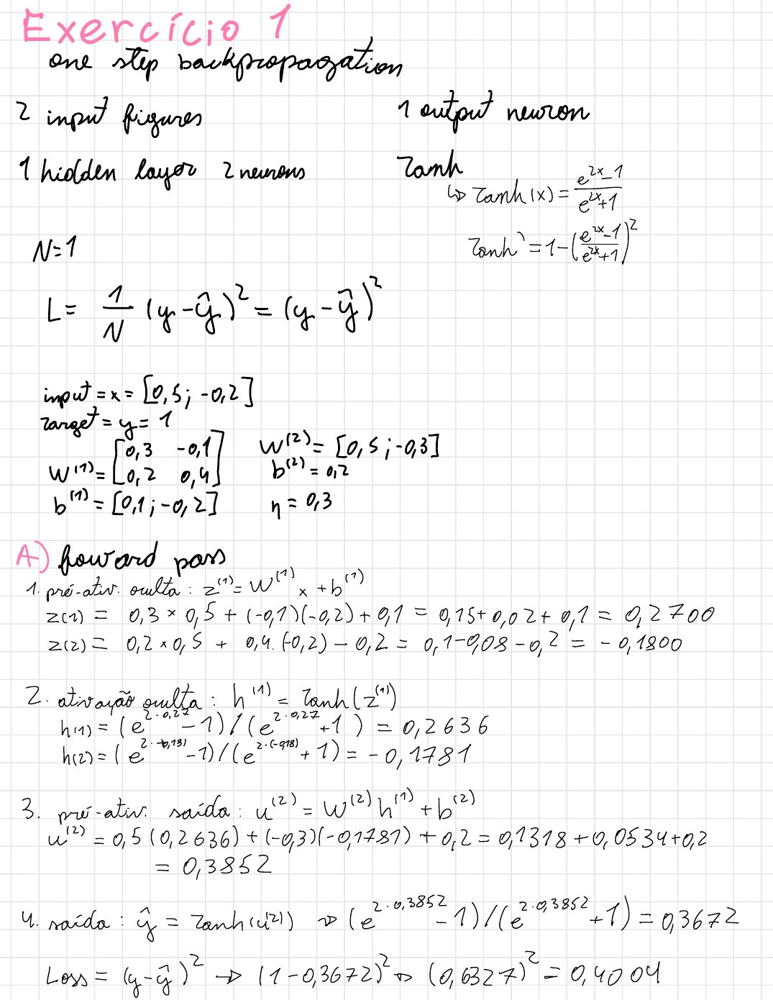
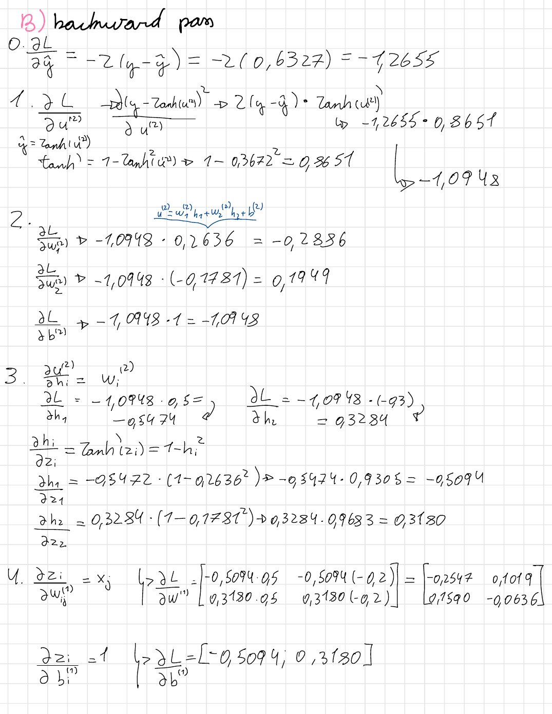
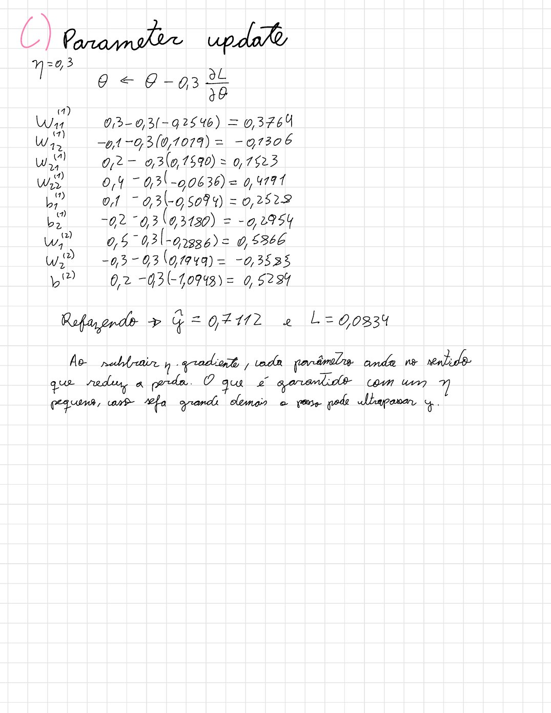
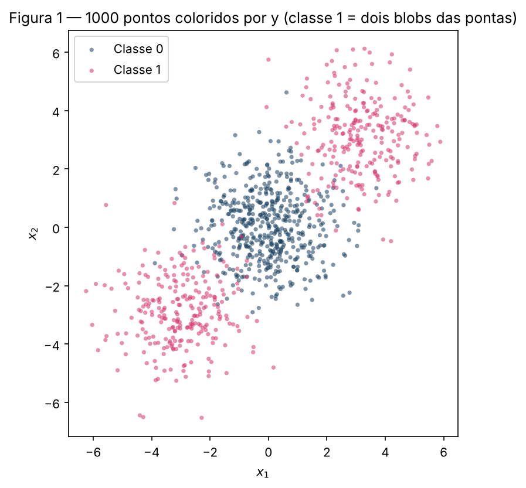
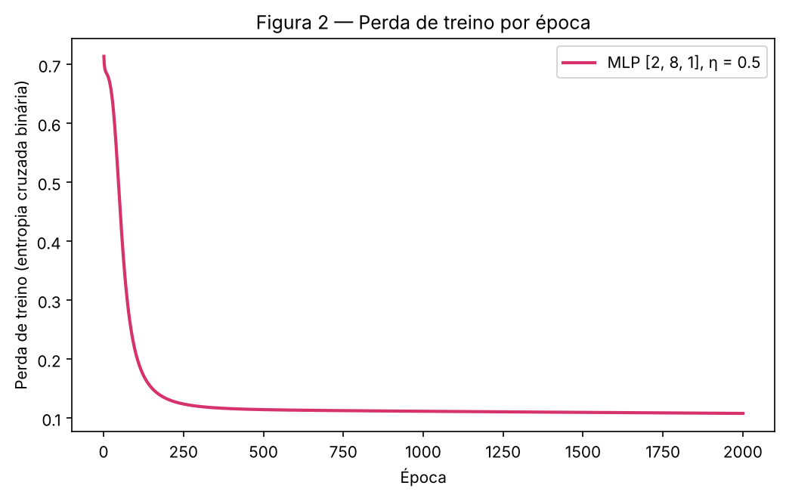
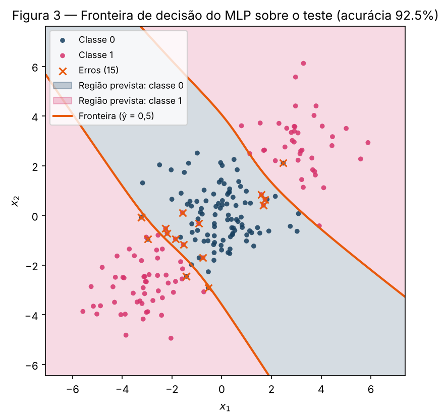
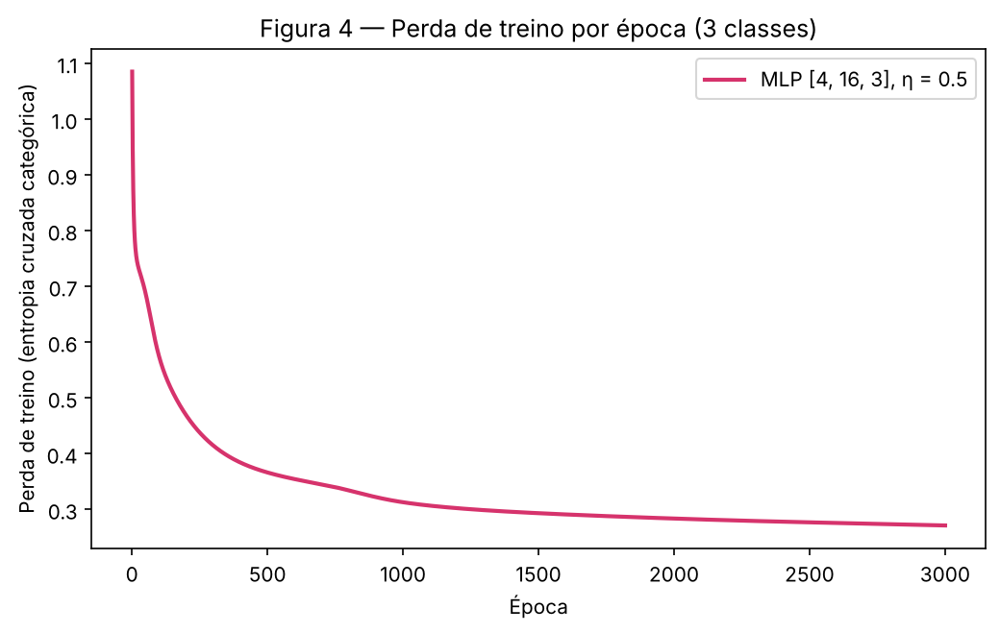
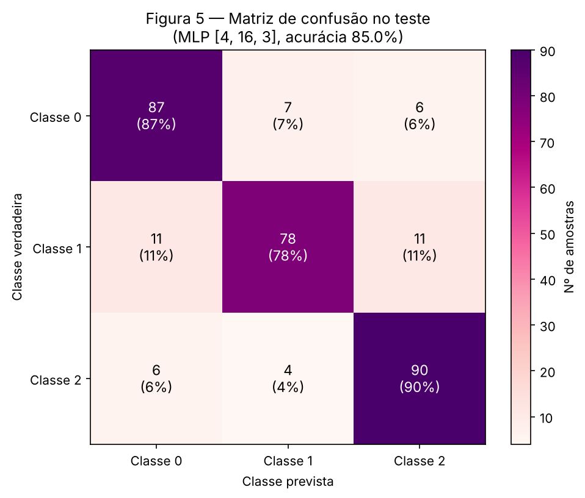
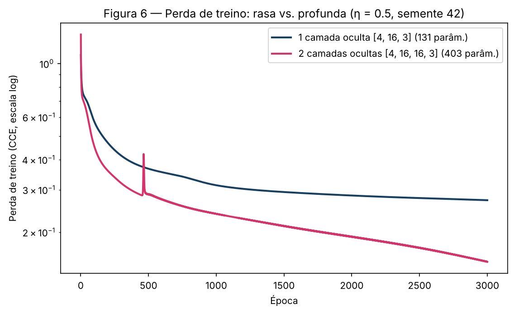

# 3. MLP

!!! abstract "Enunciado"

    [Exercises → MLP](https://insper.github.io/ann-dl/2026.2/exercises/mlp/){:target='_blank'}

## Visão geral

O exercício constrói um perceptron multicamadas (MLP) do zero com NumPy. O Exercício 1 faz
uma passagem direta, uma reversa e uma atualização à mão numa rede 2-2-1. Os Exercícios 2 a 4
usam um único módulo, [`code/mlp.py`](https://github.com/julia-campos-ma/ANN-DL/blob/main/docs/exercises/mlp/code/mlp.py),
que implementa ativações, perdas, passagem direta, gradientes e atualização. A mesma classe
`MLP` serve aos três exercícios **sem nenhuma alteração**: o que muda é só a lista de
tamanhos das camadas (`layer_sizes`), o tipo de saída (`"sigmoid"` ou `"softmax"`) e os
hiperparâmetros.

Regras seguidas: `rng = np.random.default_rng(42)` é criado uma vez no topo de cada script e
usado em toda a inicialização de pesos; o scikit-learn é usado **apenas** para gerar os dados
(`make_blobs`, `make_classification`), dividi-los (`train_test_split`) e calcular a matriz de
confusão (`confusion_matrix`). As linhas de base de regressão logística também são escritas à
mão: regressão logística é exatamente o `MLP` sem camada oculta (`[2, 1]` ou `[4, 3]`).

**Escolhas comuns aos três exercícios.**

- **Treino em lote completo** (*full batch*): cada época é uma passada direta, uma reversa e
  uma atualização com todas as amostras de treino. Os conjuntos são pequenos (800 e 1200
  pontos), então isso é barato e torna o treino determinístico dada a inicialização.
- **Padronização** (z-score) com média e desvio-padrão do **treino**; o teste é transformado
  com as mesmas estatísticas, para não vazar informação.
- **Inicialização de Xavier/Glorot** (normal, $\mathrm{Var}(W) = 2/(n_\text{in} + n_\text{out})$)
  e vieses em zero, adequada à tanh das camadas ocultas (GLOROT; BENGIO, 2010).
- **Checagem do gradiente**: os gradientes derivados à mão são comparados com diferenças
  finitas centrais em todos os parâmetros. O maior erro relativo foi $1{,}4 \times 10^{-8}$
  (Ex. 2) e $1{,}1 \times 10^{-7}$ (Ex. 3), o que confirma as derivações.

**Desafios encontrados.**

- **Uma `backward` que sirva para binário e multiclasse.** Para ganhar o ponto extra, a
  passagem reversa não podia ter um `if` por tipo de problema. A solução foi tratar
  "ativação de saída + perda" como um par: para sigmoide + BCE e para softmax + CCE o
  gradiente na pré-ativação da saída é o mesmo, $(\hat{y} - y)/N$ (derivação no
  [Ex. 3 B](#b-adapt-the-network)).
- **Linha de base sem `LogisticRegression`.** O enunciado permite usar o `LogisticRegression`
  do scikit-learn na linha de base, mas preferimos o próprio `MLP` sem camada oculta: assim a
  linha de base e a rede usam exatamente o mesmo código, a mesma perda e o mesmo otimizador, e a
  única diferença entre elas é a camada oculta.
- **Um único `rng`.** O k-means usado na análise do Ex. 3 D tem inicialização determinística,
  para não precisar de um segundo gerador aleatório.
- **Mesma semente no Ex. 4.** Para que as duas redes partam "da mesma semente", cada uma é
  criada com o seu próprio `np.random.default_rng(seed)`. Com `seed = 42`, a rede rasa do
  Ex. 4 é idêntica à do Ex. 3.

## Exercise 1

*One Step of Backpropagation, by Hand.* Rede 2-2-1 com tanh nas duas camadas, perda
$L = (y - \hat{y})^2$, $N = 1$, com $\mathbf{x} = [0.5,\ -0.2]$, $y = 1.0$,
$\mathbf{W}^{(1)} = \begin{bmatrix} 0.3 & -0.1 \\ 0.2 & 0.4 \end{bmatrix}$,
$\mathbf{b}^{(1)} = [0.1,\ -0.2]$, $\mathbf{W}^{(2)} = [0.5,\ -0.3]$, $b^{(2)} = 0.2$ e
$\eta = 0.3$. As contas estão nas folhas manuscritas abaixo, com 4 casas decimais; as tabelas
repetem os valores no texto. Correspondência com a notação da aula (sigmoide):
$\mathbf{W}^{(1)} \equiv \mathbf{W}$, $\mathbf{W}^{(2)} \equiv \mathbf{V}$,
$\mathbf{b}^{(1)} \equiv \mathbf{b}^h$, $b^{(2)} \equiv b^y$.

### A — Forward pass


/// caption
**Folha 1A** — Passagem direta: $\mathbf{z}^{(1)}$, $\mathbf{h}^{(1)}$, $u^{(2)}$, $\hat{y}$ e $L$.
///


### B — Backward pass


/// caption
**Folha 1B** — Passagem reversa pela regra da cadeia, da saída para a entrada.
///

### C — Parameter update


/// caption
**Folha 1C** — Atualização de todos os parâmetros com $\eta = 0.3$ e segunda passagem direta.
///

Regra: $\theta \leftarrow \theta - \eta\,\partial L/\partial \theta$, com $\eta = 0.3$. Todos os
gradientes foram calculados antes de qualquer atualização.


## Exercise 2

*Binary Classification a Straight Line Cannot Do.*

### A — Generate the data

`make_blobs` com centros $[0, 0]$, $[3, 3]$ e $[-3, -3]$, `n_samples=[500, 250, 250]`,
`cluster_std=1.2` e `random_state=42`. O rótulo é `y = (c > 0)`: o blob central é a classe 0
(500 pontos) e os dois blobs das pontas formam a classe 1 (250 + 250). Divisão 80/20
estratificada (`random_state=42`): 800 pontos de treino e 200 de teste, 50% de cada classe nos
dois conjuntos.


/// caption
**Figura 1** — Os 1000 pontos coloridos por `y`. A classe 1 (rosa) está dos **dois lados** da
classe 0 (azul), ao longo da diagonal $x_1 = x_2$. As médias das duas classes quase coincidem:
$(0{,}004;\ 0{,}042)$ para a classe 0 e $(0{,}075;\ 0{,}095)$ para a classe 1.
///

O script do Exercício 2 (dados, linha de base, MLP, figuras e números do item D):

``` { .python .copy .select linenums='1' title="docs/exercises/mlp/code/exercise2_binary.py" }
--8<-- "docs/exercises/mlp/code/exercise2_binary.py"
```

1.  Semente fixa, criada uma vez: o mesmo `rng` inicializa primeiro a linha de base e depois o
    MLP, sempre na mesma ordem. Sem isso, os números do relatório mudariam a cada execução.
2.  `plt.close(fig)` libera a figura da memória depois de salva.

### B — Establish the baseline

Regressão logística (sem camada oculta: `MLP([2, 1], output="sigmoid")`), treinada com
$\eta = 0.5$ por 2000 épocas no treino padronizado. Resultado: **47,50% no teste** (95 de 200)
e 53,12% no treino. A perda final é 0,6924, praticamente $\ln 2 \approx 0{,}6931$, o valor de
um classificador que responde 0,5 para tudo: no teste, $\hat{y}$ fica entre 0,456 e 0,544.

### C — Implement the MLP

**Arquitetura: `[2, 8, 1]`** — 2 entradas, uma camada oculta com 8 unidades tanh e 1 saída
sigmoide (33 parâmetros), $\eta = 0.5$, **2000 épocas** em lote completo, perda de entropia
cruzada binária. **Acurácia no teste: 92,50%** (185 de 200; 96,37% no treino). A perda de treino
cai de 0,7141 para 0,1081.

**Passagem direta.** Com as amostras nas linhas de $\mathbf{X}$ ($N \times 2$):

$$
\mathbf{U}^{(1)} = \mathbf{X}\mathbf{W}^{(1)} + \mathbf{b}^{(1)}, \quad
\mathbf{H}^{(1)} = \tanh(\mathbf{U}^{(1)}), \quad
\mathbf{u}^{(2)} = \mathbf{H}^{(1)}\mathbf{W}^{(2)} + b^{(2)}, \quad
\hat{\mathbf{y}} = \sigma(\mathbf{u}^{(2)}).
$$

**Perda.** $L = -\frac{1}{N}\sum_{n} \left[ y_n \log \hat{y}_n + (1 - y_n)\log(1 - \hat{y}_n) \right]$.

**Gradientes, derivados à mão** (retropropagação; RUMELHART; HINTON; WILLIAMS, 1986;
GOODFELLOW; BENGIO; COURVILLE, 2016, cap. 6). Na saída, $\dfrac{\partial L}{\partial \hat{y}_n} =
\dfrac{1}{N}\,\dfrac{\hat{y}_n - y_n}{\hat{y}_n(1 - \hat{y}_n)}$ e $\sigma'(u) = \sigma(u)\,(1 - \sigma(u))$,
então os termos $\hat{y}_n(1 - \hat{y}_n)$ se cancelam:

$$
\boldsymbol{\delta}^{(2)} \equiv \frac{\partial L}{\partial \mathbf{u}^{(2)}} = \frac{1}{N}(\hat{\mathbf{y}} - \mathbf{y}).
$$

Daí, pela regra da cadeia (usando $\tanh'(u) = 1 - \tanh^2(u)$):

$$
\frac{\partial L}{\partial \mathbf{W}^{(2)}} = \mathbf{H}^{(1)\top}\boldsymbol{\delta}^{(2)}, \quad
\frac{\partial L}{\partial b^{(2)}} = \sum_n \delta^{(2)}_n, \quad
\boldsymbol{\delta}^{(1)} = \left(\boldsymbol{\delta}^{(2)}\mathbf{W}^{(2)\top}\right) \odot \left(1 - \mathbf{H}^{(1)} \odot \mathbf{H}^{(1)}\right),
$$

$$
\frac{\partial L}{\partial \mathbf{W}^{(1)}} = \mathbf{X}^{\top}\boldsymbol{\delta}^{(1)}, \qquad
\frac{\partial L}{\partial \mathbf{b}^{(1)}} = \sum_n \boldsymbol{\delta}^{(1)}_n .
$$

**Atualização.** $\theta \leftarrow \theta - \eta\,\partial L/\partial\theta$ para os quatro
blocos de parâmetros. A implementação generaliza essas fórmulas para qualquer número de camadas
(o laço da `backward` repete o passo $\boldsymbol{\delta}^{(l-1)} = (\boldsymbol{\delta}^{(l)}\mathbf{W}^{(l)\top}) \odot (1 - \mathbf{H}^{(l-1)2})$),
e os tamanhos das camadas são argumentos do construtor.

O módulo com o MLP (comentado):

``` { .python .copy .select linenums='1' title="docs/exercises/mlp/code/mlp.py" }
--8<-- "docs/exercises/mlp/code/mlp.py"
```

??? note "Passo a passo do código"

    1. **Ativações.** `tanh` nas camadas ocultas; `tanh_grad_from_output` escreve a derivada em
       função da saída ($1 - h^2$), o que evita guardar as pré-ativações. A `sigmoid` é calculada
       separando $u \ge 0$ e $u < 0$ para não estourar `exp`; a `softmax` subtrai o máximo de cada
       linha antes de exponenciar (o resultado não muda).
    2. **Perdas.** BCE e CCE com `np.clip` para evitar $\log 0$. O dicionário `OUTPUTS` liga cada
       saída à sua perda: é isso que permite trocar de problema só com um argumento.
    3. **`__init__`.** Percorre os pares (`fan_in`, `fan_out`) de `layer_sizes` e sorteia cada
       $\mathbf{W}^{(l)}$ com o `rng` recebido (Xavier); vieses em zero.
    4. **`forward`.** Guarda a lista $[\mathbf{H}^{(0)} = \mathbf{X}, \mathbf{H}^{(1)}, \dots, \hat{\mathbf{Y}}]$;
       a última camada usa a ativação de saída e as outras, tanh.
    5. **`backward`.** Começa com `delta = (ŷ − Y) / N` e anda de trás para frente: gradiente de
       $\mathbf{W}^{(l)}$ (`hs[l].T @ delta`), de $\mathbf{b}^{(l)}$ (soma nas linhas) e o novo
       `delta` (multiplica por $\mathbf{W}^{(l)\top}$ e pela derivada da tanh).
    6. **`update`.** Descida do gradiente em todos os parâmetros.
    7. **`fit`.** Repete forward → registra a perda → backward → update por `epochs` épocas.
    8. **`gradient_check`.** Perturba cada parâmetro em $\pm h$ e compara
       $[L(\theta + h) - L(\theta - h)]/2h$ com o gradiente analítico.


/// caption
**Figura 2** — Perda de treino (BCE) por época. Há um breve platô inicial perto de
$\ln 2$ (a rede ainda responde ≈ 0,5 para tudo), depois uma queda rápida até a época ≈ 200,
quando a rede "descobre" a faixa central; o resto do treino só refina a fronteira.
///


/// caption
**Figura 3** — Fronteira de decisão ($\hat{y} = 0{,}5$, laranja) sobre os 200 pontos de teste, com
as regiões previstas sombreadas. Os 15 erros estão marcados com "×".
///

### D — Analysis

**Por que a linha de base fica abaixo de 50%.** Um modelo linear decide pelo sinal de
$\mathbf{w}^\top\mathbf{x} + b$, isto é, pela posição do ponto ao longo de uma única direção
$\mathbf{w}$. Ao longo de qualquer direção, a classe 1 aparece nas **duas pontas** e a classe 0 no
meio. A Figura 3 mostra a geometria: a fronteira de que o problema precisa são **duas** curvas
quase paralelas, com a faixa da classe 0 entre elas e uma região da classe 1 de cada lado. Uma
reta é uma única fronteira e só consegue fazer o papel de uma dessas duas curvas. Se ela ficar
sobre uma delas, a região do outro lado fica com a faixa azul **e** o blob rosa oposto juntos; se
atravessar a faixa, deixa um blob da classe 1 de cada lado, e um deles sempre fica do lado errado,
junto com metade da classe 0. Em todos os casos a reta acerta cerca de metade. Como as médias das classes praticamente
coincidem (Figura 1), não existe direção com sinal útil, e o ótimo da regressão logística é quase
um classificador constante: perda 0,6924 ≈ $\ln 2$ e $\hat{y} \in [0{,}456;\ 0{,}544]$. Os
pesos que restam ($\mathbf{w} \approx (0{,}074;\ 0{,}004)$) ajustam flutuações da amostra de treino
(53,12% no treino) que não se repetem no teste. Os 47,50% são, portanto, **acaso**: com 200
pontos, o desvio-padrão de uma acurácia de 50% é $\sqrt{0{,}5 \cdot 0{,}5/200} \approx 3{,}5$ p.p.,
e 47,5% está a menos de um desvio do chute. Ficar abaixo de 50% não indica que o modelo aprendeu
"o contrário", e sim que ele não aprendeu nada que generalize.

**Formato da região da classe 1 na Figura 3.** A região prevista como classe 0 é uma **faixa
diagonal** que atravessa o plano perpendicularmente à reta $x_1 = x_2$, limitada por duas
fronteiras curvas quase paralelas. A região da classe 1 é o complemento: **duas regiões
desconexas**, uma no canto superior direito e outra no canto inferior esquerdo. Cada unidade
oculta tanh cria uma "meia-região" suave; a saída combina unidades com orientações opostas, e
duas meias-regiões viradas uma para a outra formam a faixa, do mesmo jeito que um MLP resolve o
XOR. Dos 15 erros no teste, 13 ficam na zona de transição entre os blobs (projeção na diagonal
entre 1 e 3 em módulo), onde as gaussianas de desvio 1,2 realmente se sobrepõem.

**Por que nenhuma reta produz essa região.** Uma reta divide o plano em dois semiplanos, e
semiplanos são **convexos**: se dois pontos $\mathbf{a}$ e $\mathbf{c}$ satisfazem
$\mathbf{w}^\top\mathbf{x} + b > 0$, todo ponto do segmento entre eles também satisfaz
($\mathbf{w}^\top(\lambda\mathbf{a} + (1 - \lambda)\mathbf{c}) + b$ é uma média de dois números
positivos). Tome $\mathbf{a} = (3, 3)$ e $\mathbf{c} = (-3, -3)$, os centros dos dois blobs da
classe 1: o ponto médio do segmento é a origem, centro da classe 0. Logo, qualquer reta que
classifique os dois blobs como classe 1 também classifica o centro da classe 0 como classe 1. A
região de que precisamos é desconexa (não convexa), e só uma composição não linear de
semiplanos, como a camada oculta, consegue produzi-la.

## Exercise 3

*Multi-Class, Same Network.*

### A — Generate the data

`make_classification` com `n_samples=1500`, `n_features=4`, `n_informative=4`,
`n_redundant=0`, `n_repeated=0`, `n_classes=3`, `n_clusters_per_class=2`, `class_sep=1.0` e
`random_state=42`. Cada classe é formada por **dois grupos gaussianos** colocados em vértices de
um hipercubo em 4D (GUYON, 2003). Divisão 80/20 estratificada: 1200 pontos de treino e 300 de
teste (100 por classe). Padronização com as estatísticas do treino.

``` { .python .copy .select linenums='1' title="docs/exercises/mlp/code/exercise3_multiclass.py" }
--8<-- "docs/exercises/mlp/code/exercise3_multiclass.py"
```

1.  Semente fixa: o primeiro uso do `rng` é a inicialização do MLP; a linha de base (item D)
    vem depois. É isso que faz o Ex. 4 com `seed = 42` reproduzir este resultado.
2.  `plt.close(fig)` libera a figura da memória depois de salva.

### B — Adapt the network

A camada de saída passa a ter **3 unidades com softmax**, e a perda passa a ser a **entropia
cruzada categórica**, com $\mathbf{y}$ em one-hot:

$$
\hat{y}_k = \frac{e^{u_k}}{\sum_{j} e^{u_j}}, \qquad
L = -\frac{1}{N}\sum_{n}\sum_{k} y_{nk}\log\hat{y}_{nk}.
$$

**Derivada de $\partial L/\partial \mathbf{u}$ para o par softmax + entropia cruzada.** Para uma
amostra (o fator $1/N$ volta no fim), $L = -\sum_j y_j \log \hat{y}_j$. A derivada da softmax é

$$
\frac{\partial \hat{y}_j}{\partial u_k} = \hat{y}_j\,(\mathbb{1}[j = k] - \hat{y}_k).
$$

Então

$$
\frac{\partial L}{\partial u_k}
= -\sum_j \frac{y_j}{\hat{y}_j}\,\hat{y}_j\,(\mathbb{1}[j = k] - \hat{y}_k)
= -y_k + \hat{y}_k \sum_j y_j
= \hat{y}_k - y_k,
$$

porque $\sum_j y_j = 1$ (one-hot). Em lote: $\boldsymbol{\delta}^{(L)} = \partial L/\partial \mathbf{U}^{(L)} = (\hat{\mathbf{Y}} - \mathbf{Y})/N$,
**a mesma expressão** do par sigmoide + BCE do Ex. 2. Assim como lá, a derivada da ativação de
saída se cancela com a derivada da perda; daí em diante a passagem reversa pelas camadas ocultas
é idêntica.

!!! success "Extra — reutilização literal do núcleo"

    `forward`, `backward` e `update` são **as mesmas funções, do mesmo arquivo**
    (`code/mlp.py`), sem nenhuma linha alterada entre o Ex. 2 e o Ex. 3. A única diferença está
    na chamada:

    ``` python
    # Exercício 2
    MLP([2, 8, 1],  output="sigmoid", rng=rng).fit(Xs_tr, Y_tr, 0.5, 2000)   # Y_tr: (N, 1)
    # Exercício 3
    MLP([4, 16, 3], output="softmax", rng=rng).fit(Xs_tr, Y_tr, 0.5, 3000)   # Y_tr: one-hot (N, 3)
    ```

    O que muda é o tamanho da saída, a perda (escolhida pelo argumento `output`) e os
    hiperparâmetros, exatamente o que o enunciado permite. A `backward` não tem nenhum `if` que
    dependa do tipo de problema, porque começa sempre por `delta = (ŷ − Y) / N`, que é correto para
    os dois pares (derivação acima). A checagem do gradiente com softmax + CCE (erro relativo
    máximo de $1{,}1 \times 10^{-7}$) confirma que a mesma `backward` está certa também aqui. O
    Ex. 4 usa o mesmo núcleo, agora com duas camadas ocultas.

### C — Train and evaluate

**Arquitetura: `[4, 16, 3]`** — 4 entradas, uma camada oculta com 16 unidades tanh e 3 saídas
softmax (131 parâmetros). Hiperparâmetros: $\eta = 0.5$, **3000 épocas** em lote completo,
inicialização de Xavier com `rng = default_rng(42)`. **Acurácia no teste: 85,00%** (255 de 300;
89,83% no treino). A perda de treino cai de 1,0854 para 0,2714.


/// caption
**Figura 4** — Perda de treino (CCE) por época. Ela parte de ≈ $\ln 3 \approx 1{,}10$ (chute
uniforme entre as 3 classes), cai depressa nas primeiras centenas de épocas e segue descendo
devagar até o fim, sem estabilizar por completo.
///


/// caption
**Figura 5** — Matriz de confusão no teste (linhas: classe verdadeira; colunas: prevista), com a
fração de cada linha entre parênteses.
///

### D — Analysis

**Par de classes mais confundido.** Somando os erros nos dois sentidos, o par mais confundido na
Figura 5 é **(0, 1): 18 erros** (7 da classe 0 previstos como 1 e 11 da classe 1 previstos como 0),
seguido de perto por (1, 2) com 15 e por (0, 2) com 12. A diferença entre 18 e 15 é pequena (três
pontos): nas cinco sementes do Ex. 4, (0, 1) é o par mais confundido em quatro e (1, 2) em uma.
O resultado mais robusto da Figura 5 é outro: **a classe 1 é a mais difícil** (78% de acerto,
contra 87% e 90%), e seus erros se dividem igualmente entre as outras duas (11 e 11).

**Explicação pela estrutura de 4 dimensões e 6 grupos.** O `make_classification` coloca cada
um dos 6 grupos (3 classes × 2 grupos) num vértice de um hipercubo em 4D, com lado
$2 \cdot$ `class_sep` $= 2$, e depois aplica uma transformação linear aleatória a cada grupo
(GUYON, 2003). Dois vértices vizinhos diferem em um único eixo. Para enxergar os grupos, rodamos
um k-means com $k = 2$ (escrito à mão e com inicialização determinística) dentro de cada classe,
no treino padronizado, e anotamos o padrão de sinais de cada centróide nos 4 eixos:

| Classe | Grupo 1 | Grupo 2 |
|---|---|---|
| 0 | `+ − + +` | `− − − −` |
| 1 | `− + − −` | `− + + +` |
| 2 | `− + − +` | `+ + + −` |

Três fatos aparecem:

1. Os dois grupos de uma mesma classe estão **mais longe entre si** (distância entre centróides
   de 2,10 a 2,42) do que do grupo mais próximo de outra classe (1,50 a 1,76). As classes não são
   "bolhas": cada uma é um par de grupos separados, com grupos de outras classes no meio.
2. A classe 1 ocupa o **meio** do hipercubo. Seu grupo `− + − −` difere em um único eixo tanto do
   grupo `− − − −` da classe 0 quanto do grupo `− + − +` da classe 2, ou seja, é vizinho de vértice
   das duas outras classes ao mesmo tempo. O outro grupo, `− + + +`, também é vizinho de um grupo
   da classe 2 (`− + − +`). Nenhum grupo das classes 0 e 2 tem essa posição entre as outras duas.
3. Com `class_sep=1.0`, grupos em vértices vizinhos se sobrepõem, porque o espaçamento é da
   ordem do espalhamento dos próprios grupos. Os pontos da classe 1 que caem nessas zonas de
   sobreposição são os primeiros a errar, e caem dos dois lados.

Isso explica a classe 1 ser a pior (78%) e se confundir igualmente com a 0 e a 2 (11 e 11). Entre
(0, 1) e (1, 2), quem fica na frente depende de quantos pontos caem em cada zona de
sobreposição, e isso varia com a inicialização.

**Linha de base e o que a camada oculta acrescentou.** A regressão logística multinomial
(`MLP([4, 3], output="softmax")`, mesmo $\eta$ e mesmas épocas) atinge **66,33% no teste**
(63,67% no treino). Na regressão logística, a região de cada classe é o conjunto em que o seu
escore linear é o maior, uma interseção de semiespaços e portanto uma região **convexa e
conexa**. Como cada classe tem dois grupos separados por grupos de outras classes, uma região
convexa que cubra os dois grupos de uma classe engole os grupos alheios do meio (mesmo argumento
do Ex. 2 D). Os erros da linha de base se concentram justamente no par mais entrelaçado:
**57 dos 101 erros são entre 1 e 2**. A camada oculta permite regiões não convexas e desconexas,
uma por grupo. Com ela, os erros (1, 2) caem de 57 para 15, os erros (0, 2) de 22 para 12, e a
acurácia sobe **18,67 p.p.** (de 66,33% para 85,00%). O que sobra de erro vem principalmente da
sobreposição real entre grupos vizinhos, que nenhuma fronteira resolve.

## Exercise 4

*Does a Second Hidden Layer Help?*

Mesmos dados, mesma divisão, mesmo orçamento de treino (3000 épocas em lote completo), mesma
taxa de aprendizado ($\eta = 0.5$) e mesma semente do Ex. 3. Muda apenas a profundidade:
`[4, 16, 3]` contra **`[4, 16, 16, 3]`**.

``` { .python .copy .select linenums='1' title="docs/exercises/mlp/code/exercise4_depth.py" }
--8<-- "docs/exercises/mlp/code/exercise4_depth.py"
```

### A — Train the deeper network

**Arquitetura: `[4, 16, 16, 3]`** — duas camadas ocultas de 16 unidades tanh e saída softmax
(403 parâmetros), com o mesmo núcleo `MLP`. Com a semente 42: **acurácia no teste de 85,67%**
(257 de 300; 94,42% no treino) e perda final de treino de 0,1509. Na média de 5 sementes, a
acurácia no teste é **85,33%**.

### B — Compare


/// caption
**Figura 6** — Perda de treino das duas redes nos mesmos eixos (escala logarítmica), semente 42.
A rede profunda alcança a perda final da rasa (0,2714) já na época 613 e termina em 0,1509. Perto
da época 460 ela tem um pico (de 0,284 para 0,422 em nove épocas), e a curva só volta ao
patamar de antes (abaixo de 0,30) por volta da época 473.
///

**Semente 42** (a mesma do Ex. 3):

| | camadas ocultas | parâmetros | perda final de treino | acurácia no teste |
|---|---|---|---|---|
| Exercício 3 | 1 | 131 | 0,2714 | 85,00% |
| Exercício 4 | 2 | 403 | 0,1509 | 85,67% |

**Média ± desvio-padrão sobre 5 sementes de inicialização** (42 a 46; dados e divisão fixos):

| | camadas ocultas | parâmetros | perda final de treino | acurácia no treino | acurácia no teste |
|---|---|---|---|---|---|
| Exercício 3 `[4, 16, 3]` | 1 | 131 | 0,2561 ± 0,0084 | 90,82% ± 0,55 | 84,00% ± 1,05 |
| Exercício 4 `[4, 16, 16, 3]` | 2 | 403 | 0,1452 ± 0,0094 | 94,85% ± 0,64 | **85,33% ± 1,38** |
| *Controle: `[4, 50, 3]`* | 1 | 403 | 0,2124 ± 0,0057 | 92,55% ± 0,20 | 84,73% ± 0,77 |

Diferença de acurácia no teste (profunda − rasa) por semente: +0,67; +0,33; +2,67; −1,67;
+4,67 p.p. **Média: +1,33 p.p.** (desvio-padrão de 2,16 p.p.). A linha de controle não é pedida
pelo enunciado: é uma rede de uma camada oculta com o **mesmo número de parâmetros** da profunda
(50 unidades), incluída para separar o efeito da profundidade do efeito da capacidade.

### C — Analysis

**O que aconteceu.** A segunda camada oculta reduziu muito a perda de treino (−43% na média, de
0,256 para 0,145), mas melhorou pouco o teste: +1,33 p.p. em média, com a diferença mudando de
sinal entre sementes (−1,67 a +4,67 p.p.). Num teste de 300 pontos, 1 p.p. são 3 amostras, e o
desvio-padrão amostral de uma acurácia de 85% é $\sqrt{0{,}85 \cdot 0{,}15/300} \approx 2{,}1$ p.p.
A melhora média é menor que essa incerteza; a conclusão honesta é que **a profundidade não trouxe
um ganho claro nestes dados**. Além disso, a rede larga de uma camada com os mesmos 403 parâmetros
fica no meio (84,73%), então parte do pequeno ganho pode ser simplesmente capacidade extra, e não
profundidade.

**Complexidade dos dados.** O problema tem seis grupos gaussianos em 4D, e as fronteiras de que
ele precisa são suaves e pouco numerosas. Uma camada oculta de 16 tanh já consegue representá-las
(pelo teorema da aproximação universal, uma camada oculta basta para funções contínuas desse tipo;
CYBENKO, 1989), e o erro que sobra é dominado pela **sobreposição** entre grupos vizinhos (Ex. 3 D),
que nenhuma arquitetura elimina. Não há o que uma representação mais rica capture aqui que uma
rasa não capture.

**Representação versus otimização.** Mais profundidade aumenta o que a rede pode representar, mas
também muda a otimização. Com o mesmo $\eta = 0.5$, a rede profunda é menos estável: o pico da
Figura 6 perto da época 460 e mais de mil pequenos aumentos da perda depois da época 600 (todos
menores que $7 \times 10^{-4}$), contra **nenhum** aumento na rede rasa. O gradiente da primeira
camada passa por um produto de duas matrizes de pesos e duas derivadas de tanh, o que torna a
superfície de perda mais curva; com o mesmo passo, a profunda trabalha perto do limite de
estabilidade da descida do gradiente (COHEN *et al.*, 2021). "Mesmo $\eta$" é uma comparação
controlada, mas não neutra: o $\eta$ ideal de cada profundidade é diferente. Mesmo assim, nesta
configuração a otimização não foi o gargalo: a profunda chegou a uma perda de treino bem menor.

**A perda de treino conta a mesma história que o teste?** Não. A perda de treino diz que a
profunda é muito melhor (0,145 contra 0,256); o teste diz que as duas são praticamente iguais.
O que a perda extra comprou foi principalmente **ajuste ao treino**: a diferença treino − teste
sobe de 6,8 p.p. (rasa) para 9,5 p.p. (profunda). A entropia cruzada também cai quando a rede só
fica mais confiante nos pontos que já acertava, sem mudar nenhuma decisão. Por isso a comparação
entre arquiteturas deve ser feita no teste (ou numa validação), não na perda de treino.

**Que tipo de dado recompensaria a profundidade.** Dados com estrutura **hierárquica ou
composicional**, em que a função-alvo é uma composição de funções mais simples: imagens (bordas →
texturas → partes → objetos), áudio, texto, ou funções como paridade e "XOR de XORs" em muitas
dimensões. Para essas funções, uma rede profunda consegue um número de regiões lineares que cresce
exponencialmente com a profundidade, enquanto uma rede rasa precisaria de exponencialmente mais
unidades para o mesmo efeito (MONTÚFAR *et al.*, 2014; TELGARSKY, 2016). Também ajudaria ter mais
dados: com 1200 pontos de treino, a capacidade extra vira sobreajuste mais rápido do que vira
generalização.

## Referências

COHEN, J. M. *et al.* Gradient descent on neural networks typically occurs at the edge of
stability. In: INTERNATIONAL CONFERENCE ON LEARNING REPRESENTATIONS, 9., 2021, online.
**Proceedings** [...]. [S. l.]: ICLR, 2021.

CYBENKO, G. Approximation by superpositions of a sigmoidal function. **Mathematics of Control,
Signals and Systems**, v. 2, n. 4, p. 303–314, 1989.

GLOROT, X.; BENGIO, Y. Understanding the difficulty of training deep feedforward neural networks.
In: INTERNATIONAL CONFERENCE ON ARTIFICIAL INTELLIGENCE AND STATISTICS, 13., 2010, Sardinia.
**Proceedings** [...]. [S. l.]: PMLR, 2010. p. 249–256.

GOODFELLOW, I.; BENGIO, Y.; COURVILLE, A. **Deep learning**. Cambridge: MIT Press, 2016.

GUYON, I. **Design of experiments for the NIPS 2003 variable selection benchmark**. 2003.

MONTÚFAR, G. *et al.* On the number of linear regions of deep neural networks. In: ADVANCES IN
NEURAL INFORMATION PROCESSING SYSTEMS, 27., 2014, Montreal. **Proceedings** [...]. [S. l.]:
Curran Associates, 2014. p. 2924–2932.

RUMELHART, D. E.; HINTON, G. E.; WILLIAMS, R. J. Learning representations by back-propagating
errors. **Nature**, v. 323, n. 6088, p. 533–536, 1986.

TELGARSKY, M. Benefits of depth in neural networks. In: CONFERENCE ON LEARNING THEORY, 29., 2016,
New York. **Proceedings** [...]. [S. l.]: PMLR, 2016. p. 1517–1539.

## Results summary

| # | Quantidade | Valor |
|---|------------|-------|
| 1 | Ex. 1 — $\mathbf{z}^{(1)}$ e $\mathbf{h}^{(1)}$ | $\mathbf{z}^{(1)} = [0{,}2700;\ -0{,}1800]$; $\mathbf{h}^{(1)} = [0{,}2636;\ -0{,}1781]$ |
| 2 | Ex. 1 — $u^{(2)}$, $\hat{y}$ e $L$ | $u^{(2)} = 0{,}3852$; $\hat{y} = 0{,}3672$; $L = 0{,}4004$ |
| 3 | Ex. 1 — os parâmetros atualizados | $\mathbf{W}^{(1)} = \begin{bmatrix} 0{,}3764 & -0{,}1306 \\ 0{,}1523 & 0{,}4191 \end{bmatrix}$; $\mathbf{b}^{(1)} = [0{,}2528;\ -0{,}2954]$; $\mathbf{W}^{(2)} = [0{,}5866;\ -0{,}3585]$; $b^{(2)} = 0{,}5284$ (perda na 2ª passagem: 0,0834) |
| 4 | Ex. 2 — acurácia da linha de base linear | 47,50% (regressão logística, à mão) |
| 5 | Ex. 2 — arquitetura e acurácia no teste | `[2, 8, 1]` (tanh/sigmoide), $\eta = 0.5$, 2000 épocas; **92,50%** |
| 6 | Ex. 3 — arquitetura e acurácia no teste | `[4, 16, 3]` (tanh/softmax), $\eta = 0.5$, 3000 épocas; **85,00%** |
| 7 | Ex. 3 — par de classes mais confundido | (0, 1), 18 erros; (1, 2) logo atrás, com 15 |
| 8 | Ex. 4 — arquitetura e acurácia no teste | `[4, 16, 16, 3]`; **85,67%** (semente 42); 85,33% (média de 5 sementes) |
| 9 | Ex. 4 — diferença de acurácia em relação ao Ex. 3 | **+1,33 p.p.** (média de 5 sementes; desvio-padrão 2,16 p.p.) |

Reprodução: `python docs/exercises/mlp/code/exercise2_binary.py`,
`python docs/exercises/mlp/code/exercise3_multiclass.py` e
`python docs/exercises/mlp/code/exercise4_depth.py`, a partir da raiz do repositório, com
`numpy`, `matplotlib` e `scikit-learn` (sementes fixas em 42).
