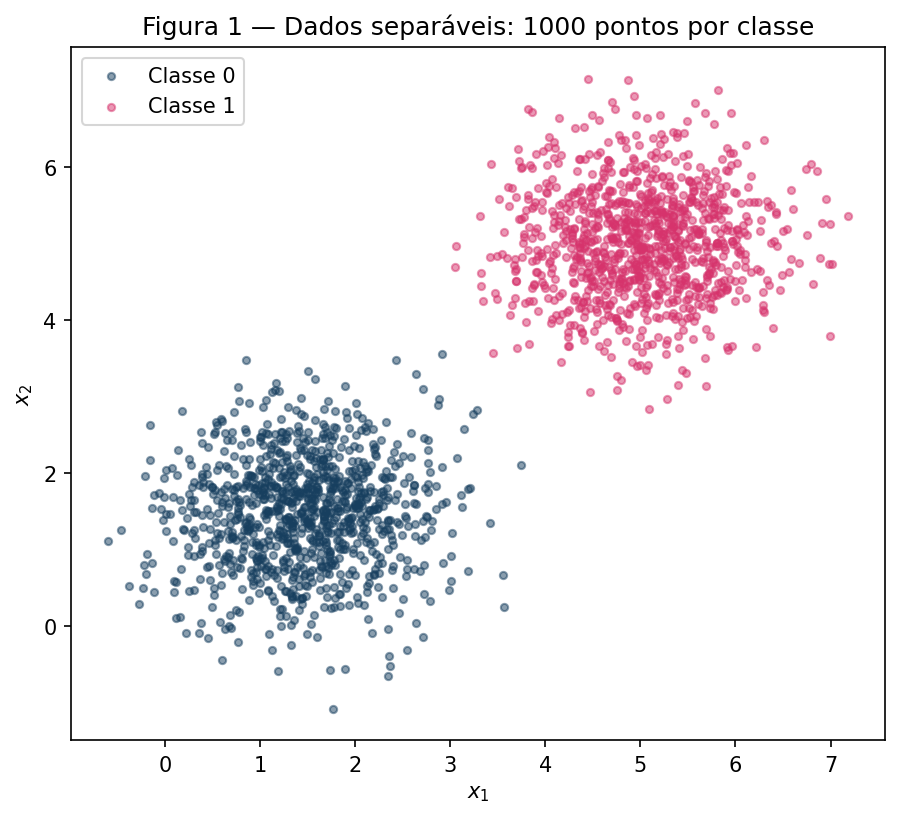
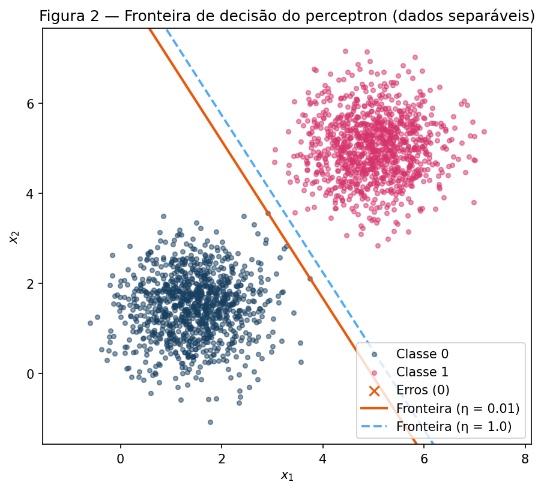
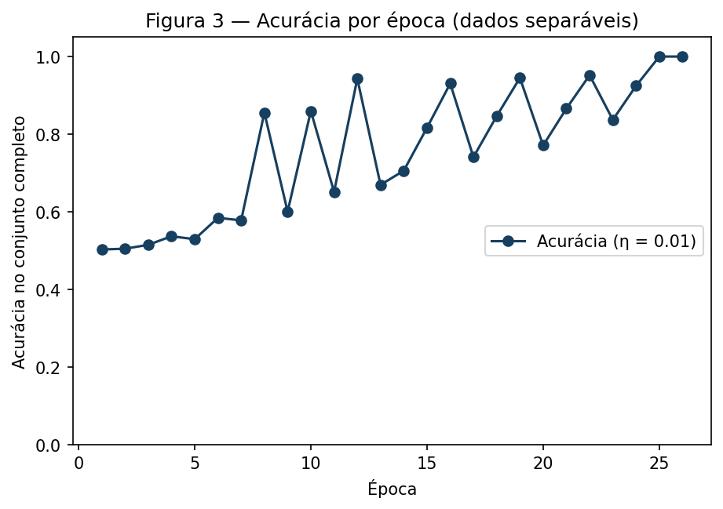
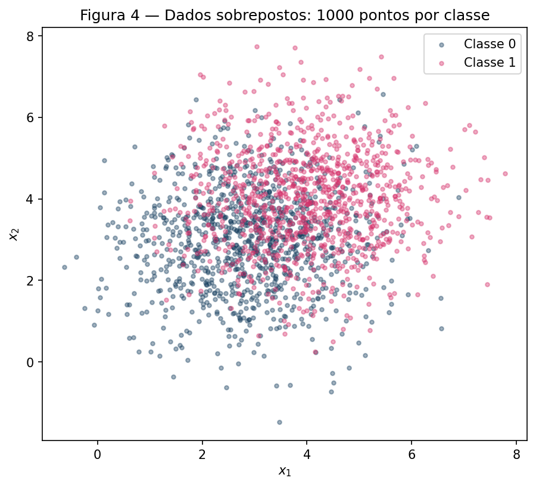
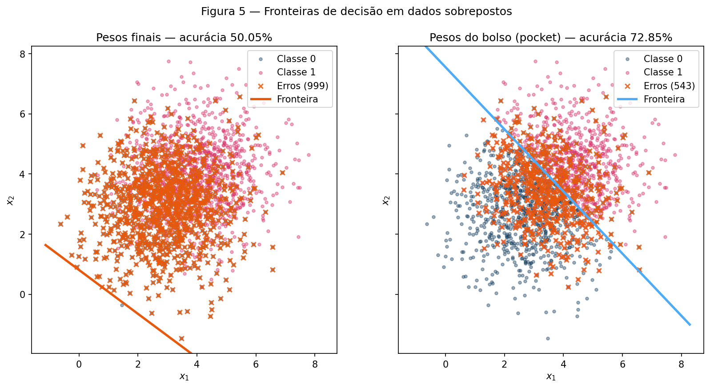
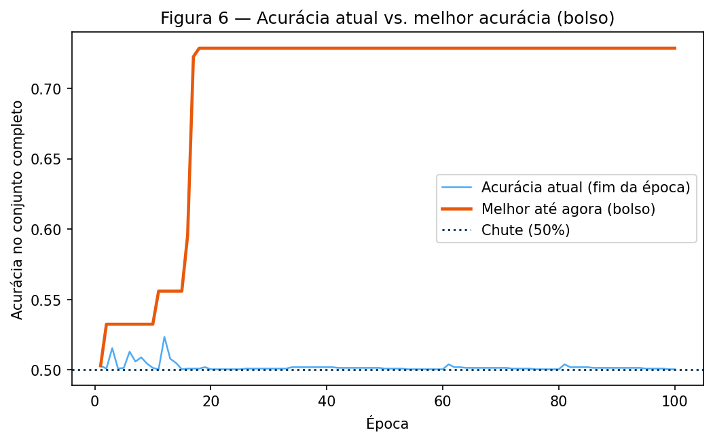

# 2. Perceptron

!!! abstract "Enunciado"

    [Exercises → Perceptron](https://insper.github.io/ann-dl/2026.2/exercises/perceptron/){:target='_blank'}

## Visão geral

O exercício usa um único perceptron de camada única , escrito à mão com NumPy, em dois
cenários: dados linearmente separáveis (Exercise 1) e dados sobrepostos (Exercise 2). A
mesma classe `Perceptron`, em [`code/perceptron.py`](https://github.com/julia-campos-ma/ANN-DL/blob/main/docs/exercises/perceptron/code/perceptron.py),
serve aos dois exercícios **sem nenhuma alteração** — o que muda é apenas o dado. O
Exercise 2 acrescenta o algoritmo do bolso, que já está dentro
da mesma classe: ele só "aparece" quando o treino não converge.

Todo o código usa só `numpy` e `matplotlib`; nenhum modelo pronto do scikit-learn. A
semente é `np.random.default_rng(42)`, criada uma vez no topo de cada script.

**Desafios encontrados.**

- **Quando avaliar o bolso.** Avaliar a acurácia só ao fim de cada época dava um bolso de
  apenas 52,35%; como os pesos só mudam quando há uma atualização, o bolso passou a ser
  reavaliado logo após *cada* atualização (é o que o enunciado pede: copiar $(w, b)$ sempre que a
  acurácia no dataset completo superar todas as anteriores), e a curva da Figura 6 é registrada por
  época.
- **Como fazer o "η só reescala" valer.** A prova do item D.3 exige partida em $w = 0$,
  mas o enunciado manda inicializar $w$ com $\mathcal{N}(0, 0.01)$. Por isso a classe tem
  o parâmetro `init_std` (padrão `0.01`), usado com `0` apenas para verificar D.3.
- **Ordem das amostras.** O treino percorre as amostras sempre na mesma ordem (classe 0,
  depois classe 1), sem embaralhar. Isso é necessário para a comparação entre taxas de
  aprendizado do D.3 e tem efeito visível na análise do Exercise 2.

## Exercise 1

### A — Geração dos dados

Duas classes 2D, 1000 pontos cada, amostradas com `rng.multivariate_normal`: classe 0 com
média $[1.5, 1.5]$ e classe 1 com média $[5, 5]$, ambas com covariância
$\begin{bmatrix} 0.5 & 0 \\ 0 & 0.5 \end{bmatrix}$ (variância 0,5 em cada eixo, eixos
independentes). A função `generate_two_classes` devolve `X` com shape `(2000, 2)` e `y` com
rótulos $\{0, 1\}$, classe 0 primeiro.


/// caption
**Figura 1** — 2000 pontos, 1000 por classe. Os dois blocos estão bem afastados: a
distância entre as médias é $3{,}5\sqrt{2} \approx 4{,}95$, contra um desvio-padrão de
$\sqrt{0{,}5} \approx 0{,}71$ por eixo.
///

### B — Implementação do perceptron

**Modelo.** Com $\hat{y} = \text{step}(\mathbf{w}^\top \mathbf{x} + b)$, sendo
$\text{step}(z) = 1$ se $z \ge 0$ e $0$ caso contrário, e rótulos
$y, \hat{y} \in \{0, 1\}$, a regra de atualização, aplicada amostra a amostra, é

$$
\mathbf{w} \leftarrow \mathbf{w} + \eta\,(y - \hat{y})\,\mathbf{x}, \qquad
b \leftarrow b + \eta\,(y - \hat{y}).
$$

O termo de erro $y - \hat{y}$ vale $0$ quando o perceptron acerta (nada muda), $+1$ quando
previu 0 e o certo era 1 (empurra $\mathbf{w}$ *para* $\mathbf{x}$) e $-1$ no caso oposto
(empurra $\mathbf{w}$ *para longe* de $\mathbf{x}$). Inicialização: $\mathbf{w} \sim
\mathcal{N}(0, 0.01^2)$ e $b = 0$; $\eta = 0.01$. O treino para quando uma época inteira
termina sem nenhuma atualização, ou ao completar 100 épocas; a acurácia no conjunto
completo é registrada ao fim de cada época.

O módulo com a implementação (comentado):

``` { .python .copy .select linenums='1' title="docs/exercises/perceptron/code/perceptron.py" }
--8<-- "docs/exercises/perceptron/code/perceptron.py"
```

??? note "Passo a passo do código"

    1. **`generate_two_classes`** monta a matriz de covariância $0.5\,I$ e chama
       `rng.multivariate_normal` uma vez por classe. `np.vstack` empilha as duas nuvens em
       `X` e `np.concatenate` cria os rótulos (mil zeros e mil uns).
    2. **`step`** implementa o degrau com `z >= 0`, o que dá um array de booleanos; o
       `.astype(int)` converte para 0/1. Note o `>=`: em $z = 0$ exato a previsão é 1.
    3. **`predict`** calcula `X @ w + b` para todas as amostras de uma vez (produto matriz-vetor)
       e aplica o degrau. Os argumentos opcionais `w` e `b` permitem avaliar *outros* pesos —
       é assim que os pesos do bolso são avaliados no Exercise 2.
    4. **`fit`, inicialização.** `w` recebe 2 valores de $\mathcal{N}(0, 0.01)$ e `b` começa
       em 0. Em seguida são criadas as listas de histórico (acurácia por época, melhor
       acurácia por época, atualizações por época) e o bolso começa com os pesos iniciais.
    5. **`fit`, laço interno.** Para cada amostra `(xi, yi)`: prevê `y_hat`, calcula
       `err = yi - y_hat` e, só se `err != 0`, aplica a regra de atualização. Isso é o
       aprendizado *guiado por erro*: acertos não mexem em nada.
    6. **`fit`, bolso.** Toda vez que há atualização, `(w, b)` mudou; reavalia-se a acurácia
       no dataset completo e, se for **estritamente** maior que a do bolso, copia-se `(w, b)`
       (`.copy()` é essencial, senão o bolso seria uma referência que muda junto com `w`).
    7. **`fit`, fim da época.** Guarda-se a acurácia atual, o número de atualizações e a
       melhor acurácia até ali. Se `n_updates == 0`, o perceptron acertou tudo numa passada
       completa sem mudar nenhum peso: convergiu, e o laço termina (`break`).
    8. **`decision_line`** isola $x_2$ em $w_1 x_1 + w_2 x_2 + b = 0$, dando
       $x_2 = -(w_1 x_1 + b)/w_2$, para desenhar a fronteira.

O script do Exercise 1 (dados, treino, figuras e os números do item D):

``` { .python .copy .select linenums='1' title="docs/exercises/perceptron/code/exercise1_separable.py" }
--8<-- "docs/exercises/perceptron/code/exercise1_separable.py"
```

1.  Semente fixa, criada uma vez: primeiro sorteia os dados e depois a inicialização de
    $\mathbf{w}$, sempre na mesma ordem. Sem isso, os números da tabela final mudariam a
    cada execução.
2.  `p.predict(X) != y` é uma máscara booleana: `True` onde o perceptron erra. É ela que
    seleciona os pontos a marcar com "×" laranja.
3.  `plt.close(fig)` libera a figura da memória depois de salva.

### C — Treino e medição

Com $\eta = 0.01$, o treino convergiu na **época 26** (a 26ª passada não teve nenhuma
atualização; as 25 primeiras tiveram entre 1 e 4). No total foram apenas **73
atualizações**. Resultados finais:

- $\mathbf{w} = (0{,}0505,\ 0{,}0289)$ e $b = -0{,}25$;
- acurácia final: **100%** (0 erros nos 2000 pontos).


/// caption
**Figura 2** — Fronteira $\mathbf{w}^\top \mathbf{x} + b = 0$ (linha laranja, $\eta = 0.01$)
sobre os dados. Não há pontos mal classificados, então a legenda mostra "Erros (0)". A
linha azul-clara tracejada é a fronteira do treino com $\eta = 1.0$ (item D.2).
///


/// caption
**Figura 3** — Acurácia no conjunto completo ao fim de cada época ($\eta = 0.01$).
///

### D — Análise

**D.1 — Por que dados separáveis convergem rápido.** A regra só altera os pesos quando há
erro, e cada correção aproxima a fronteira de classificar aquele ponto corretamente. Se
existe um hiperplano que separa as classes com folga, o teorema de convergência
garante que o número *total* de atualizações é finito, limitado por
$(R/\gamma)^2$, em que $R$ é o maior $\lVert (\mathbf{x}, 1) \rVert$ e $\gamma$ é a margem
da separação (com $\lVert (\mathbf{w}^*, b^*) \rVert = 1$). Como o número de atualizações é finito, alguma época não tem nenhuma —
e é isso que o critério de parada detecta. Aqui: 73 atualizações no total, no máximo 4 por
época (das 2000 previsões de cada época), e a época 26 sem nenhuma.

Vale notar que "rápido" não significa "suave": a Figura 3 mostra uma acurácia que **não é
monótona**, chegando a cair de 94% para 67% entre épocas. Isso acontece porque uma única
correção é grande em relação aos pesos: uma atualização em $\mathbf{x}_i$ soma
$\eta\,e\,(\mathbf{x}_i^\top \mathbf{x} + 1)$ ao score $z$ de *cada* ponto $\mathbf{x}$,
e com $\eta = 0.01$ e pontos a distâncias de 2 a 7 da origem isso é comparável ao valor de
$z$ que os pesos ainda pequenos produzem. A fronteira "balança" até encontrar uma posição
entre as duas nuvens; quando encontra, não há mais erro para corrigir e tudo para.

**D.2 — Repetindo com $\eta = 1.0$** (mesma semente, mesmos dados, mesma inicialização):

| | $\eta = 0.01$ | $\eta = 1.0$ |
|---|---|---|
| Épocas até convergir | 26 | 37 |
| Atualizações totais | 73 | 101 |
| Acurácia final | 100% | 100% |
| $\mathbf{w}$ final | $(0{,}0505,\ 0{,}0289)$ | $(5{,}871,\ 3{,}359)$ |
| $b$ final | $-0{,}25$ | $-31{,}0$ |
| $\mathbf{w}/\lVert \mathbf{w} \rVert$ | $(0{,}8681,\ 0{,}4963)$ | $(0{,}8679,\ 0{,}4967)$ |

As direções normalizadas praticamente coincidem: o cosseno entre elas é $\approx 0{,}9999999$
(ângulo de $0{,}02^\circ$). As retas ficam quase sobrepostas, com um pequeno deslocamento
paralelo (distância à origem $\lvert b \rvert / \lVert \mathbf{w} \rVert$ = 4,30 contra
4,58; ver Figura 2). Ambas separam os dados perfeitamente.

O que $\eta$ controla, então? Não a direção da fronteira, mas **o tamanho de cada passo
relativo ao tamanho dos pesos iniciais**. Com inicialização em torno de $0{,}01$, um passo
de $\eta = 1.0$ move $\mathbf{w}$ em cerca de $\eta \lVert \mathbf{x} \rVert \approx 2$ a
$7$, isto é, centenas de vezes o valor inicial: depois da primeira atualização a
inicialização é esquecida e o treino se comporta como uma partida em zero. Com
$\eta = 0.01$, o passo (cerca de $0{,}02$ a $0{,}07$) é da ordem dos pesos iniciais, então a
inicialização ainda influencia o caminho. Por isso o número de épocas difere (26 contra 37)
sem que a fronteira mude de direção. O item seguinte mostra exatamente isso.

**D.3 — $\eta$ só reescala (partindo de $\mathbf{w} = 0$, $b = 0$).**

*Afirmação:* sejam duas execuções com $\eta_1$ e $\eta_2$, mesmos dados, mesma ordem e
partida em zero. Então, em todo instante $t$ (após cada amostra),

$$
\mathbf{w}^{(2)}_t = \frac{\eta_2}{\eta_1}\,\mathbf{w}^{(1)}_t, \qquad
b^{(2)}_t = \frac{\eta_2}{\eta_1}\,b^{(1)}_t.
$$

*Prova por indução em $t$.* Base: em $t = 0$ ambos são zero, e $0 = (\eta_2/\eta_1)\cdot 0$.
Passo: suponha a relação válida em $t$. O escore da execução 2 é
$z^{(2)} = \mathbf{w}^{(2)\top}_t \mathbf{x} + b^{(2)}_t = (\eta_2/\eta_1)\,z^{(1)}$. Como
$\eta_2/\eta_1 > 0$, $z^{(2)}$ e $z^{(1)}$ têm o mesmo sinal (e são zero juntos), logo
$\text{step}(z^{(2)}) = \text{step}(z^{(1)})$ e o erro $e = y - \hat{y}$ é o **mesmo** nas
duas execuções. Então

$$
\mathbf{w}^{(2)}_{t+1} = \mathbf{w}^{(2)}_t + \eta_2\, e\, \mathbf{x}
= \frac{\eta_2}{\eta_1}\left(\mathbf{w}^{(1)}_t + \eta_1\, e\, \mathbf{x}\right)
= \frac{\eta_2}{\eta_1}\,\mathbf{w}^{(1)}_{t+1},
$$

e o mesmo cálculo vale para $b$. $\blacksquare$

*Consequências.* (i) A fronteira $\mathbf{w}^\top \mathbf{x} + b = 0$ é o mesmo conjunto de
pontos nas duas execuções (multiplicar a equação por uma constante positiva não a altera).
(ii) Como as previsões são idênticas a cada passo, os erros são os mesmos em todas as
épocas: o **número de épocas até convergir e a acurácia por época são idênticos**. Em
zero, $\eta$ é só uma escolha de unidade.

*Verificação numérica* (script, com `init_std=0`): $\eta = 0.01$ dá
$\mathbf{w} = (0{,}05868,\ 0{,}03350)$, $b = -0{,}31$; $\eta = 1.0$ dá
$\mathbf{w} = (5{,}86808,\ 3{,}35029)$, $b = -31{,}0$. A razão é exatamente $100$ em todas as
componentes, e ambas convergem em 37 épocas. Isso também explica os 37 épocas do
$\eta = 1.0$ de D.2: nesse caso a inicialização é irrelevante e a execução equivale à
partida em zero. Com inicialização não nula a relação vale só de forma aproximada: rodar
com $\eta$ equivale a rodar com $\eta = 1$ partindo de $\mathbf{w}_0/\eta$, e é por isso que
$\eta = 0.01$ (que enxerga $\mathbf{w}_0/\eta$ de ordem 1) difere.

## Exercise 2

### A — Geração dos dados

Duas classes 2D, 1000 pontos cada: classe 0 com média $[3, 3]$ e classe 1 com média
$[4, 4]$, ambas com covariância $\begin{bmatrix} 1.5 & 0 \\ 0 & 1.5 \end{bmatrix}$. As médias
estão a $\sqrt{2} \approx 1{,}41$ de distância, contra um desvio-padrão de
$\sqrt{1{,}5} \approx 1{,}22$ por eixo: as nuvens se sobrepõem muito.


/// caption
**Figura 4** — 2000 pontos, 1000 por classe. As duas classes se misturam na região central.
///

### B — Treino com o algoritmo do bolso

Reusamos a classe `Perceptron` do Exercise 1 sem mudar uma linha, com $\eta = 0.01$ e
limite de 100 épocas. Como os dados não são separáveis, nenhuma época terá zero
atualizações e o treino sempre roda as 100 épocas. Dois conjuntos de pesos são
acompanhados: os **finais** (o que o laço tem ao fim da época 100) e os do **bolso**
(o melhor $(\mathbf{w}, b)$ já visto, copiado sempre que a acurácia no dataset completo
supera a de todos os anteriores; ver o passo 6 do "Passo a passo" do Exercise 1).

``` { .python .copy .select linenums='1' title="docs/exercises/perceptron/code/exercise2_overlapping.py" }
--8<-- "docs/exercises/perceptron/code/exercise2_overlapping.py"
```

1.  Semente fixa; a ordem de uso é a mesma do Exercise 1 (dados e depois inicialização).
2.  `plt.close(fig)` libera a figura depois de salva.

Resultados (100 épocas, sem convergência):

| | $\mathbf{w}$ | $b$ | Acurácia |
|---|---|---|---|
| Pesos finais | $(0{,}0361,\ 0{,}0494)$ | $-0{,}04$ | **50,05%** |
| Pesos do bolso | $(0{,}00684,\ 0{,}00662)$ | $-0{,}05$ | **72,85%** |

O bolso foi salvo na **época 18** (na atualização de número 53 de um total de 382).

### C — Figuras


/// caption
**Figura 5** — À esquerda, a fronteira dos pesos finais (999 erros); à direita, a do
bolso (543 erros). Os erros de cada fronteira estão marcados com "×" laranja; a fronteira
dos pesos finais é laranja e a do bolso é azul-clara.
///


/// caption
**Figura 6** — Acurácia dos pesos atuais ao fim de cada época (azul-claro) e melhor acurácia
até a época (laranja, o bolso).
///

### D — Análise

**D.1 — Por que 50,05% e 72,85%.** A melhor reta possível para estes dados é a mediatriz
das médias, $x_1 + x_2 = 7$. Como as distribuições são gaussianas com mesma covariância, a
acurácia ótima teórica é $\Phi\!\left(\tfrac{d}{2\sigma}\right)$ com $d = \sqrt{2}$ e
$\sigma = \sqrt{1{,}5}$, ou seja $\approx 71{,}8\%$; essa reta acerta 72,60% *desta*
amostra. Os 72,85% do bolso estão, portanto, no teto do que uma reta pode fazer (ligeiramente
acima por selecionarmos o melhor ponto do treino *na própria amostra*, o que é otimista).
Já os pesos finais, com 50,05%, não passam de um chute: a Figura 5 (esquerda) mostra a
fronteira num canto do plano, **fora da nuvem**, com todos os pontos do mesmo lado. Eles
prevêem a classe 1 para os 2000 pontos (acertam os 1000 da classe 1 e apenas 1 da classe 0).

*Por que o treino deixa a fronteira ali.* Uma atualização em $\mathbf{x}_i$ com erro $e$
soma $\eta\,e\,(\mathbf{x}_i^\top \mathbf{x} + 1)$ ao escore de cada ponto $\mathbf{x}$. O
"$+1$" é a contribuição do viés; o resto, $\mathbf{x}_i^\top \mathbf{x}$, vem de
$\mathbf{w}$. Aqui $\lVert \mathbf{x} \rVert \approx 5{,}07$ (média medida) e a nuvem está
toda no primeiro quadrante, longe da origem e com pouca dispersão angular; portanto
$\mathbf{x}_i^\top \mathbf{x} \approx \lVert \boldsymbol{\mu} \rVert^2 \approx 24$ para
quase qualquer par de pontos (a média medida dá $\approx 24$). Cada erro muda o escore de **todos** os pontos por quase o
mesmo valor, cerca de $\pm 0{,}26$, e só 1 dessas 26 unidades vem do viés: em cada
passo $\mathbf{w}$ se move cerca de $\lVert \mathbf{x} \rVert \approx 5$ vezes mais que
$b$ (0,05 contra 0,01). A consequência é que a fronteira fica presa perto da origem — a
distância dela à origem, $\lvert b \rvert / \lVert \mathbf{w} \rVert$, é 0,65 no fim do
treino, enquanto o centro da nuvem está a 4,95. Para atravessar a nuvem, $b$ teria de
chegar perto de $-\mathbf{w}^\top \boldsymbol{\mu} \approx -0{,}30$; mas $b$ só anda $\pm 0{,}01$
por erro, e como as classes se sobrepõem os erros de sinais opostos se alternam e se
cancelam ($\lvert b \rvert \le 0{,}04$ ao fim de toda época).

Com esse deslocamento em bloco, cada erro joga os 2000 pontos de um lado para o outro da
fronteira: só 3,82 atualizações por época em média (entre 2 e 4), mas cada uma vira quase
toda a previsão. Como a ordem é fixa e o fim de toda época é um trecho só de classe 1 (as
últimas 1000 amostras), o estado em que cada época termina é quase sempre o "prevê tudo como classe 1"
(em todas as 100 épocas, pelo menos 97,6% dos pontos são previstos como classe 1), que rende ≈ 50%. A Figura 6 confirma: a curva azul-clara fica entre 50,0% e 52,4% em todas as
épocas. O bolso, por sua vez, só precisa que *em algum instante* os pesos tenham
passado por uma boa reta: isso ocorreu na atualização 53, com
$\mathbf{w} \approx (0{,}0068,\ 0{,}0066)$ e $b = -0{,}05$, ou seja a reta
$x_1 + x_2 \approx 7{,}4$, quase a mediatriz.

**D.2 — Figura 3 versus Figura 6; o teorema.** Na Figura 3 a acurácia oscila no começo e
depois sobe até 100% e **fica** ali: há uma época sem atualização e o treino para. Na
Figura 6 a curva azul-clara nunca estabiliza (fica em torno de 50%) e o bolso é uma escada
não decrescente que satura em 72,85%. O teorema de convergência do perceptron
(NOVIKOFF, 1962) diz: se existe $(\mathbf{w}^*, b^*)$ e $\gamma > 0$ com
$y_i(\mathbf{w}^{*\top}\mathbf{x}_i + b^*) \ge \gamma$ para todo $i$ (**separabilidade
linear com margem positiva**) e $\lVert (\mathbf{x}_i, 1) \rVert \le R$ (com $\lVert (\mathbf{w}^*, b^*) \rVert = 1$), então o
algoritmo comete um número finito de erros, no máximo $(R/\gamma)^2$ quando parte de zero, e
termina com zero erro, para qualquer $\eta > 0$. **A hipótese violada aqui é a separabilidade linear**: as
classes se sobrepõem, e nenhuma reta acerta todos os pontos (a melhor reta erra ≈ 28%).
Consequência direta: uma época sem atualização exigiria pesos que acertassem os 2000
pontos, o que é impossível; então o critério de parada nunca dispara e as atualizações
nunca se esgotam.

**D.3 — Mais épocas ou $\eta$ menor resolvem?** Não, e dá para ver pela regra de atualização.

- *Mais épocas.* O teorema não vale, e não há razão para o número de atualizações se
  esgotar: a cada passada, os erros continuam a chegar. Os pesos finais continuam a ser
  uma sequência que oscila (D.1), não uma sequência que converge. Mais épocas apenas dão
  mais chances ao bolso, cujo teto é a melhor reta possível (≈ 73%).
- *$\eta$ menor.* Pela prova do D.3 do Exercise 1, a partida em zero com qualquer $\eta$
  produz a mesma sequência de erros, só em outra escala. O que faz a fronteira escapar da
  nuvem é a geometria ($\mathbf{x}_i^\top \mathbf{x} \approx 25 \gg 1$, então $\mathbf{w}$
  domina $b$), e ela não depende de $\eta$. Diminuir $\eta$ só muda a escala dos pesos.
  Com a inicialização $\mathcal{N}(0, 0.01)$ a equivalência é aproximada (diminuir $\eta$
  aumenta o peso relativo de $\mathbf{w}_0$), mas $\mathbf{w}_0$ é sorteado sem informação
  sobre as classes e não ajuda: a tabela abaixo confirma.

Como verificação complementar (não substitui o argumento acima), o script também roda
outras configurações com a mesma semente:

| $\eta$ | Épocas | Acurácia dos pesos finais | Acurácia do bolso (época) |
|---|---|---|---|
| 0.01 | 100 | 50,05% | 72,85% (18) |
| 0.01 | 1000 | 50,30% | 73,35% (710) |
| 0.001 | 100 | 50,10% | 72,85% (42) |
| 0.1 | 100 | 50,10% | 73,20% (49) |
| 1.0 | 100 | 50,10% | 70,10% (12) |

Com 10 vezes mais épocas o bolso ganha 0,5 ponto percentual (10 pontos em 2000), o que é
compatível com sorte na seleção do melhor ponto, não com melhora do modelo; e os pesos
finais ficam em 50% em todas as configurações. Ferramentas que ataquem a causa (por exemplo,
centralizar os dados ou trocar a perda) estão fora do escopo do exercício e não foram testadas.

## Results summary

| # | Quantidade | Valor |
|---|------------|-------|
| 1 | Exercise 1 — $\mathbf{w}$ e $b$ finais ($\eta = 0.01$) | $\mathbf{w} = (0{,}0505,\ 0{,}0289)$; $b = -0{,}25$ |
| 2 | Exercise 1 — épocas até convergir | 26 (a 26ª sem atualizações) |
| 3 | Exercise 1 — acurácia final | 100% |
| 4 | Exercise 1 — épocas e acurácia com $\eta = 1.0$ | 37 épocas; 100% |
| 5 | Exercise 2 — $\mathbf{w}$ e $b$ finais | $\mathbf{w} = (0{,}0361,\ 0{,}0494)$; $b = -0{,}04$ |
| 6 | Exercise 2 — acurácia dos pesos finais | 50,05% |
| 7 | Exercise 2 — acurácia dos pesos do bolso | 72,85% |
| 8 | Exercise 2 — época em que o melhor do bolso ocorreu | 18 (atualização nº 53) |

Reprodução: `python docs/exercises/perceptron/code/exercise1_separable.py` e
`python docs/exercises/perceptron/code/exercise2_overlapping.py`, a partir da raiz do
repositório, com `numpy` e `matplotlib` (sementes fixas em 42).

## Referências

GALLANT, S. I. Perceptron-based learning algorithms. **IEEE Transactions on Neural
Networks**, v. 1, n. 2, p. 179–191, 1990.

NOVIKOFF, A. B. J. On convergence proofs on perceptrons. In: SYMPOSIUM ON THE MATHEMATICAL
THEORY OF AUTOMATA, 12., 1962, Brooklyn. **Proceedings** [...]. Brooklyn: Polytechnic
Institute of Brooklyn, 1962. p. 615–622.

ROSENBLATT, F. The perceptron: a probabilistic model for information storage and
organization in the brain. **Psychological Review**, v. 65, n. 6, p. 386–408, 1958.
