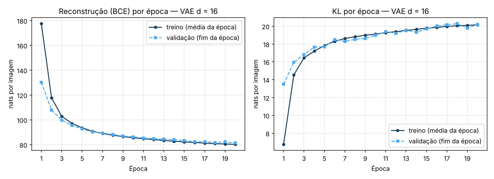
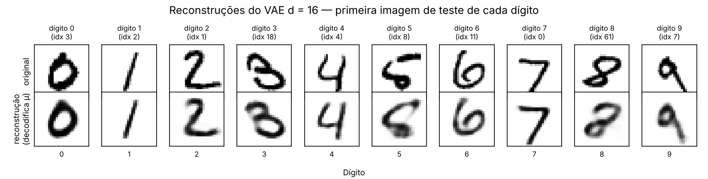
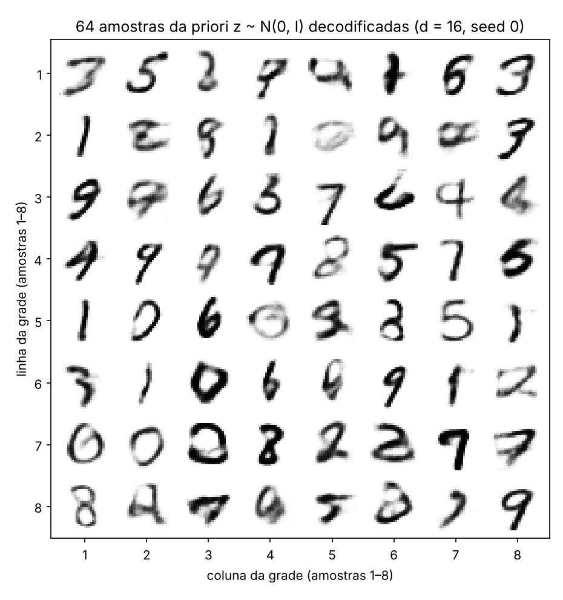
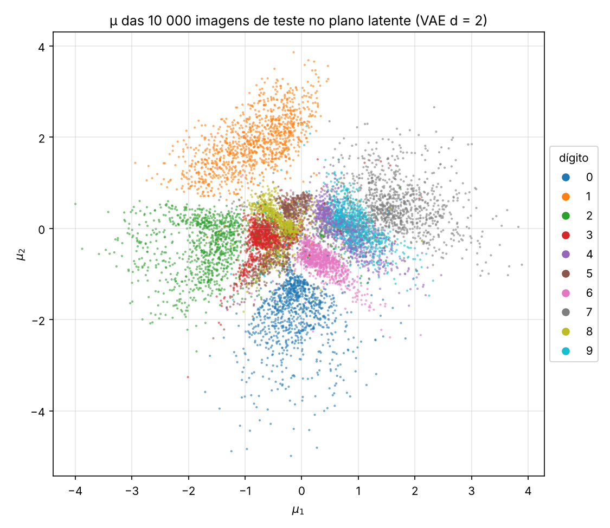
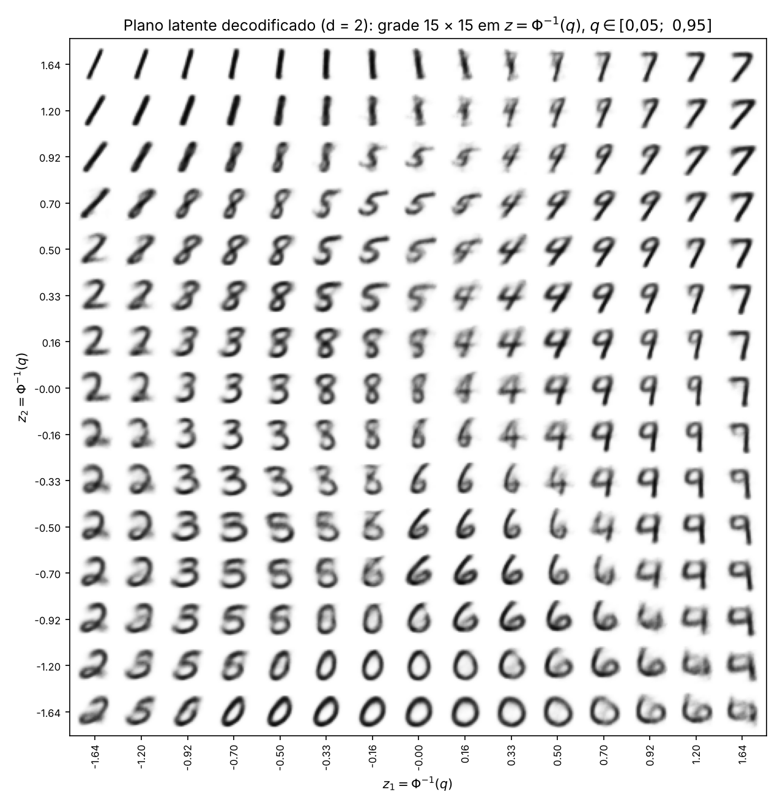
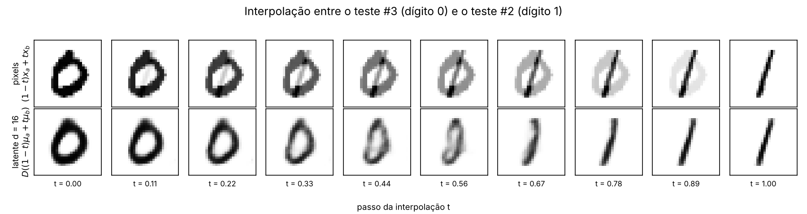

# 4. VAE

!!! abstract "Enunciado"

    [Exercises → VAE](https://insper.github.io/ann-dl/2026.2/exercises/vae/){:target='_blank'}

## Visão geral

O exercício treina um autoencoder variacional (VAE; KINGMA; WELLING, 2014; REZENDE; MOHAMED;
WIERSTRA, 2014) no MNIST e estuda o equilíbrio entre **reconstruir bem** cada imagem e manter o
espaço latente **perto de uma priori da qual se possa amostrar**. Os dois exercícios usam um
único módulo, [`code/vae.py`](https://github.com/julia-campos-ma/ANN-DL/blob/main/docs/exercises/vae/code/vae.py),
com os dados, o modelo, a perda e o laço de treino. O Exercício 1 usa $d = 16$ dimensões
latentes; o Exercício 2 usa o **mesmo código** com $d = 2$, o que só muda um argumento.

Regras seguidas:

- **Sementes**: `torch.manual_seed(42)` imediatamente antes de construir cada modelo (dentro de
  `train_vae`), e um `torch.Generator` com semente 42 no `random_split`. As avaliações usam um
  gerador próprio, com semente fixa, para não consumir o gerador do treino. Rodando os scripts
  duas vezes, os números saem idênticos.
- **Bibliotecas**: `torch`, `torchvision` (só para carregar o MNIST), `numpy`, `matplotlib`,
  `scipy` (`norm.ppf`, item 2C). O scikit-learn não foi necessário: o k-NN usado **apenas na
  análise** 2E é escrito à mão em torch (`knn_predict`).
- **Partes do VAE escritas à mão**: a reparametrização (`reparameterize`), os dois termos da
  perda (`vae_loss_terms`, com a KL em forma fechada escrita termo a termo) e a amostragem da
  priori (`torch.randn`). Nenhuma classe pronta de VAE e nenhum `torch.distributions`. O
  autograd calcula os gradientes.
- **Unidades**: os dois termos da perda são sempre reportados **separados**, em **nats por
  imagem** (somados nos 784 pixels ou nas $d$ dimensões e tirada a média sobre as imagens).
- **Teste só no fim**: todos os hiperparâmetros são fixados pelo enunciado, então nenhuma
  decisão de treino foi tomada; a validação serve para acompanhar o treino. O conjunto de teste
  só é avaliado com cada modelo já treinado (depois das 20 épocas), para os números finais.

## Exercise 1

**A VAE on MNIST**

### A — Load and split the data

O MNIST é carregado pelo `torchvision.datasets.MNIST`; os pixels `uint8` são divididos por 255,
ficando em $[0, 1]$, e cada imagem $28 \times 28$ vira um vetor de 784. Isso é exatamente o que
`transforms.ToTensor()` faz, só que de uma vez para o conjunto inteiro; o código confere a
igualdade, pixel a pixel, com um `assert` contra o `ToTensor()`. As 60 000 imagens oficiais de
treino são divididas por
`random_split(full, [50_000, 10_000], generator=torch.Generator().manual_seed(42))` em
**50 000 de treino** e **10 000 de validação**. As
**10 000 imagens oficiais de teste** formam o conjunto de teste, usado só no fim do item C.

O módulo com os dados, o modelo, a perda e o treino (comentado):

``` { .python .copy .select linenums='1' title="docs/exercises/vae/code/vae.py" }
--8<-- "docs/exercises/vae/code/vae.py"
```

### B — Build the model

**Arquitetura** (função `VAE` em `vae.py`):

| Bloco | Camadas | Ativação |
|---|---|---|
| Codificador | $784 \to 512 \to 256$ | ReLU depois de cada camada |
| Cabeça $\boldsymbol\mu$ | $256 \to d$ | linear |
| Cabeça $\log\boldsymbol\sigma^2$ | $256 \to d$ | linear |
| Decodificador | $d \to 256 \to 512 \to 784$ | ReLU nas ocultas, sigmoide na saída |

Com $d = 16$, o modelo tem 1 079 600 parâmetros. O codificador define a posteriori aproximada
$q_\phi(\mathbf{z} \mid \mathbf{x}) = \mathcal{N}(\boldsymbol\mu_\phi(\mathbf{x}),\ \operatorname{diag}\boldsymbol\sigma^2_\phi(\mathbf{x}))$;
a priori é $p(\mathbf{z}) = \mathcal{N}(\mathbf{0}, \mathbf{I})$; o decodificador devolve
$\hat{\mathbf{x}} = D_\theta(\mathbf{z}) \in (0, 1)^{784}$, a probabilidade de cada pixel estar
aceso, isto é, $p_\theta(\mathbf{x} \mid \mathbf{z}) = \prod_j \text{Bernoulli}(x_j;\ \hat{x}_j)$.

**Reparametrização.** Para que o gradiente passe pela amostragem, $\mathbf{z}$ é escrito como
uma função determinística de $(\boldsymbol\mu, \log\boldsymbol\sigma^2)$ e de um ruído que não
depende dos parâmetros:

$$
\mathbf{z} = \boldsymbol\mu + \boldsymbol\sigma \odot \boldsymbol\epsilon,\qquad
\boldsymbol\epsilon \sim \mathcal{N}(\mathbf{0}, \mathbf{I}),\qquad
\boldsymbol\sigma = \exp\!\left(\tfrac12 \log\boldsymbol\sigma^2\right),
$$

com $\partial z_j/\partial\mu_j = 1$ e $\partial z_j/\partial\log\sigma_j^2 = \tfrac12\sigma_j\epsilon_j$.
A cabeça prevê $\log\sigma^2$ (sem restrição de sinal) e não $\sigma$, o que garante $\sigma > 0$.

**Perda.** Para cada imagem, a perda é a $-$ELBO com $\beta = 1$:

$$
\mathcal{L}(\mathbf{x}) =
\underbrace{-\sum_{j=1}^{784}\Big[x_j\log\hat{x}_j + (1 - x_j)\log(1 - \hat{x}_j)\Big]}_{\text{reconstrução (BCE)} \;=\; -\log p_\theta(\mathbf{x}\mid\mathbf{z})}
\;+\; \beta\,\underbrace{\frac12\sum_{k=1}^{d}\left(\mu_k^2 + \sigma_k^2 - 1 - \log\sigma_k^2\right)}_{\mathrm{KL}(q_\phi(\mathbf{z}\mid\mathbf{x})\,\|\,p(\mathbf{z}))},
$$

com $\hat{\mathbf{x}} = D_\theta(\mathbf{z})$ e $\mathbf{z}$ reparametrizado, e a média é tirada sobre
o lote. No código, a reconstrução é `F.binary_cross_entropy(x_hat, x, reduction="sum") / batch`.
Com `reduction="mean"`, a BCE seria dividida também por 784, o que equivale a multiplicar a KL
por $\beta \approx 784$ e esmagar o espaço latente.

**De onde vem a KL em forma fechada.** Em uma dimensão, com $q = \mathcal{N}(\mu, \sigma^2)$ e
$p = \mathcal{N}(0, 1)$:

$$
\mathrm{KL}(q\,\|\,p) = \mathbb{E}_q[\log q(z) - \log p(z)]
= \underbrace{-\tfrac12\log(2\pi\sigma^2) - \tfrac12}_{\mathbb{E}_q[\log q]}
\;+\; \underbrace{\tfrac12\log 2\pi + \tfrac12(\mu^2 + \sigma^2)}_{-\mathbb{E}_q[\log p]}
= \tfrac12\left(\mu^2 + \sigma^2 - 1 - \log\sigma^2\right),
$$

usando $\mathbb{E}_q[(z - \mu)^2] = \sigma^2$ e $\mathbb{E}_q[z^2] = \mu^2 + \sigma^2$. Como a
covariância é diagonal, a KL em $d$ dimensões é a soma das $d$ parcelas. No código:
`0.5 * (mu.pow(2) + logvar.exp() - 1.0 - logvar).sum(dim=1)`.

### C — Train

Adam com taxa de aprendizado $10^{-3}$, lotes de 128 (embaralhados), **20 épocas**, $\beta = 1$
(função `train_vae`). Em cada época registramos os dois termos no **treino** (média ao longo da
época, enquanto o modelo muda) e na **validação** (com o modelo do fim da época). O treino leva
cerca de 1,5 min numa CPU de 2 núcleos.

O script do Exercício 1 (treino, Figuras 1 a 3 e números da análise):

``` { .python .copy .select linenums='1' title="docs/exercises/vae/code/exercise1_vae_mnist.py" }
--8<-- "docs/exercises/vae/code/exercise1_vae_mnist.py"
```

1.  `train_vae` chama `torch.manual_seed(42)` antes de construir o modelo: os pesos iniciais, a
    ordem dos lotes e os $\boldsymbol\epsilon$ do treino ficam todos determinados.
2.  `plt.close(fig)` libera a figura da memória depois de salva.
3.  A Figura 2 decodifica $\boldsymbol\mu$, não um $\mathbf{z}$ sorteado (ver 1E, pergunta 3).

**Resultado no teste ($d = 16$)**, avaliado uma vez, depois do treino:

| Termo | nats por imagem |
|---|---|
| Reconstrução (BCE) | **80,74** |
| KL | **20,25** |
| $-$ELBO (soma) | **100,99** |

Os valores estão de acordo com os esperados pelo enunciado (≈ 81 e ≈ 20). Na validação, a KL
vai de **13,50 nats na época 1** a **20,19 nats na época 20**, e a reconstrução vai de 130,22
para 81,43.


/// caption
**Figura 1** — Reconstrução (esquerda) e KL (direita) por época, em nats por imagem, no treino
(média da época) e na validação (fim da época). A reconstrução cai o tempo todo; a KL **sobe**,
depressa nas primeiras épocas e devagar depois. Na época 1 a curva de treino fica acima da de
validação na reconstrução e abaixo na KL porque é a média de uma época que começa no modelo
inicial; nas demais as duas curvas praticamente coincidem (não há sobreajuste visível).
///

### D — Reconstructions and samples


/// caption
**Figura 2** — Linha de cima: a primeira imagem de teste de cada dígito, de 0 a 9 (índices 3,
2, 1, 18, 4, 8, 11, 0, 61 e 7). Linha de baixo: a reconstrução $D_\theta(\boldsymbol\mu(\mathbf{x}))$,
decodificando $\boldsymbol\mu$. A identidade e o formato geral são mantidos; os traços ficam
mais macios, e os detalhes raros (o "5" de formato incomum, o "8" torto) são suavizados em
direção a um formato mais típico.
///


/// caption
**Figura 3** — Grade $8 \times 8$ de $D_\theta(\mathbf{z})$ com $\mathbf{z} \sim \mathcal{N}(\mathbf{0}, \mathbf{I})$,
sorteados depois de `torch.manual_seed(0)`. Muitas amostras são dígitos legíveis, mas várias são
borradas, fantasmagóricas ou misturas de dois dígitos (por exemplo, linha 2, colunas 2, 5 e 7).
///

### E — Analysis

**1. A KL sobe nas primeiras épocas enquanto a perda total cai. Por que o otimizador escolhe
pagar mais KL?**

A KL média é o **custo, em nats, da informação que o código $\mathbf{z}$ carrega sobre
$\mathbf{x}$**: ela é um limite superior da informação mútua entre $\mathbf{x}$ e $\mathbf{z}$
(HOFFMAN; JOHNSON, 2016; ALEMI *et al.*, 2018). Na inicialização, as cabeças devolvem
$\boldsymbol\mu \approx \mathbf{0}$ e $\log\boldsymbol\sigma^2 \approx \mathbf{0}$, ou seja,
$q(\mathbf{z}\mid\mathbf{x}) \approx p(\mathbf{z})$ para toda imagem: medimos **KL = 0,03 nats**
na validação antes do treino. Nesse ponto $\mathbf{z}$ não diz nada sobre $\mathbf{x}$, e o
decodificador só pode devolver ≈ 0,5 em todos os pixels: a reconstrução vale **544,70 nats**,
praticamente $784 \ln 2 = 543{,}4$.

Treinar é "comprar" informação: afastar as posterioris da priori (mover $\boldsymbol\mu$ e
encolher $\boldsymbol\sigma$) custa KL, mas permite ao decodificador saber qual imagem
reconstruir. No começo a troca é muito vantajosa: da época 0 para a 1, a KL de validação sobe
13,5 nats e a reconstrução cai 414,5 nats. Como a perda soma os dois termos com $\beta = 1$, o
otimizador aceita pagar KL enquanto cada nat de KL comprar mais de um nat de reconstrução. A
vantagem vai diminuindo: da época 1 para a 2, +2,5 nats de KL compram −22,4 de reconstrução; da
época 10 para a 20, +1,2 compram só −4,9. Por isso a KL sobe rápido e depois quase estabiliza em
≈ 20 nats, enquanto a soma cai em todas as épocas (de 143,7 para 101,6 na validação). A KL por
dimensão mostra como essa informação é distribuída: 12 das 16 dimensões são **ativas**
(variância de $\mu_k$ entre imagens maior que 0,01; BURDA; GROSSE; SALAKHUTDINOV, 2016), com
0,6 a 2,5 nats cada, e 4 ficam **inativas**, com KL ≈ 0,001: nelas a posteriori continua igual
à priori, porque o ganho de reconstrução não pagaria o custo.

**2. Por que a Figura 3 parece pior que a Figura 2? Duas razões distintas.**

*(a) Onde as amostras da priori caem.* A Figura 2 decodifica $\boldsymbol\mu$ de imagens reais,
que caem onde o decodificador foi treinado. Na Figura 3, o $\mathbf{z}$ vem da priori, mas o
decodificador só viu códigos vindos da **posteriori agregada**
$q(\mathbf{z}) = \frac{1}{N}\sum_i q(\mathbf{z}\mid\mathbf{x}_i)$, e as duas não coincidem.
Elas até têm os mesmos momentos de segunda ordem: a variância de $q(\mathbf{z})$ por dimensão
fica entre 0,97 e 1,08. Mas cada posteriori é estreita ($\sigma$ médio de **0,22** nas dimensões
ativas, contra 1 da priori), e 50 000 gaussianas estreitas não preenchem uniformemente a bola da
priori em 12 dimensões: sobram **buracos** entre elas. Medimos isso diretamente. Pela priori, as
64 amostras da Figura 3 e 2000 códigos $\mathbf{z} \sim q(\mathbf{z}\mid\mathbf{x})$ de imagens de
teste são igualmente prováveis (mediana de $\log p(\mathbf{z})$: −22,49 contra −22,40). Pela
posteriori agregada, não: a mediana de $\log q(\mathbf{z})$ é **−52,9** para as amostras da
priori e **−32,6** para os códigos de teste, uma densidade cerca de $e^{20} \approx 7 \times 10^{8}$
vezes menor. **27%** das amostras da priori (17 de 64) ficam abaixo do percentil 5 dos códigos
de teste, e a distância mediana ao $\boldsymbol\mu$ de treino mais próximo (nas dimensões ativas)
é 1,75, contra 1,21 para imagens de teste. O decodificador é chamado a extrapolar para regiões
que quase nunca viu, e é aí que aparecem os dígitos híbridos e mal formados.

*(b) O que o decodificador devolve para um $\mathbf{z}$.* Mesmo num $\mathbf{z}$ "bom", o
decodificador não devolve **uma** imagem: devolve $\hat{\mathbf{x}} = \mathbb{E}[\mathbf{x}\mid\mathbf{z}]$,
a probabilidade de cada pixel estar aceso, com os pixels independentes entre si. Se um mesmo
$\mathbf{z}$ é compatível com várias imagens (um traço um pouco mais à esquerda ou à direita, o
alto do "4" aberto ou fechado), a melhor resposta para a BCE é a **média** delas, que é uma
imagem borrada, com traços em meia-tinta (a KL é *mode-covering* e a média de vários modos é
cinzenta). Essa incerteza é maior justamente onde $\mathbf{z}$ é ambíguo, nas regiões entre
classes e nos buracos do item (a). Medimos a fração de pixels "cinzentos" ($0{,}1 < x < 0{,}9$):
**8,6%** nas imagens de teste, **14,4%** nas reconstruções a partir de $\boldsymbol\mu$ e
**16,7%** nas amostras da Figura 3. Além disso, a figura mostra as médias $\hat{\mathbf{x}}$ e
não amostras de Bernoulli; sortear os pixels independentemente produziria ruído "sal e pimenta",
porque o modelo não tem como representar a correlação entre pixels vizinhos de um traço.

**3. Por que decodificar $\boldsymbol\mu$ em vez de um $\mathbf{z}$ sorteado na Figura 2?**

$\boldsymbol\mu(\mathbf{x})$ é a média (e a moda) de $q(\mathbf{z}\mid\mathbf{x})$, o código
"mais provável" da imagem. Decodificá-lo mostra, de forma **determinística**, o que o código
guardou sobre $\mathbf{x}$. Um $\mathbf{z} = \boldsymbol\mu + \boldsymbol\sigma\odot\boldsymbol\epsilon$
sorteado soma a isso o ruído da posteriori ($\sigma \approx 0{,}22$ por dimensão ativa e
$\approx 1$ nas inativas): a reconstrução mudaria a cada execução e misturaria duas coisas, a
qualidade da compressão e a incerteza do codificador. No teste, a BCE média é **75,31 nats**
decodificando $\boldsymbol\mu$ e **80,75 nats** decodificando um $\mathbf{z}$ sorteado. Para os
números do item C, ao contrário, usamos o $\mathbf{z}$ sorteado, porque o termo de reconstrução
da ELBO é uma esperança sob $q(\mathbf{z}\mid\mathbf{x})$: uma amostra por imagem dá um estimador
não enviesado dela. Decodificar $\boldsymbol\mu$ é a escolha certa para **olhar** a
reconstrução, não para **medir** a ELBO.

## Exercise 2

**A Latent Space You Can See**

O script do Exercício 2 (treino com $d = 2$, Figuras 4 a 6 e números da análise):

``` { .python .copy .select linenums='1' title="docs/exercises/vae/code/exercise2_latent_2d.py" }
--8<-- "docs/exercises/vae/code/exercise2_latent_2d.py"
```

1.  Imagens de teste interpoladas no item D: índice 3 (um "0") e índice 2 (um "1").

### A — Train a 2-D VAE

Mesmo modelo, mesmos dados e divisão, mesma semente (`torch.manual_seed(42)` antes de construir
o modelo), $\beta = 1$ e o mesmo orçamento (Adam, $10^{-3}$, lotes de 128, 20 épocas), só que com
$d = 2$ (função `train_vae(2, ...)`). Resultados no teste, ao lado dos do Exercício 1:

| Modelo | Reconstrução | KL | $-$ELBO |
|---|---|---|---|
| $d = 16$ (Exercício 1) | 80,74 | 20,25 | 100,99 |
| $d = 2$ | **133,65** | **6,73** | **140,38** |
| diferença ($d = 2$ − $d = 16$) | +52,91 | −13,52 | +39,39 |

Os valores estão de acordo com os esperados (≈ 135 e ≈ 7). Com duas dimensões, o código
transmite muito menos informação (6,7 nats em vez de 20,2), e a reconstrução piora 52,9 nats
por imagem. A KL de validação vai de 4,83 nats (época 1) a 6,71 (época 20).

### B — The encoded test set


/// caption
**Figura 4** — $\boldsymbol\mu(\mathbf{x})$ das 10 000 imagens de teste, coloridas pelo dígito.
Os pontos cobrem uma região arredondada perto da origem, como pede a priori. O 0 (embaixo), o 1
(em cima), o 2 (à esquerda) e o 7 (à direita) formam regiões bem separadas; o 4 e o 9 ocupam
praticamente a mesma região, e o 3, o 5 e o 8 se misturam no centro.
///

### C — The decoded plane


/// caption
**Figura 5** — Grade $15 \times 15$ de $D_\theta(\mathbf{z})$, com $z_1, z_2 = \Phi^{-1}(q)$ para 15
valores de $q$ igualmente espaçados em $[0{,}05;\ 0{,}95]$ (`scipy.stats.norm.ppf`). Os valores de
$z$ estão nos eixos; $z_2$ cresce para cima. A disposição dos dígitos repete a da Figura 4.
///

**Por que a grade $\Phi^{-1}(q)$ dá a cada célula a mesma massa da priori:** como $\Phi$ é a
função de distribuição de $\mathcal{N}(0, 1)$, pontos com $q$ igualmente espaçados separam faixas
com a mesma probabilidade em cada eixo (aqui $0{,}9/14 \approx 6{,}4\%$), e como a priori
$\mathcal{N}(\mathbf{0}, \mathbf{I})$ é o produto das duas marginais, cada célula recebe a mesma
massa $(0{,}9/14)^2$, de modo que a grade fica densa no centro e esparsa nas caudas,
exatamente na proporção em que a priori (e, se a KL funcionou, o código) usa o plano.

### D — Interpolation

Imagens escolhidas: **teste #3** (um "0") e **teste #2** (um "1"), dígitos de formatos bem
diferentes. Para $t \in \{0, 1/9, \dots, 1\}$:

- linha de cima, espaço dos pixels: $(1 - t)\,\mathbf{x}_a + t\,\mathbf{x}_b$;
- linha de baixo, espaço latente do **modelo $d = 16$ do Exercício 1** (carregado de
  `checkpoints/vae_d16.pt` ou treinado de novo com a mesma semente):
  $D_\theta\big((1 - t)\,\boldsymbol\mu_a + t\,\boldsymbol\mu_b\big)$.


/// caption
**Figura 6** — Interpolação entre o teste #3 (0) e o teste #2 (1). Em cima, nos pixels: o "0"
esmaece enquanto o "1" aparece por cima dele, e os passos do meio são as duas imagens sobrepostas
pela metade. Embaixo, no espaço latente ($d = 16$): o "0" se estreita num oval inclinado, vira um
laço fino e fecha num traço, que é o "1".
///

### E — Analysis

**1. Quais dígitos se sobrepõem na Figura 4? A mesma transição na Figura 5.**

Para medir a sobreposição, usamos um k-NN ($k = 15$, escrito à mão) com os $\boldsymbol\mu$ de
**treino** como referência e classificamos os $\boldsymbol\mu$ de teste (só para análise; o VAE não usa rótulos). O k-NN acerta
81,1%, e os erros se concentram em poucos pares (soma dos dois sentidos):

| Par | Erros | Par | Erros |
|---|---|---|---|
| **4 ↔ 9** | **632** | 3 ↔ 8 | 146 |
| 5 ↔ 8 | 283 | 7 ↔ 9 | 112 |
| 3 ↔ 5 | 167 | 2 ↔ 3 | 55 |

O caso mais forte é **4 ↔ 9**: os centróides das duas classes no plano são $(0{,}75;\ -0{,}02)$ e
$(0{,}89;\ 0{,}04)$, a 0,15 um do outro, e cerca de um terço dos 4 e dos 9 do teste têm a maioria
dos vizinhos na outra classe (326 e 306). O segundo grupo é **3, 5 e 8**, no centro do plano.
Na Figura 5, a transição 4 ↔ 9 fica na faixa $z_1 \approx 0{,}3$ a $0{,}9$ e
$z_2 \approx -0{,}5$ a $0{,}7$: andando para a direita, o "4" de alto aberto vai fechando o
laço de cima e endireitando a haste até virar um "9"; nas células do meio aparecem dígitos que
poderiam ser lidos como os dois, um "4" com o alto quase fechado. A transição 5 ↔ 8 aparece em
$z_1 \approx -0{,}7$ a $-0{,}2$ e $z_2 \approx 0{,}2$ a $0{,}9$: a curva de baixo do "5" se fecha
e o traço de cima se curva até formar o "8"; entre um e outro, há "5" com a barriga fechada e
"8" com o laço de cima aberto. Há transições parecidas entre 3 e 8, entre 1 e 7 (no alto, o "1"
ganha uma barra no topo) e entre 0 e 6 (embaixo, o "0" abre no alto à esquerda).

**2. O que duas dimensões por imagem obrigam o modelo a descartar?**

Com 2 números, o código tem pouca informação a gastar: 6,73 nats por imagem, contra 20,25 com
$d = 16$. Só saber **qual** dos 10 dígitos é custa $\ln 10 \approx 2{,}3$ nats, então sobram
cerca de 4 nats para todo o resto. O que o modelo descarta é a **variação dentro de cada
classe**: espessura do traço, inclinação, largura, detalhes como a cauda do "9", o alto do "4"
aberto ou fechado e as variações de caligrafia. A Figura 5 é a evidência: o plano inteiro é um
mapa de **identidade do dígito** com algumas poucas direções suaves de estilo (por exemplo, a
inclinação do "1" no alto e a abertura do "4"), e todas as 225 células são dígitos
**prototípicos**, com espessura praticamente constante e sem nenhum dos traços idiossincráticos
da linha de cima da Figura 2. Para quantificar, medimos a variância total de pixels **dentro de
cada classe** (média nas 10 classes) no teste: 41,6 nas imagens reais, **30,8** nas reconstruções
do modelo $d = 16$ (74% preservados) e só **14,0** nas do modelo $d = 2$ (34%). É essa variação
perdida que custa os 52,9 nats a mais de reconstrução, e ela também explica a sobreposição do
item 1: um "4" fechado e um "9" diferem justamente num detalhe de estilo que 2 números não
conseguem guardar junto com o resto.

**3. Compare as duas linhas da Figura 6.**

A **linha latente** passa por imagens parecidas com dígitos; a **linha dos pixels**, não. A
interpolação nos pixels é uma **soma ponderada de duas imagens**: no meio, o "0" e o "1" aparecem
juntos, cada um com metade da tinta. A fração de pixels em meia-tinta ($0{,}1 < x < 0{,}9$) sobe
de 9,4% em $t = 0$ para 22% a 25% em todo o meio do caminho ($t = 0{,}11$ a $0{,}78$), quando um
dígito real tem 8,6%. Isso acontece porque o conjunto das imagens de dígitos **não é convexo** no
espaço dos pixels: ele ocupa uma superfície curva (uma variedade) de dimensão baixa dentro de
$[0, 1]^{784}$, e o segmento de reta entre dois pontos dessa superfície sai dela. No espaço
latente, o segmento entre $\boldsymbol\mu_a$ e $\boldsymbol\mu_b$ é levado pelo **decodificador**
de volta para a superfície: todo $\mathbf{z}$ é transformado numa imagem com cara de dígito, e
o termo de KL empurrou os códigos das imagens de treino para uma região contínua e preenchida em
volta da origem, de modo que pontos intermediários do segmento caem perto de códigos que o
decodificador já viu. O resultado é uma deformação contínua do **formato** (o "0" estreita, vira
laço e fecha num traço) em vez de um esmaecimento. Não é perfeito: os passos do meio
($t = 0{,}44$ e $0{,}56$) são mais borrados (até 20% de meia-tinta), porque a reta em 16
dimensões atravessa regiões menos densas da posteriori agregada, os mesmos buracos da pergunta
2(a) do Exercício 1.

## Referências

ALEMI, A. A. *et al.* Fixing a broken ELBO. In: INTERNATIONAL CONFERENCE ON MACHINE LEARNING,
35., 2018, Stockholm. **Proceedings** [...]. [S. l.]: PMLR, 2018. p. 159–168.

BURDA, Y.; GROSSE, R.; SALAKHUTDINOV, R. Importance weighted autoencoders. In: INTERNATIONAL
CONFERENCE ON LEARNING REPRESENTATIONS, 4., 2016, San Juan. **Proceedings** [...]. [S. l.]:
ICLR, 2016.

HOFFMAN, M. D.; JOHNSON, M. J. ELBO surgery: yet another way to carve up the variational
evidence lower bound. In: NIPS WORKSHOP IN ADVANCES IN APPROXIMATE BAYESIAN INFERENCE, 2016,
Barcelona. **Proceedings** [...]. [S. l.: s. n.], 2016.

INSPER. **Redes Neurais Artificiais e Deep Learning**: Variational Autoencoders. São Paulo,
2026. Disponível em: https://insper.github.io/ann-dl/2026.2/classes/variational-autoencoders/.
Acesso em: 27 out. 2026.

KINGMA, D. P.; WELLING, M. Auto-encoding variational Bayes. In: INTERNATIONAL CONFERENCE ON
LEARNING REPRESENTATIONS, 2., 2014, Banff. **Proceedings** [...]. [S. l.]: ICLR, 2014.

REZENDE, D. J.; MOHAMED, S.; WIERSTRA, D. Stochastic backpropagation and approximate inference
in deep generative models. In: INTERNATIONAL CONFERENCE ON MACHINE LEARNING, 31., 2014, Beijing.
**Proceedings** [...]. [S. l.]: PMLR, 2014. p. 1278–1286.

## Results summary

| # | Quantity | Value |
|---|----------|-------|
| 1 | Ex. 1 — test reconstruction, KL and negative ELBO (d = 16) | Reconstrução **80,74**; KL **20,25**; $-$ELBO **100,99** nats/imagem |
| 2 | Ex. 1 — validation KL at the first and at the last epoch | **13,50** nats (época 1) → **20,19** nats (época 20) |
| 3 | Ex. 2 — test reconstruction and KL (d = 2) | Reconstrução **133,65**; KL **6,73** nats/imagem ($-$ELBO 140,38; com d = 16: 80,74 e 20,25) |
| 4 | Ex. 2 — the two test indices interpolated | **3** (dígito 0) e **2** (dígito 1) |

Reprodução, a partir da raiz do repositório (o MNIST é baixado em `data/MNIST/`, fora do git):
`python docs/exercises/vae/code/exercise1_vae_mnist.py` e depois
`python docs/exercises/vae/code/exercise2_latent_2d.py`, com as versões de `torch`,
`torchvision`, `scipy`, `numpy` e `matplotlib` do `requirements.txt`. Os números
de cada script também ficam gravados em `results/`.
