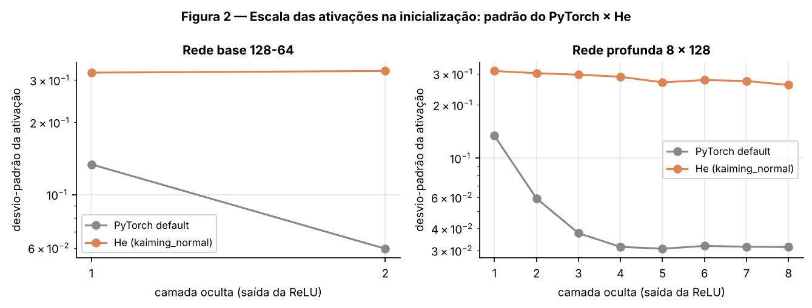
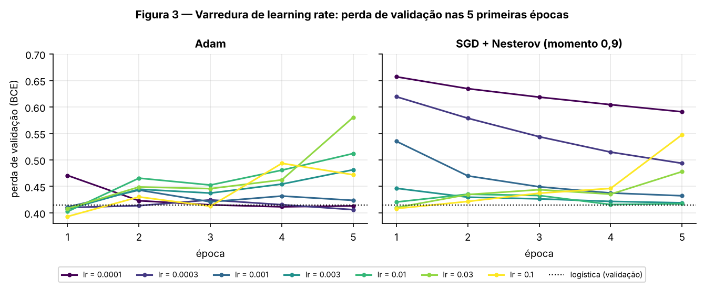
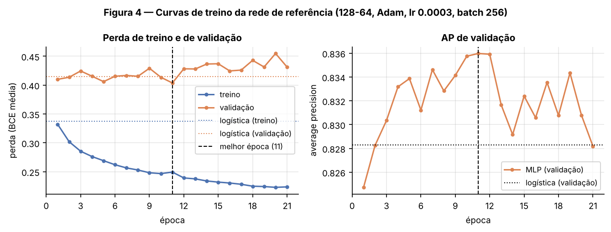
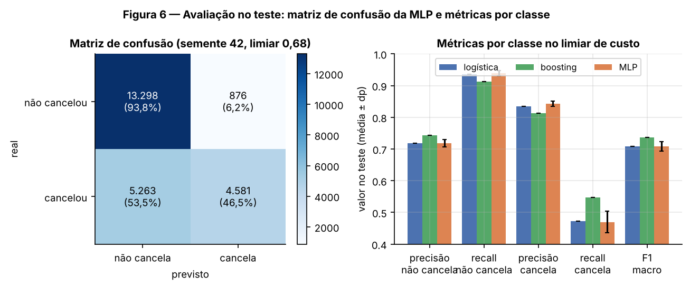
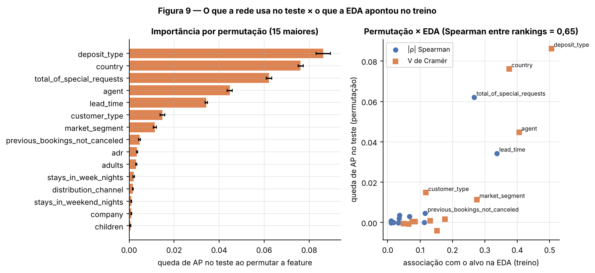

# 2. Classificação — Previsão de cancelamento

!!! abstract "Entrega 2 de 3 do [Projeto](../index.md)"

    [Projects → Classification or Regression](https://insper.github.io/ann-dl/2026.2/projects/supervised/){:target='_blank'}

!!! info "Equipe"

    | Nome completo | GitHub |
    |---------------|--------|
    | Tiago Liberman | [tiliberman](https://github.com/tiliberman) |
    | Júlia Campos | [julia-campos-ma](https://github.com/julia-campos-ma) |

    Dataset, decisões e status: [página do projeto](../index.md).

!!! info "Reprodutibilidade"

    Mesmo dataset (`data/hotel/hotel_bookings.csv`), mesmo split temporal e mesma semente (42)
    da [EDA](../eda/index.md). O código importa `load_split()` e `build_preprocessor()` dos
    scripts da EDA sem alterá-los. Rodando, a partir da raiz do repositório,

    ```shell
    python docs/projects/classification/code/step0_setup.py
    python docs/projects/classification/code/step1_baselines.py
    python docs/projects/classification/code/step2_network.py
    python docs/projects/classification/code/step3_training.py
    python docs/projects/classification/code/step4_search.py   # ~25 min em 2 núcleos
    python docs/projects/classification/code/step5_test.py     # único que lê o teste
    python docs/projects/classification/code/step6_errors.py
    ```

    todos os números desta página são impressos, as 9 figuras são regeradas em `figures/` e os
    resultados ficam em `results/*.json`. Versões: Python 3.12–3.13, PyTorch 2.14.1 (CPU), NumPy
    2.5.3, pandas 3.0.5, scikit-learn 1.7.2 e Matplotlib 3.11.2, fixadas no `requirements.txt`.
    Toda fonte de aleatoriedade é semeada e o PyTorch roda com
    `torch.use_deterministic_algorithms(True)`. Mesmo assim, a ordem das operações de ponto
    flutuante muda entre CPUs e sistemas, então as métricas das redes podem variar na terceira casa
    decimal em outra máquina.

O dataset é o da [EDA](../eda/index.md): reservas de dois hotéis portugueses, de julho de 2015 a
agosto de 2017. A pergunta continua sendo **se uma reserva será cancelada** (`is_canceled`). O
enunciado faz duas perguntas, e elas organizam a página: **a rede aprende algo que modelos mais
simples não aprendem?** e **até que ponto o número que ela reporta merece confiança?** A
resposta curta às duas passa pela **deriva temporal** que a EDA já tinha encontrado. O
modelo é treinado em 2015–2016 e avaliado em 2017, numa população com menos Portugal, menos
depósito não reembolsável e quase nenhum `previous_cancellations > 0`. Boa parte do que uma
rede consegue decorar no passado não vale no futuro, e isso aparece em todos os passos abaixo.

---

## Abordagem

O código está em nove arquivos em `code/`: dois módulos compartilhados e sete scripts, um por passo, rodados a partir da raiz do repositório. Os resultados
numéricos de cada passo ficam em `results/stepN.json`.

| Arquivo | Conteúdo |
|---------|----------|
| `common.py` | Passo 0: importa o split e o pipeline da EDA, cria a validação temporal, fixa métrica, critério de sucesso e custos; métricas e limiar de custo. |
| `model.py` | A rede (`MLP`, inicialização He) e o laço de treino com *early stopping* e restauração dos melhores pesos. |
| `step0_setup.py` | Tamanhos dos três conjuntos, checagens de vazamento, Figura 1. |
| `step1_baselines.py` | Passo 1: trivial, regressão logística e *gradient boosting*, só na validação. |
| `step2_network.py` | Passo 2: contagem de parâmetros, escala das ativações na inicialização (Figura 2), teste de sanidade. |
| `step3_training.py` | Passo 3: varredura de *learning rate* (Figura 3), *batch size* e a rede de referência (Figura 4). |
| `step4_search.py` | Passo 4: regularização (Figura 5), busca de 24 configurações e ablação de features. |
| `step5_test.py` | Passo 5: **o único script que lê o teste**. Retreina a configuração escolhida com 5 sementes e avalia com os baselines (Figuras 6 e 7). |
| `step6_errors.py` | Passo 6: erros por subgrupo, piores exemplos e importância por permutação (Figuras 8 e 9). |

---

## 0. Starting point

### Pipeline e split da EDA

Nada do pré-processamento foi refeito. `common.py` importa o `data.py` e o `pipeline.py` da EDA
e usa as mesmas funções: limpeza por regras fixas, descarte das quatro colunas de vazamento e do
ano, split temporal com corte em 2017-04-22 e o `ColumnTransformer` de quatro ramos (imputação,
recorte nos quantis 0,1%/99,9%, `log1p` em sete contagens, padronização e *one-hot* com
`min_frequency = 100`).

A única diferença está em **onde o pipeline é ajustado**. Na EDA, ele era ajustado no treino
inteiro. Aqui, parte do treino vira validação, e o pipeline é ajustado **só na parte que treina o
modelo**. Por isso a matriz tem **175 colunas, e não 193**: num período 20% mais curto, menos
países, agências e empresas chegam a 100 reservas (32, 68 e 9, mais as três colunas
`infrequent`, contra 35, 80 e 12 na EDA). As 14 numéricas e as 49 colunas de baixa cardinalidade
não mudam. Os níveis que aparecem só na validação (10 linhas de países, 462 de agências e 312 de
empresas) caem na coluna `infrequent`, como os níveis novos do teste já caíam na EDA.

```python
--8<-- "docs/projects/classification/code/common.py:protocol"
```

### Validação temporal

A validação sai **do treino** e repete a regra que a EDA usou para o teste: os últimos 20% das
chegadas do treino, com corte em dia inteiro (**2016-12-10**). Uma validação aleatória não serviria
por dois motivos. Primeiro, ela avaliaria o modelo em reservas do mesmo período do treino, e a
pergunta deste projeto é justamente prever um período *posterior*. Segundo, ela poria cópias de
reservas de grupo dos dois lados. Com o corte temporal, **nenhuma** linha da validação tem cópia
exata no treino.

**Tabela 1** — Os três conjuntos (`step0_setup.py`).

| Conjunto | Linhas | % | Chegadas | Taxa de cancelamento | Non Refund | PRT | `previous_cancellations > 0` |
|----------|-------:|--:|----------|---------------------:|-----------:|----:|-----------------------------:|
| Treino | 76.098 | 63,8% | 2015-07-01 a 2016-12-09 | 36,27% | 13,64% | 45,66% | 8,12% |
| Validação | 19.094 | 16,0% | 2016-12-10 a 2017-04-21 | 35,39% | 9,71% | 34,42% | 0,84% |
| Teste | 24.018 | 20,1% | 2017-04-22 a 2017-08-31 | 40,99% | 9,79% | 29,83% | 0,60% |

A validação se parece mais com o teste do que com o treino nas três colunas que a EDA marcou
como deriva (Non Refund, Portugal, `previous_cancellations`). Isso é bom para a seleção de
modelo: um modelo que depende do padrão de 2015–2016 é punido já na validação, antes de chegar
ao teste. Ela difere do teste na taxa de cancelamento (35,4% contra 41,0%) e na estação
(inverno contra primavera e verão). Por isso o limiar escolhido na validação pode não ser o
ótimo no teste, ponto que o passo 5 confere.


/// caption
**Figura 1** — Reservas por mês de chegada, coloridas pelo conjunto, e taxa de cancelamento
mensal. Conclusão: os três conjuntos são fatias consecutivas do tempo. A validação cobre sobretudo o
inverno de 2016–2017, com taxas mensais entre 32,6% e 34,8% de dezembro a março (abril, cortado
pelo split, tem 42,3%), e o teste começa nos meses de maior cancelamento da série (43%–44%).
///

### Correções da EDA

**Até a data desta entrega (13/11/2026), a correção da EDA não havia sido divulgada, então não há
comentários do professor a incorporar.** O pipeline da EDA é reaproveitado sem alteração e sem
vazamento: ele é ajustado só no treino, e validação e teste apenas passam por `transform`. No
lugar da correção, esta entrega executa o plano que a própria EDA deixou para cada risco que ela
identificou (seção 5 da EDA). A tabela abaixo mostra onde cada plano foi executado.

| Risco deixado pela EDA | O que esta entrega fez | Onde |
|------------------------|------------------------|------|
| Deriva entre treino e teste | Validação **temporal** dentro do treino, sem k-fold aleatório; teste não recentrado; métricas por mês de chegada. A EDA sugeria o último trimestre; usamos os últimos 20% (pouco mais de 4 meses), a mesma regra do teste, para ter 19 mil linhas de validação | Passo 0, passo 6 |
| `previous_cancellations` como artefato | Ablação na validação: rede com e sem a feature, com regra de decisão fixada antes | Passo 4C |
| `booking_changes` acumula até o check-in | Mesma ablação | Passo 4C |
| `Non Refund` e `PRT` dominam | Métricas dentro de `No Deposit` (87% das reservas) e por país | Passo 6 |
| Duplicatas de grupo | Métricas de teste também nas linhas sem cópia | Passo 6 |
| Níveis raros e novos em `agent`, `country` e `company` | Tratados pelo `infrequent` do pipeline. Sobreajuste nas colunas *one-hot* foi combatido com *dropout* e redes menores (passo 4), sem precisar subir `min_frequency` | Passo 0, passo 4 |
| Contagens quase binárias com \|z\| até 14 | Avaliar *flags* só se as curvas oscilassem. A perda de treino desce sem oscilar (Figura 4), então as contagens ficaram como estão | Passo 3 |
| 715 reservas com zero noites | Criar um *flag* só se o modelo as errasse sistematicamente. No teste, são 41 reservas com erro de 2,4%, contra 25,6% no geral, então não foi preciso | Passo 6 |
| Pesos $1/\text{tamanho do bloco}$ para duplicatas | **Não testado**; registrado nas limitações | Passo 7 |

### Métrica principal e critério de sucesso

Os três itens abaixo foram fixados no código (`common.py`, bloco acima) **antes de qualquer
treino**.

**Métrica principal: *average precision* (AP, a área sob a curva precisão–recall) da classe
"cancelada".** O hotel usa a previsão para ordenar reservas por risco antes de decidir quantos
quartos vender além da capacidade. Por isso importa a **qualidade da ordenação**, medida sem
fixar um limiar. Entre as duas medidas sem limiar, a aula de métricas recomenda AP quando a
classe positiva é minoritária. Ela se concentra nas canceladas, e sua referência trivial é a
prevalência: 0,354 na validação e 0,410 no teste. A ROC-AUC é invariante à prevalência e é
reportada como métrica secundária, junto com F1 macro, precisão e recall por classe no limiar de
custo.

**Critério de sucesso.** No teste, a AP média da rede em 5 sementes precisa superar a da
regressão logística (o baseline linear, no mesmo pipeline) em **pelo menos 0,01**, e esse ganho
precisa ser **maior que 2 desvios-padrão entre sementes**. O critério é relativo porque a
pergunta do enunciado é relativa ("a rede aprende algo que modelos mais simples não aprendem?").
O exemplo do enunciado compara com o **melhor** baseline. Escolhemos o **linear** porque a pergunta
é sobre o que a não linearidade acrescenta: o *gradient boosting* é ele mesmo um modelo não
linear, e a comparação com ele mede outra coisa, a saber, qual não linearidade funciona melhor.
O passo 5 reporta também a comparação com o *boosting*.
O 0,01 é o menor ganho que justificaria trocar um modelo de coeficientes legíveis por uma rede
mais cara de manter e explicar. O teste dos 2 desvios garante que o ganho não é sorte da
semente.

**Custos e limiar.** Um **falso positivo** (prever cancelamento de quem vem) vira, numa política
de *overbooking*, um hóspede realocado: outro hotel, transporte e compensação, cerca de **duas
diárias**. Um **falso negativo** (prever que vem quem cancela) custa no máximo um quarto vazio,
**uma diária**. Com $C_{FP} = 2$ e $C_{FN} = 1$, o limiar ótimo para probabilidades calibradas é
$p^* = C_{FP} / (C_{FP} + C_{FN}) = 0{,}667$. Como a calibração não é garantida, principalmente
sob deriva, o limiar de cada modelo é o que **minimiza o custo médio na validação**, numa grade
de 0,01 a 0,99. O teste nunca é usado para isso.

```python
--8<-- "docs/projects/classification/code/common.py:threshold"
```

---

## 1. Baselines

Os três baselines usam as mesmas 175 colunas, são ajustados no treino e avaliados **só na
validação**. Hiperparâmetros e limiar são escolhidos ali.

- **Trivial**: responde sempre a classe mais frequente ("não cancela"). Sua AP é a prevalência.
- **Linear**: regressão logística com penalidade L2. O $C$ foi escolhido numa grade logarítmica
  (0,001 a 10). As APs de validação foram 0,8206; 0,8265; **0,8283**; 0,8277 e 0,8273, então
  $C = 0{,}1$. A curva é quase plana a partir de 0,01: o modelo linear não é limitado pela
  regularização, e sim pela própria forma linear.
- **Opcional, *gradient boosting*** (`HistGradientBoostingClassifier`): é a referência forte
  para dados tabulares. A grade de cinco combinações de taxa de aprendizado, folhas e número de
  árvores deu APs entre 0,8328 e **0,8395** (lr 0,1, 15 folhas, 200 árvores). A parada interna
  do scikit-learn foi desligada porque ela separa 10% aleatórios do treino e ignoraria a deriva.
  O número de árvores entrou na grade e foi escolhido na validação temporal. Mais árvores pioram
  a validação (300 contra 100 árvores: 0,8328 contra 0,8357), mais um sinal de que ajustar demais
  ao período de treino custa caro.

**Tabela 2** — Baselines na validação, cada um no seu limiar de custo (`step1_baselines.py`).

| Modelo | Hiperparâmetros | AP | ROC-AUC | F1 macro | Recall (cancela) | Precisão (cancela) | Acurácia | Custo / reserva | Limiar |
|--------|-----------------|---:|--------:|---------:|-----------------:|-------------------:|---------:|----------------:|-------:|
| Trivial | — | 0,3539 | 0,5000 | 0,3925 | 0,000 | — | 0,6461 | 0,3539 | — |
| Regressão logística | $C = 0{,}1$ | 0,8283 | 0,8824 | 0,7572 | 0,536 | 0,842 | 0,8001 | 0,2356 | 0,51 |
| *Gradient boosting* | lr 0,1; 15 folhas; 200 árvores | **0,8395** | **0,8934** | 0,7320 | 0,465 | 0,883 | 0,7887 | **0,2330** | 0,69 |

Três leituras:

- **O modelo linear já vai longe.** Ele sai de 0,354 para 0,828 de AP. Os maiores coeficientes
  são os sinais que a EDA apontou: `deposit_type = Non Refund` (+2,27), `country = PRT` (+1,84),
  as agências 17, 9 e 240, e `No Deposit` (−1,79) no sentido oposto. A distância que sobra para a
  rede ganhar é pequena.
- **O *boosting* mostra que há algo não linear a aprender**: +0,011 de AP sobre a logística. É a
  primeira evidência de que interações e limiares ajudam. A pergunta dos próximos passos é se a
  rede captura esse ganho.
- **O limiar de custo da logística (0,51) fica bem abaixo do $p^* = 0{,}667$.** Na validação, a
  logística é **subconfiante**. A probabilidade média que ela prevê é 0,294, para uma prevalência
  de 0,354. Entre as reservas com probabilidade entre 0,50 e 0,60 (média 0,55), **68,3%**
  cancelaram, acima do ponto de equilíbrio de 66,7%. É a deriva vista pela calibração, e é por
  isso que o limiar sai da validação e não da fórmula. A curva de custo é rasa perto do mínimo:
  0,2356 por reserva em 0,51, contra 0,2442 em 0,67.

---

## 2. The network

### Arquitetura

**Tabela 3** — A rede de partida e o porquê de cada escolha (`model.py`). A configuração final
sai da busca do passo 4, dentro desta mesma família.

| | Escolha | Por quê |
|---|---------|---------|
| Entrada | 175 colunas do pipeline da EDA | Numéricas padronizadas e *one-hot*. A rede recebe as entradas centradas e em escala comparável que a EDA preparou para ela (seção 4A da EDA). |
| Camadas ocultas | **2** camadas, **128 → 64** unidades | Uma camada oculta já é um aproximador universal. A segunda deixa a rede combinar interações de primeira ordem (por exemplo, antecedência × segmento) sem precisar de uma camada única muito larga. O funil 128 → 64 reduz pela metade a cada camada, de 175 entradas até uma saída. Profundidade e largura são testadas no passo 4 (de 1 × 64 a 3 camadas e de 64 a 512 unidades). |
| Ativação | **ReLU** | A derivada é 1 nas unidades ativas, então o gradiente não encolhe a cada camada como na sigmoide, cuja derivada nunca passa de 0,25 (aula de MLP). É barata e é a escolha padrão para MLPs. |
| Inicialização | **He (Kaiming normal)**, $\mathrm{Var}(w) = 2/n_{\text{in}}$, vieses em zero; saída com $1/n_{\text{in}}$ | A ReLU zera metade das saídas e corta pela metade o segundo momento do sinal. O fator 2 compensa (aula de Deep Networks). A camada de saída alimenta uma sigmoide, não uma ReLU, e recebe a variância que preserva escala. O padrão do `nn.Linear` tem cerca de um sexto dessa variância, e a Figura 2 mostra o efeito. |
| Saída | **1 unidade linear (logit)** | Classificação binária. A rede devolve o logit, sem sigmoide. |
| Perda | **`BCEWithLogitsLoss`** | Entropia cruzada binária calculada a partir do logit, numericamente estável porque junta sigmoide e log num só passo. É a perda que o enunciado pede para o caso binário. |
| Desbalanceamento | **Sem pesos** na rede de partida; `pos_weight` = 1,757 testado na busca | A razão é 1,76 : 1, moderada. A aula de desbalanceamento recomenda ajustar primeiro a métrica (AP) e o limiar (pelos custos) e pesar a perda só se os negativos dominarem o gradiente, porque o peso distorce a calibração. O passo 4 mede o peso em vez de supor. |

```python
--8<-- "docs/projects/classification/code/model.py:mlp"
```

### Parâmetros contra linhas de treino

**Tabela 4** — Parâmetros de cada arquitetura testada, para 175 entradas e 76.098 linhas de
treino (`step2_network.py`).

| Camadas ocultas | Parâmetros | Parâmetros por linha de treino |
|-----------------|-----------:|-------------------------------:|
| 64 | 11.329 | 0,149 |
| 128 | 22.657 | 0,298 |
| **128 × 64 (partida)** | **30.849** | **0,405** |
| 256 × 128 | 78.081 | 1,026 |
| 256 × 128 × 64 | 86.273 | 1,134 |
| 512 × 256 | 221.697 | 2,913 |

A rede de partida tem **30.849 parâmetros** (22.528 na primeira camada, 8.256 na segunda e 65 na
saída) para **76.098 linhas**: 0,41 parâmetro por linha, ou um parâmetro para cada 430 valores de
entrada. Não é uma rede grande para os dados. Mesmo assim, ela tem capacidade de sobra para
decorar o treino: o teste de sanidade abaixo decora 256 linhas, e o passo 3 mostra a perda de
treino caindo bem abaixo da logística. Com 26,8% de linhas duplicadas, o número efetivo de
reservas independentes é menor que 76 mil, o que torna a razão menos folgada do que parece.

### Inicialização, medida


/// caption
**Figura 2** — Desvio-padrão da saída de cada ReLU na inicialização, com 5.000 linhas de treino
(média de 5 sorteios), para a rede base e para uma rede de 8 camadas de 128. Conclusão: com o
padrão do PyTorch, a escala cai de 0,134 para 0,059 já na segunda camada da rede base e para
0,031 na rede profunda, sustentada só pelos vieses. Com He, ela fica entre 0,32 e 0,33 na rede
base e perde só 16% em 8 camadas (0,311 → 0,260).
///

### Teste de sanidade

A aula de regularização recomenda, antes de tudo, verificar que a rede **consegue** sobreajustar
um subconjunto pequeno; se não consegue, o problema é um *bug*. Com 256 linhas de treino, Adam e
lr 0,001, a perda vai de 0,647 para 0,137 em 100 passos, 0,022 em 300 e **0,0019 em 1.000**, com
acurácia de 100%. O laço de treino, a perda e os gradientes funcionam.

---

## 3. Training

### Otimizador

**Adam** (com *weight decay* desacoplado, isto é AdamW, quando há decaimento). A aula de
otimização indica Adam com lr $10^{-3}$ como ponto de partida para MLP em dados tabulares: o
passo é dividido pela raiz da média móvel dos gradientes ao quadrado, o que compensa entradas
com escalas e frequências muito diferentes. É o caso aqui, com 14 numéricas densas ao lado de 161
colunas *one-hot*, algumas com 100 uns em 76 mil linhas. A varredura confirma a escolha (Figura 3,
direita): SGD com momento de Nesterov 0,9 precisa de lr entre 0,01 e 0,1 para chegar perto. Nas
lr pequenas ele ainda está longe da logística depois de 5 épocas (perda 0,59 com lr $10^{-4}$), e
sua melhor AP de validação (0,830) fica abaixo da melhor do Adam com as mesmas 5 épocas (0,834 a
0,840).

### Learning rate

A Figura 3 varre sete valores, de $10^{-4}$ a $10^{-1}$, por 5 épocas cada. Nenhum diverge, então a
regra da aula (o maior lr que não diverge, dividido por dois) não decide sozinha. O que a figura
mostra é outra coisa: **com lr ≥ $10^{-3}$, a perda de validação atinge o mínimo já na primeira
época e depois só sobe**. A rede aprende padrões específicos de 2015–2016 nas primeiras 298
atualizações, e esses padrões pioram a previsão de 2017. Com $3 \times 10^{-4}$, a validação
melhora por 5 épocas (mínimo 0,4061) e o *early stopping* tem uma curva de verdade para cortar.
Com lr maior, o ponto de parada só pode ser escolhido na resolução de uma época inteira. O valor
de $10^{-1}$ tem a menor perda na primeira época (0,3932), mas a perda de treino estaciona em 0,27:
o otimizador está pulando, não aprendendo, e o bom número é sorte de uma época. **Escolhemos
$3 \times 10^{-4}$.**


/// caption
**Figura 3** — Perda de validação nas 5 primeiras épocas, para sete *learning rates*, com Adam
(esquerda) e SGD com Nesterov (direita); rede 128-64, *batch* 256, sem regularização. A linha
pontilhada é a perda de validação da logística (0,4150). Conclusão: com Adam, as lr de $10^{-3}$ a
$3 \times 10^{-2}$ batem no mínimo na primeira época e sobem até 0,48–0,58 na quinta. Só $10^{-4}$ e
$3 \times 10^{-4}$ descem de forma contínua. O SGD é mais lento e não supera o Adam.
///

### Batch size

O ruído do gradiente de mini-*batch* cai com $\sigma/\sqrt{B}$. A tabela compara três tamanhos com
o lr escalado pela regra da raiz quadrada, que a aula indica para Adam.

**Tabela 5** — *Batch size* com Adam e lr escalado pela raiz quadrada a partir de $3 \times 10^{-4}$
em 256 (`step3_training.py`).

| *Batch* | lr | Passos por época | Melhor época | Perda de validação | AP de validação | s / época |
|--------:|---:|-----------------:|-------------:|-------------------:|----------------:|----------:|
| 64 | $1{,}5 \times 10^{-4}$ | 1.190 | 5 | 0,4116 | 0,8323 | 1,47 |
| **256** | $3 \times 10^{-4}$ | 298 | 11 | **0,4038** | **0,8360** | 0,57 |
| 1.024 | $6 \times 10^{-4}$ | 75 | 3 | 0,4053 | 0,8339 | 0,26 |

**256** tem a menor perda e a maior AP de validação. Com 298 passos por época, o *early stopping*
ainda tem resolução fina. O *batch* de 64 custa 2,6 vezes mais por época sem ganho, e o de 1.024
para cedo demais (época 3). Como a diferença para 1.024 é pequena, os dois tamanhos entram na
busca do passo 4.

### Épocas e early stopping

Até **100 épocas**, com **paciência de 10**: depois de 10 épocas seguidas sem a perda de
validação melhorar ao menos $10^{-4}$, o treino para e **restaura os pesos da melhor época**. A
perda monitorada é a BCE de validação **sem pesos**, a mesma régua para todas as configurações,
mesmo quando a perda de treino usa `pos_weight`. Uma paciência de 10 é longa o bastante para
atravessar as oscilações de ±0,02 época a época da Figura 4, e o teto de 100 épocas nunca é
atingido.

```python
--8<-- "docs/projects/classification/code/model.py:train"
```

### Curvas


/// caption
**Figura 4** — Perda de treino e de validação (esquerda) e AP de validação (direita) por época,
para a rede de referência (128-64, Adam, lr $3 \times 10^{-4}$, *batch* 256, sem regularização). As
linhas pontilhadas são a logística. Conclusão: a melhor época é a **11** (perda de validação
0,4038, AP 0,8360), e o treino para na 21.
///

Leitura das curvas:

- **A distância entre as curvas tem duas partes.** Mesmo a logística, que não tem como decorar
  nada, perde 0,0775 do treino para a validação (0,3375 → 0,4150): essa é a parcela da
  **deriva**, que nenhum ajuste de capacidade remove. Na melhor época, a distância da rede é
  0,1544, o dobro. A parcela extra é **sobreajuste**: a perda de treino da rede (0,2494) já está
  muito abaixo da logística, e a de validação mal se move.
- **Depois da época 11, é sobreajuste clássico.** A perda de treino continua caindo (0,2494 →
  0,2238 na época 21) enquanto a de validação sobe para 0,4314, e a AP de validação volta para
  0,828, o nível da logística.
- **A perda de validação oscila mais que a AP.** Ela pula entre 0,40 e 0,45 de uma época para a
  outra, enquanto a AP varia na terceira casa. A ordenação das reservas é estável. O que oscila é
  a **calibração**: uma rede cada vez mais confiante erra com probabilidades extremas, e a BCE
  pune isso de forma pesada. É também por isso que o limiar sai da validação.
- O diagnóstico aponta para o passo 4: há capacidade de sobra e a validação começa a piorar cedo,
  então a rede precisa de regularização.

---

## 4. Regularization and hyperparameters

### A — Três regularizações contra nenhuma

A rede de referência (128-64, Adam, lr $3 \times 10^{-4}$, *batch* 256) foi treinada **60 épocas sem
*early stopping*** em quatro versões e com três sementes. As versões foram: sem regularização,
com ***weight decay*** desacoplado (AdamW, $\lambda = 0{,}05$, só nas matrizes de pesos), com
***dropout*** $p = 0{,}3$ depois de cada ReLU, e com os dois. A tabela mostra duas leituras: a
**melhor época**, que é o que o *early stopping* com restauração entregaria, e a **época 60**, o
que aconteceria sem ele.

**Tabela 6** — Regularização, média ± desvio-padrão em 3 sementes (`step4_search.py`, parte A).

| Regularização | Melhor época | AP val. (melhor época) | Perda val. (melhor época) | AP val. (época 60) | Perda val. (época 60) | Perda treino (época 60) | Distância val. − treino (época 60) |
|---------------|-------------:|-----------------------:|--------------------------:|-------------------:|----------------------:|------------------------:|-----------------------------------:|
| Nenhuma | 5,3 ± 5,1 | 0,8331 ± 0,0044 | 0,4034 ± 0,0085 | 0,8157 ± 0,0039 | 0,5587 ± 0,0408 | 0,1762 | 0,3825 |
| *Weight decay* ($\lambda = 0{,}05$) | 5,3 ± 5,1 | 0,8332 ± 0,0045 | 0,4027 ± 0,0086 | 0,8192 ± 0,0049 | 0,5303 ± 0,0418 | 0,1815 | 0,3487 |
| *Dropout* ($p = 0{,}3$) | 5,0 ± 1,0 | 0,8360 ± 0,0011 | 0,4031 ± 0,0052 | 0,8290 ± 0,0031 | 0,4770 ± 0,0027 | 0,2053 | 0,2717 |
| *Dropout* + *weight decay* | 5,0 ± 1,0 | **0,8361 ± 0,0010** | 0,4030 ± 0,0050 | **0,8299 ± 0,0034** | **0,4729 ± 0,0040** | 0,2051 | **0,2678** |


/// caption
**Figura 5** — Perda de treino (pontilhada) e de validação (linha) e AP de validação por época,
para as quatro versões, na semente 42. Os pontos marcam a melhor época. Conclusão: sem
regularização, a perda de validação vai de 0,40 para mais de 0,50 e a AP cai de 0,836 para menos
de 0,82. O *dropout* achata essa degradação e é o único que mantém a perda de treino visivelmente
acima das outras. O *weight decay* quase não se separa da versão sem regularização.
///

Leituras:

- **O regularizador mais forte aqui é o próprio *early stopping*.** Sem ele, a rede sem
  regularização perde 0,017 de AP entre a melhor época e a 60. Com ele, as quatro versões ficam a
  menos de 0,003 uma da outra. É a mesma lição da Figura 4: o problema é parar cedo, antes que a
  rede decore o período de treino.
- **O *dropout* ajuda de três formas.** Ele sobe a AP da melhor época em 0,003, divide por quatro
  o desvio entre sementes (0,0011 contra 0,0044) e reduz a menos da metade a perda de AP depois do
  ponto ótimo (−0,007 contra −0,017 até a época 60). Ao zerar 30% das unidades a cada passo, ele impede que a
  rede dependa de combinações específicas de colunas *one-hot* (uma agência num mês), que é
  exatamente o tipo de padrão que não sobrevive à deriva.
- **O *weight decay* com $\lambda = 0{,}05$ quase não age** na melhor época (+0,0001). A explicação
  é aritmética. No AdamW, o encolhimento por passo é $\eta\lambda = 3 \times 10^{-4} \times 0{,}05 =
  1{,}5 \times 10^{-5}$. Até a época 5, são cerca de 1.500 passos, e os pesos encolhem só 2%. Na
  época 60, o encolhimento acumulado é de 24%, e aí ele já reduz a perda de validação (0,530
  contra 0,559). Valores maiores de $\lambda$ (até 0,1) entram na busca abaixo.

### B — Busca de hiperparâmetros

Foram sorteadas **24 configurações**, com semente 42, de uma grade de 1.152 combinações: seis
arquiteturas (de 1 × 64 a 3 camadas e 512 × 256), *dropout* de 0 a 0,5, *weight decay* de 0 a 0,1,
lr de $10^{-4}$ a $10^{-3}$, *batch* 256 ou 1.024 e `pos_weight` de 1 ou $n_{neg}/n_{pos} = 1{,}757$.
Todas foram treinadas com *early stopping* (paciência 10) e restauração de pesos, e foram
ordenadas pela AP de validação na época restaurada.

**Tabela 7** — As 24 configurações, ordenadas pela AP de validação (semente 42; `step4_search.py`,
parte B).

| # | Camadas ocultas | *Dropout* | *Weight decay* | lr | *Batch* | `pos_weight` | AP val. | Perda val. | Melhor época | Parâmetros |
|--:|-----------------|----------:|---------------:|---:|--------:|-------------:|--------:|-----------:|-------------:|-----------:|
| 13 | **64** | **0,3** | **0** | **3e-4** | **256** | **1** | **0,8433** | 0,3965 | 22 | 11.329 |
| 7 | 128 | 0 | 1e-3 | 3e-4 | 1.024 | 1 | 0,8412 | 0,3980 | 40 | 22.657 |
| 22 | 128 | 0 | 0,1 | 1e-4 | 256 | 1,757 | 0,8405 | 0,3882 | 58 | 22.657 |
| 11 | 64 | 0,3 | 0 | 1e-3 | 1.024 | 1,757 | 0,8401 | 0,3848 | 11 | 11.329 |
| 1 | 64 | 0,3 | 0 | 1e-4 | 256 | 1,757 | 0,8399 | 0,3851 | 38 | 11.329 |
| 15 | 128 × 64 | 0,5 | 0,1 | 1e-3 | 1.024 | 1 | 0,8398 | 0,3974 | 6 | 30.849 |
| 21 | 64 | 0,5 | 0 | 1e-4 | 1.024 | 1 | 0,8391 | 0,3971 | 76 | 11.329 |
| 8 | 256 × 128 × 64 | 0,3 | 1e-2 | 1e-3 | 1.024 | 1,757 | 0,8389 | 0,3936 | 6 | 86.273 |
| 18 | 512 × 256 | 0,3 | 0 | 1e-3 | 1.024 | 1,757 | 0,8387 | 0,3895 | 3 | 221.697 |
| 16 | 256 × 128 × 64 | 0,3 | 0 | 1e-3 | 1.024 | 1 | 0,8385 | 0,3992 | 6 | 86.273 |
| 6 | 128 × 64 | 0,3 | 0 | 1e-3 | 1.024 | 1 | 0,8380 | 0,4041 | 6 | 30.849 |
| 14 | 256 × 128 × 64 | 0,1 | 1e-3 | 1e-3 | 1.024 | 1,757 | 0,8375 | 0,4013 | 6 | 86.273 |
| 12 | 128 × 64 | 0,3 | 0,1 | 1e-4 | 256 | 1,757 | 0,8374 | 0,3908 | 18 | 30.849 |
| 2 | 256 × 128 | 0 | 0 | 1e-3 | 1.024 | 1,757 | 0,8370 | 0,3981 | 4 | 78.081 |
| 17 | 128 × 64 | 0,3 | 1e-3 | 3e-4 | 256 | 1 | 0,8369 | 0,4029 | 6 | 30.849 |
| 20 | 256 × 128 | 0 | 1e-3 | 1e-3 | 1.024 | 1,757 | 0,8368 | 0,3985 | 4 | 78.081 |
| 5 | 256 × 128 × 64 | 0 | 1e-2 | 1e-4 | 256 | 1 | 0,8350 | 0,4037 | 11 | 86.273 |
| 9 | 512 × 256 | 0 | 1e-3 | 1e-4 | 256 | 1,757 | 0,8347 | 0,3948 | 7 | 221.697 |
| 24 | 512 × 256 | 0 | 0 | 1e-4 | 1.024 | 1,757 | 0,8328 | 0,3964 | 11 | 221.697 |
| 4 | 256 × 128 × 64 | 0,3 | 0 | 3e-4 | 256 | 1,757 | 0,8327 | 0,3947 | 3 | 86.273 |
| 19 | 128 × 64 | 0 | 0,1 | 3e-4 | 1.024 | 1 | 0,8319 | 0,4085 | 5 | 30.849 |
| 10 | 256 × 128 | 0,5 | 1e-3 | 1e-3 | 256 | 1 | 0,8319 | 0,3978 | 1 | 78.081 |
| 3 | 512 × 256 | 0,5 | 0 | 1e-3 | 256 | 1 | 0,8317 | 0,4015 | 1 | 221.697 |
| 23 | 256 × 128 × 64 | 0,1 | 0 | 3e-4 | 256 | 1 | 0,8259 | 0,4110 | 1 | 86.273 |

Os padrões importam mais que o primeiro lugar, porque a diferença entre o 1.º e o 10.º colocado
(0,005) é do tamanho do ruído entre sementes da Tabela 6:

- **Redes menores generalizam melhor para o período seguinte.** As cinco primeiras têm **uma
  camada oculta** (64 ou 128 unidades). A AP média é 0,8407 com uma camada, 0,8356 com duas e
  0,8347 com três. As redes com 256 unidades ou mais atingem o melhor ponto entre as épocas 1
  e 11 (mediana 4) e depois só sobreajustam. É a deriva de novo: capacidade extra serve para decorar 2015–2016.
- **Regularização é necessária**: 0,3 é o *dropout* com maior AP média (0,8384, contra 0,8362
  sem *dropout*). As cinco primeiras têm todas *dropout* 0,3 ou *weight decay* ≥ $10^{-3}$.
- **`pos_weight` não muda a ordenação** (AP média 0,8372 com peso e 0,8361 sem), mas **reduz a
  perda de validação** (0,393 contra 0,402). O peso empurra as probabilidades para cima, e isso
  compensa a subconfiança que a deriva provoca (passo 1). É o efeito na calibração que a aula
  descreve. Como a métrica é de ordenação e o limiar é escolhido pelo custo, o peso não traz
  ganho, e a configuração sem peso é preferível por ser mais simples.

**Reteste das três primeiras com mais duas sementes (43 e 44).** Escolher pela melhor execução
única favorece quem teve sorte (aula de *splitting*). Por isso, o vencedor é a melhor **média**:

| # | Configuração | AP val. (3 sementes) | Por semente |
|--:|--------------|---------------------:|-------------|
| **13** | **64, *dropout* 0,3, Adam lr 3e-4, *batch* 256** | **0,8409 ± 0,0031** | 0,8433; 0,8373; 0,8420 |
| 22 | 128, *weight decay* 0,1, lr 1e-4, `pos_weight` 1,757 | 0,8401 ± 0,0019 | 0,8405; 0,8419; 0,8380 |
| 7 | 128, *weight decay* 1e-3, lr 3e-4, *batch* 1.024 | 0,8377 ± 0,0059 | 0,8412; 0,8409; 0,8309 |

### C — Ablação das duas features de risco da EDA

A EDA pediu que a rede fosse medida **com e sem** `previous_cancellations` (um artefato de blocos
de grupo, cuja taxa de cancelamento cai de 99% em 2015 para 17% em 2017) e `booking_changes` (a
contagem final de alterações, que nenhum momento de previsão enxerga). A regra foi fixada no código
**antes** de rodar: uma feature fica só se removê-la baixar a AP média de validação em **mais de 2
desvios-padrão** entre sementes. Caso contrário, vence o conjunto mais simples e mais seguro.

**Tabela 8** — Ablação com a configuração 13, 3 sementes (`step4_search.py`, parte C).

| Conjunto | Entradas | AP val. | Variação | 2 dp | Decisão |
|----------|---------:|--------:|---------:|-----:|---------|
| Todas as 26 features | 175 | 0,8409 ± 0,0031 | — | — | — |
| Sem `previous_cancellations` | 174 | 0,8395 ± 0,0014 | −0,0014 | 0,0063 | **remover** |
| Sem `booking_changes` | 174 | 0,8355 ± 0,0014 | −0,0054 | 0,0063 | **remover** |
| Sem as duas | **173** | 0,8350 ± 0,0028 | −0,0059 | — | **conjunto final** |

`previous_cancellations` não acrescenta nada na validação. Em 2016–2017, só 0,84% das reservas têm
valor positivo, e a regra que a feature carregava em 2015 já não vale. `booking_changes` custa
0,005, abaixo do limiar de ruído. Esse ganho é, pelo menos em parte, o próprio vazamento que a EDA
descreveu: uma reserva que chegou teve mais tempo para acumular alterações. Remover as duas tira da
rede uma informação que ela não teria no momento real de previsão. **O teste, portanto, usa 173
entradas**, e os baselines do passo 5 são reajustados nas mesmas 173.

**Configuração escolhida**: 173 → **64 (ReLU, *dropout* 0,3)** → 1 logit; Adam, lr $3 \times
10^{-4}$, *batch* 256, sem *weight decay* e sem `pos_weight`; *early stopping* com paciência 10;
**11.201 parâmetros**, 0,147 por linha de treino.

---

## 5. Test evaluation

`step5_test.py` é o **único** script que lê o teste, e o leu **uma vez**, depois de fixadas todas
as escolhas acima. Antes disso, o código foi ensaiado com a validação no lugar do teste, para que
um erro de programação não obrigasse uma segunda leitura. O ensaio encontrou e corrigiu um erro de
índice no passo 6. **Nenhuma escolha deste relatório foi influenciada pelo teste.**

A configuração escolhida foi retreinada com **5 sementes** (42 a 46). Cada uma tem seu *early
stopping* na validação, com melhores épocas 12, 21, 14, 14 e 20 (paradas em 22, 31, 24, 24 e
30), e seu limiar de custo na validação (0,68; 0,75; 0,69; 0,65 e 0,73; média 0,70 ± 0,04). Os
baselines foram reajustados com os hiperparâmetros do passo 1 nas mesmas 173 entradas. O
*boosting* sem subamostragem nem parada interna é determinístico, e as 5 sementes dão o mesmo
modelo, daí o desvio zero.

**Tabela 9** — Teste, média ± desvio-padrão em 5 sementes, cada modelo no seu limiar de custo
escolhido na validação (`step5_test.py`).

| Modelo | AP | ROC-AUC | F1 macro | F1 (cancela) | Precisão (cancela) | Recall (cancela) | Acurácia | Custo / reserva | Brier |
|--------|---:|--------:|---------:|-------------:|-------------------:|-----------------:|---------:|----------------:|------:|
| Trivial | 0,4099 | 0,5000 | 0,3711 | 0,0000 | — | 0,0000 | 0,5901 | 0,4099 | — |
| Regressão logística | 0,8207 | 0,8572 | 0,7079 | 0,6032 | 0,8350 | 0,4721 | 0,7454 | 0,2928 | 0,1551 |
| *Gradient boosting* | 0,8277 | 0,8662 | **0,7371** | **0,6544** | 0,8135 | **0,5473** | **0,7631** | **0,2884** | 0,1575 |
| **MLP (64, *dropout* 0,3)** | **0,8283 ± 0,0023** | **0,8667 ± 0,0022** | 0,7081 ± 0,0155 | 0,6023 ± 0,0264 | **0,8425 ± 0,0088** | 0,4696 ± 0,0343 | 0,7465 ± 0,0096 | 0,2896 ± 0,0057 | 0,1551 ± 0,0018 |

**Tabela 10** — Precisão, recall e F1 por classe da MLP no teste (média ± dp, 5 sementes).

| Classe | Precisão | Recall | F1 | Suporte |
|--------|---------:|-------:|---:|--------:|
| Não cancela (0) | 0,7184 ± 0,0115 | 0,9388 ± 0,0079 | 0,8139 ± 0,0047 | 14.174 |
| Cancela (1) | 0,8425 ± 0,0088 | 0,4696 ± 0,0343 | 0,6023 ± 0,0264 | 9.844 |
| **Macro** | | | **0,7081 ± 0,0155** | 24.018 |


/// caption
**Figura 6** — Matriz de confusão da MLP (semente 42, limiar 0,68) e métricas por classe dos três
modelos no limiar de custo, com média e desvio das sementes. Conclusão: a rede quase não erra
quem vem (876 falsos positivos, 6,2% dos que vieram), mas deixa passar mais da metade dos
cancelamentos (5.263 falsos negativos). Na média das 5 sementes, a matriz é TN 13.306,6; FP
867,4; FN 5.221,0; TP 4.623,0.
///


/// caption
**Figura 7** — Curvas precisão–recall e ROC no teste da MLP, do *boosting* e da logística,
com o ponto de operação da MLP no limiar de custo. Conclusão: as três curvas quase se sobrepõem.
A MLP e o *boosting* ficam um pouco acima da logística na faixa de recall de 0,4 a 0,8, e as
três têm precisão 1,0 até recall de cerca de 0,24: são as reservas *Non Refund*, que qualquer
modelo acerta.
///

### O critério do passo 0 foi atingido?

**Não.** A AP média da rede é **0,8283 ± 0,0023**, contra **0,8207** da regressão logística: ganho
de **+0,0076**. O ganho é real, porque supera 2 desvios-padrão (0,0046) e as 5 sementes ficam
todas acima da logística (de 0,8262 a 0,8311). Mas ele fica **abaixo do 0,01** que fixamos como
o mínimo para justificar a rede. A média das probabilidades das 5 sementes, como conjunto, chega a 0,8291, ainda abaixo do
critério.

**Na versão mais exigente do enunciado, contra o melhor baseline, o resultado é o mesmo.** O
melhor baseline na validação é o *gradient boosting*, e contra ele (0,8277) o ganho é de
+0,0006, dentro do ruído: **a rede empata com o *boosting*.** Essa comparação foi acrescentada na
revisão, depois de lido o teste, apenas como verificação: ela não altera nenhuma escolha e não
substitui o critério fixado no passo 0. Pelas duas réguas, a conclusão é a mesma: a rede não
justifica a troca.

Quatro observações sobre quanto confiar nesses números:

1. **O ganho encolheu da validação para o teste.** Com as 173 entradas finais, a validação dava
   à MLP 0,8360 de AP média nas 5 sementes, contra 0,8226 da logística: +0,013, acima do
   critério. No teste, o ganho cai para +0,0076. Duas causas se somam. A primeira é a
   **otimização sobre a validação**: 24 configurações, um reteste e uma ablação escolhidos nela
   tornam o número de validação otimista (aula de *splitting*). A segunda é a **deriva**: o teste
   está mais longe do treino que a validação.
2. **A ROC-AUC conta a mesma história** (0,8667 contra 0,8572 e 0,8662). A conclusão não depende
   da escolha da métrica.
3. **O limiar de custo é conservador no teste.** Escolhido na validação, ele fica em média em
   0,70, e o recall dos cancelamentos fica em 0,47. A prevalência sobe de 35% na validação para
   41% no teste, e a rede é subconfiante em 2017 (passo 6), então muitos cancelamentos ficam
   logo abaixo do limiar. O custo médio de 0,290 por reserva ainda é 29% menor que o do trivial
   (0,410). Mas um limiar escolhido numa validação de inverno e aplicado ao verão é o ponto mais
   frágil da operação, e a recalibração periódica é o primeiro item dos próximos passos.
4. O F1 macro da MLP (0,708) é menor que o do *boosting* (0,737) **no limiar escolhido**, e não por
   ordenar pior. O limiar do *boosting* caiu em 0,59 e o da rede em 0,70, e com mais deriva no
   teste o limiar mais baixo acertou mais cancelamentos. O desvio de 0,0155 no F1 da rede vem
   quase todo da variação do limiar entre sementes (0,65 a 0,75).

---

## 6. Error analysis

A análise usa a rede da semente 42 (AP 0,8262, limiar 0,68, erro de 25,6%) e as previsões
salvas pelo passo 5. Nada aqui volta para o modelo.

### A — Erros por subgrupo

**Tabela 11** — Erros por subgrupo no teste: níveis com ao menos 200 linhas (`step6_errors.py`,
parte A). Erro = 1 − acurácia no limiar; FPR = falsos positivos ÷ quem veio; FNR = falsos negativos
÷ quem cancelou.

| Variável | Nível | n | Taxa real | Prob. média | Erro | FPR | FNR | AP |
|----------|-------|--:|----------:|------------:|-----:|----:|----:|---:|
| `deposit_type` | No Deposit | 21.644 | 0,345 | 0,276 | 0,283 | 0,062 | 0,702 | 0,668 |
| | Non Refund | 2.352 | 1,000 | 0,996 | **0,000** | — | 0,000 | — |
| `market_segment` | **Online TA** | 13.961 | 0,430 | 0,343 | **0,340** | 0,097 | 0,663 | 0,675 |
| | Direct | 2.653 | 0,184 | 0,141 | 0,181 | 0,000 | **0,984** | 0,382 |
| | Offline TA/TO | 3.843 | 0,354 | 0,306 | 0,143 | 0,008 | 0,387 | 0,965 |
| | Groups | 2.743 | 0,661 | 0,672 | 0,076 | 0,085 | 0,072 | 0,995 |
| | Corporate | 640 | 0,242 | 0,189 | 0,186 | 0,000 | 0,768 | 0,846 |
| `hotel` | Resort Hotel | 7.555 | 0,356 | **0,224** | 0,298 | 0,015 | 0,810 | 0,761 |
| | City Hotel | 16.463 | 0,434 | 0,402 | 0,236 | 0,086 | 0,431 | 0,855 |
| `customer_type` | Transient | 20.257 | 0,456 | 0,381 | 0,277 | 0,072 | 0,521 | 0,834 |
| | Transient-Party | 3.116 | 0,170 | 0,177 | 0,149 | 0,031 | 0,730 | 0,672 |
| | Contract | 528 | 0,131 | 0,070 | 0,110 | 0,000 | 0,841 | 0,970 |
| `lead_time` (dias) | 0–7 | 2.392 | 0,108 | 0,111 | 0,097 | 0,000 | 0,900 | 0,310 |
| | 8–30 | 3.025 | 0,310 | 0,208 | 0,289 | 0,017 | 0,893 | 0,577 |
| | 31–90 | 4.012 | 0,394 | 0,310 | 0,307 | 0,057 | 0,692 | 0,736 |
| | 91–180 | 7.635 | 0,479 | 0,452 | 0,247 | **0,114** | 0,392 | 0,873 |
| | 181–365 | 5.859 | 0,501 | 0,391 | 0,307 | 0,083 | 0,530 | 0,851 |
| | > 365 | 1.095 | 0,435 | 0,393 | 0,105 | 0,011 | 0,227 | 0,992 |
| Mês de chegada | 2017-04 (desde o dia 22) | 1.841 | 0,460 | 0,405 | 0,196 | 0,059 | 0,357 | 0,910 |
| | 2017-05 | 6.305 | 0,438 | 0,370 | 0,223 | 0,053 | 0,442 | 0,885 |
| | 2017-06 | 5.639 | 0,432 | 0,378 | 0,238 | 0,068 | 0,462 | 0,858 |
| | 2017-07 | 5.310 | 0,374 | 0,298 | 0,294 | 0,057 | 0,692 | 0,721 |
| | 2017-08 | 4.923 | 0,368 | 0,310 | 0,297 | 0,071 | 0,685 | 0,701 |
| País | PRT | 7.164 | 0,636 | 0,582 | 0,261 | 0,071 | 0,369 | 0,940 |
| | outros | 16.854 | 0,314 | 0,246 | 0,253 | 0,060 | 0,678 | 0,652 |
| Cópias | com cópia exata no teste | 6.832 | 0,597 | 0,526 | 0,205 | 0,063 | 0,301 | 0,963 |
| | única | 17.186 | 0,335 | 0,275 | 0,276 | 0,062 | 0,700 | 0,648 |
| `is_repeated_guest` | 0 | 23.411 | 0,419 | 0,353 | 0,260 | 0,064 | 0,533 | 0,828 |
| | 1 | 607 | 0,064 | 0,079 | 0,069 | 0,005 | 1,000 | 0,093 |


/// caption
**Figura 8** — Taxa de erro, FPR e FNR no teste por `deposit_type`, `market_segment`, faixa de
`lead_time` e mês de chegada. Conclusão: os erros são quase todos falsos negativos, e eles se
concentram onde o cancelamento não deixa sinal na reserva: `No Deposit`, `Online TA` e `Direct`,
antecedências curtas e médias, e os meses de julho e agosto.
///

Quatro padrões, cada um com uma hipótese:

1. **O número global esconde um problema mais difícil.** As 2.352 reservas *Non Refund*
   cancelam 99,96% das vezes, e a rede acerta todas. **Dentro de `No Deposit`**, onde estão 90%
   das reservas do teste e a decisão real do hotel, a AP cai para **0,668**, contra 0,655 da
   logística. Nas 17.186 linhas sem cópia no teste, a AP é 0,648, contra 0,641 da logística. Sem os
   blocos de grupo e os depósitos não reembolsáveis, o problema é bem mais difícil do que
   o 0,83 sugere. *Hipótese*: a AP global é inflada por um subconjunto quase determinístico que a
   EDA já tinha apontado (seção 3B da EDA). O ganho da rede sobre a logística dentro de `No
   Deposit` (+0,014) é maior que o global (+0,008), então é ali que a não linearidade ajuda.
2. **O maior erro está em `Online TA`: 34,0%** (13.961 reservas, 58% do teste). A taxa real de
   cancelamento é 43,0%, a probabilidade média prevista é 34,3%, e a rede deixa passar 66% dos
   cancelamentos. *Hipótese*: reservas de agência online têm cancelamento gratuito e são
   canceladas por motivos que não estão nos dados, como um preço melhor encontrado depois ou uma
   mudança de planos. O que o modelo vê (antecedência, pedidos especiais, país) não separa essas
   reservas das que vão se concretizar.
3. **A qualidade cai mês a mês: AP de 0,910 em abril e 0,701 em agosto.** O erro sobe de 19,6% para
   29,7%. *Hipótese*: julho e agosto são alta temporada do *Resort Hotel* no Algarve, e o *Resort*
   é o subgrupo mais subestimado (probabilidade média 0,224 contra taxa real 0,356; FNR 0,81).
   Em 2017, o *Resort* passou a cancelar mais do que o padrão de 2015–2016 indicava. A
   importância negativa de `hotel` na permutação (abaixo) confirma isso por outro caminho: o que
   a rede aprendeu sobre o hotel atrapalha em 2017.
4. **A rede é subconfiante em praticamente todo subgrupo** (probabilidade média abaixo da taxa
   real em 25 das 29 linhas da tabela). *Hipótese*: a prevalência sobe de 36% no treino para 41%
   no teste, e um modelo treinado com a prevalência antiga desloca todas as probabilidades para
   baixo. A ordenação sobrevive à mudança, mas a calibração e o limiar não.

### B — Os piores exemplos

**Falsos positivos mais confiantes.** São 25 reservas com $p \geq 0{,}9$ em que o hóspede
**veio**. Todas são `No Deposit`, 92% `Online TA`/`Transient` e 88% do City Hotel, com antecedência
mediana de 158 dias, **nenhum** pedido especial e nenhuma cópia no teste. Sete das dez primeiras
vêm da **agência 9**, a maior do dataset, e chegaram entre abril e agosto de 2017. *Hipótese*: a
rede aprendeu que "agência 9 + City + antecedência longa + sem pedidos" era um perfil de
cancelamento em 2015–2016, e em 2017 parte desse perfil passou a se concretizar. Um exemplo é a
reserva de 0,964: City Hotel, PRT, agência 159, 297 dias de antecedência, 8 noites de semana,
diária de 39,67, sem pedidos. Ela tem todos os sinais de risco da EDA e veio. Esses erros são
poucos: entre as 2.477 reservas com $p \geq 0{,}9$, 99,0% cancelaram (94,2% delas são *Non Refund*).

**Falsos negativos mais confiantes.** São 556 reservas com $p \leq 0{,}1$ que **cancelaram**. São
99% `No Deposit`, 67% `Online TA` e 25% `Direct`, e 56% do *Resort Hotel*. Os países mais comuns
são GBR (19%), PRT (12%) e FRA (11%). **84% têm pedidos especiais**, a feature numérica com
associação negativa mais forte na EDA ($\rho = -0{,}27$). A pior tem $p = 0{,}002$: *Resort*,
`Direct`, GBR, 11 dias de antecedência, **4 pedidos especiais**, 2 alterações. *Hipótese*: são
clientes que, por todo sinal disponível, estavam engajados com a estadia, e o cancelamento veio
de algo externo à reserva. Entre as 7.810 reservas com $p \leq 0{,}1$, 7,1% cancelaram. Esse é o
piso de ruído que nenhum modelo com estas colunas remove. Um caso à parte são três reservas
`Complementary` (cortesia, diária zero, PRT) com `previous_cancellations = 4`, previstas com $p
\approx 0{,}005$. A feature descartada no passo 4C teria sinalizado essas reservas, e esse é o
custo da escolha mais segura.

### C — Importância por permutação comparada à EDA

Cada uma das 24 features usadas foi embaralhada **antes do pipeline**, para que todas as colunas
*one-hot* de uma categórica mudem juntas. A importância é a queda de AP no teste, em 5 repetições.
A comparação é com a associação de cada feature com o alvo na EDA, calculada no treino:
$|\rho|$ de Spearman para as numéricas e V de Cramér corrigido para as categóricas.

**Tabela 12** — Importância por permutação (queda de AP, média ± dp de 5 repetições) e associação
na EDA (`step6_errors.py`, parte C). As 12 primeiras de 24. A associação foi recalculada no treino com a
mesma função da EDA. Em `country`, ela dá 0,375 contra 0,373 na Tabela 5 da EDA, porque aqui os
nulos entram como a categoria `unknown`.

| Posição | Feature | Queda de AP | Associação na EDA | Posição na EDA |
|--------:|---------|------------:|------------------:|---------------:|
| 1 | `deposit_type` | 0,0863 ± 0,0032 | V = 0,505 | 1 |
| 2 | `country` | 0,0762 ± 0,0011 | V = 0,375 | 3 |
| 3 | `total_of_special_requests` | 0,0621 ± 0,0013 | \|ρ\| = 0,266 | 6 |
| 4 | `agent` | 0,0447 ± 0,0012 | V = 0,405 | 2 |
| 5 | `lead_time` | 0,0343 ± 0,0006 | \|ρ\| = 0,337 | 4 |
| 6 | `customer_type` | 0,0148 ± 0,0010 | V = 0,117 | 10 |
| 7 | `market_segment` | 0,0114 ± 0,0006 | V = 0,275 | 5 |
| 8 | `previous_bookings_not_canceled` | 0,0046 ± 0,0004 | \|ρ\| = 0,115 | 11 |
| 9 | `adr` | 0,0035 ± 0,0003 | \|ρ\| = 0,037 | 18 |
| 10 | `adults` | 0,0031 ± 0,0003 | \|ρ\| = 0,067 | 15 |
| 11 | `stays_in_week_nights` | 0,0021 ± 0,0003 | \|ρ\| = 0,035 | 19 |
| 12 | `distribution_channel` | 0,0017 ± 0,0002 | V = 0,177 | 7 |
| … | | | | |
| 24 | `hotel` | **−0,0040 ± 0,0007** | V = 0,152 | 8 |


/// caption
**Figura 9** — Importância por permutação das 15 features mais importantes (esquerda) e a mesma
importância contra a associação com o alvo medida na EDA (direita). Conclusão: os rankings
concordam (Spearman 0,65 entre os dois, n = 24) e quatro das cinco primeiras coincidem. A rede
usa `total_of_special_requests` mais do que a associação univariada sugeria. `market_segment`,
`distribution_channel` e `hotel` valem menos para a rede do que na EDA.
///

Leituras:

- **A rede confirma a EDA no essencial.** **Quatro** das cinco features mais importantes para a
  rede (depósito, país, agência e antecedência) estão entre as cinco primeiras do ranking da
  EDA. A quinta da rede, `total_of_special_requests`, é a 6.ª no ranking da EDA, mas já aparecia
  na síntese da EDA como a numérica de associação negativa mais forte (seção 5 da EDA, item 2). A
  5.ª da EDA, `market_segment`, cai para o 7.º lugar na rede. A correlação entre os dois rankings
  é **0,65**.
- **`market_segment` e `distribution_channel` caem**: V de 0,28 e 0,18 na EDA, e importância de
  0,011 e 0,002 na rede. *Hipótese*: elas são redundantes com `agent` e `deposit_type` (o
  segmento `Groups` coincide em boa parte com *Non Refund*). Permutada uma delas, a rede
  recupera a informação pelas outras. Associação univariada não é contribuição marginal.
- **`total_of_special_requests` sobe** do 6.º lugar para o 3.º. É a feature que separa, dentro de
  `No Deposit`, quem está engajado de quem não está, justamente onde o problema é difícil.
- **`hotel` tem importância negativa**: embaralhar o hotel *melhora* a AP no teste em 0,004. É o
  sinal mais direto de deriva na tabela. A relação "City cancela mais, Resort cancela menos"
  (41,3% contra 25,9% no treino, seção 3B da EDA) encolheu em 2017 (43,4% contra 35,6% no teste).
- **As duas features descartadas** (`previous_cancellations`, $|\rho| = 0{,}317$, 5.ª na EDA, e
  `booking_changes`, 0,184) têm importância zero por construção. A primeira é o exemplo de como uma
  associação forte no treino pode ser um artefato que não generaliza, e a ablação do passo 4C
  mostrou que a rede não perde nada sem ela.

---

## 7. Conclusion

### A rede valeu a pena?

**Pelo critério que fixamos antes de treinar, não.** A MLP supera a regressão logística de forma
consistente (+0,0076 de AP, 5 sementes de 5 acima, ganho maior que 2 desvios), mas não atinge o
+0,01 que justificaria o custo de manter e explicar uma rede. Ela empata com o *gradient boosting*,
que treina em segundos e não precisou de busca de arquitetura. Os resultados respondem às duas
perguntas do enunciado:

- **A rede aprende algo que o modelo linear não aprende?** Um pouco. O ganho existe e é maior
  justamente onde o problema é difícil (dentro de `No Deposit`, +0,014 de AP), mas é pequeno. A
  maior parte do sinal é aditiva (depósito, país, agência, antecedência, pedidos), e um modelo
  linear com *one-hot* já captura isso. O *boosting* chega ao mesmo lugar pela mesma via, o que
  indica que a parte não linear do problema é estreita.
- **Quanto confiar no número?** Com cautela. A AP de 0,83 é sustentada pelas reservas *Non
  Refund*; o problema real tem AP de 0,67. O ganho da validação (+0,013) encolheu no teste
  (+0,008). A qualidade cai mês a mês dentro do próprio teste (de 0,91 para 0,70). E a calibração
  e o limiar não sobrevivem à mudança de prevalência.

A lição mais útil não é sobre redes, é sobre **tempo**. Todos os passos apontaram na mesma
direção: a validação piora depois de poucas centenas de atualizações, redes menores vencem as
maiores, o *dropout* ajuda por impedir combinações específicas e `hotel` atrapalha no teste. Em
dados de reservas, a capacidade extra da rede é gasta decorando o período de treino.

### Limitações

- **Uma única janela temporal** de validação e de teste. Com mais tempo, uma validação deslizante
  (várias janelas consecutivas) daria o desvio do desempenho *entre períodos*, que aqui só
  aparece mês a mês dentro do teste.
- **Os custos ($C_{FP} = 2$, $C_{FN} = 1$) são uma suposição da equipe**, não um dado do hotel. O
  limiar e todas as métricas de limiar dependem deles.
- **Calibração**: a rede é subconfiante em 2017 e não foi recalibrada. O limiar escolhido no
  inverno fica alto demais para o verão.
- **A rede final não usa a validação para treinar**: os 19 mil registros mais recentes antes do
  teste servem só para parar e escolher o limiar. Retreinar com treino e validação juntos, pelo
  número de épocas encontrado, provavelmente ajudaria, porque a deriva premia dados recentes.
  Não fizemos isso para manter o *early stopping* e o limiar honestos.
- **Duplicatas de grupo** continuam pesando no treino (26,8% de cópias). Os pesos $1/\text{tamanho
  do bloco}$ que a EDA sugeriu não foram testados.

### Quem é prejudicado pelos erros

- **Falsos positivos atingem hóspedes.** Se o hotel vende de novo um quarto que a rede previu
  como cancelado e o hóspede aparece, ele é realocado. A rede erra assim pouco no geral (FPR
  6,2%), mas a taxa é maior nas reservas de **91 a 180 dias** (11,4%), em `Online TA` (9,7%) e no
  City Hotel (8,6%). Os mais expostos são justamente os clientes que planejam com antecedência e
  reservam pelo canal mais comum.
- **O país de origem é a 2.ª feature mais importante.** Usar nacionalidade para decidir quem
  corre risco de ser realocado é um problema de equidade, mesmo que a taxa de falsos positivos
  hoje seja parecida entre PRT (7,1%) e os demais (6,0%). Antes de usar o modelo, o hotel deveria
  auditar as decisões por país e avaliar uma versão sem essa feature.
- **Falsos negativos atingem o hotel**, como quartos vazios e receita perdida, e, indiretamente,
  outros clientes que poderiam ter reservado. São a maioria dos erros (FNR de 70% dentro de `No
  Deposit`), concentrados no *Resort* no verão e em quem reserva direto.

### Próximos passos

1. **Retreino e recalibração periódicos**: janela deslizante com os meses mais recentes,
   *temperature scaling* ou correção de prior na validação mais recente, e limiar revisto a cada
   estação.
2. **Features no momento da previsão**: reconstruir `booking_changes` e os pedidos especiais *na
   data em que a previsão seria feita*, não a contagem final. Isso eliminaria o vazamento parcial
   em vez de descartar a feature.
3. **Representações melhores para `agent` e `country`**, como *embeddings* aprendidos no lugar do
   *one-hot* com agrupamento de raros. É onde a rede tem vantagem estrutural sobre a logística.
4. **Conjunto MLP + *boosting*** e validação com custos reais do hotel antes de qualquer uso
   operacional.

### Results summary

| # | Results summary | Value |
|---|-----------------|-------|
| 1 | Dataset, task, target, and main metric | Hotel Booking Demand (Antonio; Almeida; Nunes, 2019); classificação binária; `is_canceled`; *average precision* (PR-AUC) da classe cancelada |
| 2 | Train / validation / test row counts | 76.098 / 19.094 / 24.018 (validação = últimos 20% do treino, corte em 2016-12-10; teste = split da EDA, corte em 2017-04-22) |
| 3 | Best baseline and its test metric | *Gradient boosting* (HGB): AP 0,8277 no teste (logística: 0,8207; trivial: 0,4099) |
| 4 | Chosen network: layers × units, parameter count, regularization | 173 → 64 (ReLU) → 1 logit; 11.201 parâmetros; *dropout* 0,3 + *early stopping* (paciência 10), sem *weight decay* |
| 5 | Optimizer, learning rate, batch size, and the epoch where training stopped | Adam, lr $3 \times 10^{-4}$, *batch* 256; parada nas épocas 22, 31, 24, 24 e 30 (melhores pesos restaurados das épocas 12, 21, 14, 14 e 20) |
| 6 | Network's main test metric (mean ± std over seeds) | AP 0,8283 ± 0,0023 (5 sementes); ROC-AUC 0,8667 ± 0,0022 |
| 7 | Whether the success criterion was met | **Não**: ganho de +0,0076 de AP sobre a logística, acima de 2 dp (0,0046) mas abaixo do mínimo de 0,01. Contra o melhor baseline (*boosting*), +0,0006, também não |
| 8 | Subgroup with the largest error and its value | `market_segment = Online TA`: taxa de erro de 34,0% (n = 13.961; FNR 66,3%) |

### Referências

ANTONIO, N.; ALMEIDA, A. de; NUNES, L. Hotel booking demand datasets. **Data in Brief**, v. 22,
p. 41–49, 2019. DOI: 10.1016/j.dib.2018.11.126. Disponível em:
<https://doi.org/10.1016/j.dib.2018.11.126>. Acesso em: 10 nov. 2026.

HE, K. *et al.* Delving deep into rectifiers: surpassing human-level performance on ImageNet
classification. *In*: IEEE INTERNATIONAL CONFERENCE ON COMPUTER VISION (ICCV), 2015, Santiago.
**Proceedings** [...]. Santiago: IEEE, 2015. p. 1026–1034.

INSPER. **Redes Neurais Artificiais e Deep Learning — 2026.2**: Classes (Multi-Layer Perceptron;
Optimization; Regularization; Metrics and Evaluation — Classification; Class Imbalance;
Train/Val/Test Split; Deep Networks). São Paulo: Insper, 2026. Disponível em:
<https://insper.github.io/ann-dl/2026.2/>. Acesso em: 10 nov. 2026.

INSPER. **Project 2: Classification or Regression**. São Paulo: Insper, 2026. Disponível em:
<https://insper.github.io/ann-dl/2026.2/projects/supervised/>. Acesso em: 10 nov. 2026.

KINGMA, D. P.; BA, J. Adam: a method for stochastic optimization. *In*: INTERNATIONAL CONFERENCE
ON LEARNING REPRESENTATIONS (ICLR), 3., 2015, San Diego. **Proceedings** [...]. San Diego: ICLR,
2015.

LOSHCHILOV, I.; HUTTER, F. Decoupled weight decay regularization. *In*: INTERNATIONAL CONFERENCE
ON LEARNING REPRESENTATIONS (ICLR), 7., 2019, New Orleans. **Proceedings** [...]. New Orleans:
ICLR, 2019.

MOSTIPAK, J. **Hotel booking demand**. Kaggle, 2020. Disponível em:
<https://www.kaggle.com/datasets/jessemostipak/hotel-booking-demand>. Acesso em: 10 nov. 2026.

PASZKE, A. *et al.* PyTorch: an imperative style, high-performance deep learning library. *In*:
ADVANCES IN NEURAL INFORMATION PROCESSING SYSTEMS (NeurIPS), 32., 2019, Vancouver.
**Proceedings** [...]. Vancouver: NeurIPS, 2019. p. 8024–8035.

PEDREGOSA, F. *et al.* Scikit-learn: machine learning in Python. **Journal of Machine Learning
Research**, v. 12, p. 2825–2830, 2011.

SRIVASTAVA, N. *et al.* Dropout: a simple way to prevent neural networks from overfitting.
**Journal of Machine Learning Research**, v. 15, n. 56, p. 1929–1958, 2014.
