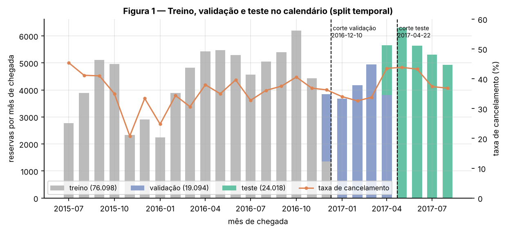
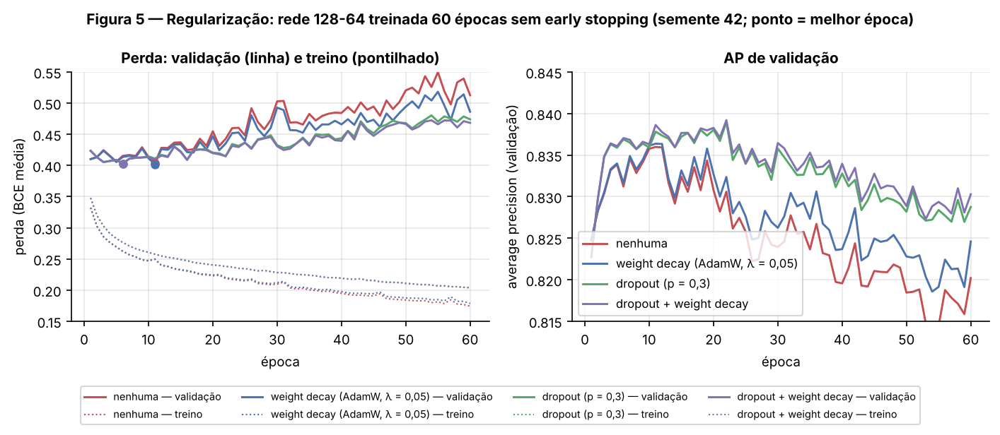
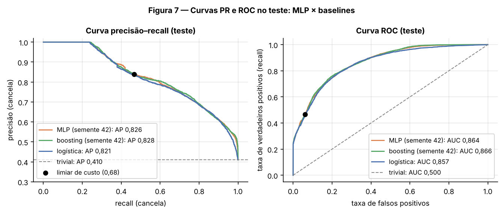
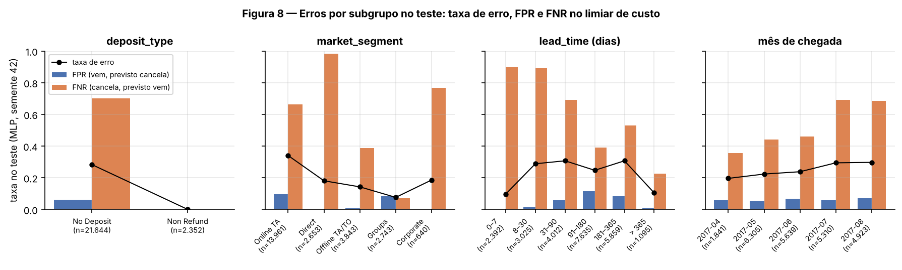

# 2. Classificação — Previsão de cancelamento

!!! abstract "Entrega 2 de 2 do [Projeto](../index.md)"

    [Projects → Classification or Regression](https://insper.github.io/ann-dl/2026.2/projects/supervised/){:target='_blank'}

!!! info "Equipe"

    | Nome completo | GitHub |
    |---------------|--------|
    | Tiago Liberman | [tiliberman](https://github.com/tiliberman) |
    | Júlia Campos | [julia-campos-ma](https://github.com/julia-campos-ma) |

    Dataset, decisões e status: [página do projeto](../index.md).

!!! info "Reprodutibilidade"

    Mesmo dataset, mesmo split temporal e mesma semente (42) da [EDA](../eda/index.md). Da raiz
    do repositório:

    ```shell
    python docs/projects/classification/code/step0_setup.py
    python docs/projects/classification/code/step1_baselines.py
    python docs/projects/classification/code/step2_network.py
    python docs/projects/classification/code/step3_training.py
    python docs/projects/classification/code/step4_search.py   # ~25 min em 2 núcleos
    python docs/projects/classification/code/step5_test.py     # único que lê o teste
    python docs/projects/classification/code/step6_errors.py
    ```

    Cada script imprime os números desta página, salva as figuras em `figures/` e os resultados em
    `results/*.json`. Versões fixadas no `requirements.txt`. Tudo é semeado, mas as métricas das
    redes podem variar na terceira casa decimal em outra máquina.

O dataset é o da [EDA](../eda/index.md): reservas de dois hotéis portugueses, de julho de 2015 a
agosto de 2017, e o alvo é `is_canceled`. O enunciado faz duas perguntas: **a rede aprende algo
que modelos mais simples não aprendem?** e **quanto confiar no número que ela reporta?** A
resposta às duas passa pela **deriva temporal** que a EDA encontrou: o modelo treina em 2015–2016
e é avaliado em 2017, quando os padrões já mudaram.

---

## Abordagem

Dois módulos compartilhados e sete scripts, um por passo, em `code/`.

| Arquivo | Conteúdo |
|---------|----------|
| `common.py` | Importa split e pipeline da EDA, cria a validação, fixa métrica, critério e custos. |
| `model.py` | A rede (`MLP`) e o laço de treino com *early stopping*. |
| `step0_setup.py` | Tamanhos dos conjuntos, Figura 1. |
| `step1_baselines.py` | Passo 1: trivial, logística e *gradient boosting*, na validação. |
| `step2_network.py` | Passo 2: parâmetros, inicialização (Figura 2), teste de sanidade. |
| `step3_training.py` | Passo 3: *learning rate* (Figura 3), *batch* e curvas (Figura 4). |
| `step4_search.py` | Passo 4: regularização (Figura 5), busca de 24 configurações, ablação. |
| `step5_test.py` | Passo 5: **o único que lê o teste** (Figuras 6 e 7). |
| `step6_errors.py` | Passo 6: erros por subgrupo e permutação (Figuras 8 e 9). |

---

## 0. Starting point

### Pipeline e split da EDA

O pré-processamento não foi refeito: `common.py` importa o `data.py` e o `pipeline.py` da EDA
(descarte das colunas de vazamento, split temporal com corte em 2017-04-22, padronização e
*one-hot*). A única diferença é que o pipeline é ajustado **só na parte do treino que treina o
modelo**, e não no treino inteiro. Com menos dados, menos categorias raras passam do mínimo de 100
reservas, e a matriz fica com **175 colunas** (193 na EDA).

```python
--8<-- "docs/projects/classification/code/common.py:protocol"
```

### Validação temporal

A validação sai do treino pela mesma regra do teste: os últimos 20% das chegadas (corte em
**2016-12-10**). Uma validação aleatória avaliaria o modelo no mesmo período do treino e poria
cópias de reservas de grupo dos dois lados.

**Tabela 1** — Os três conjuntos (`step0_setup.py`).

| Conjunto | Linhas | Chegadas | Taxa de cancelamento |
|----------|-------:|----------|---------------------:|
| Treino | 76.098 | 2015-07-01 a 2016-12-09 | 36,27% |
| Validação | 19.094 | 2016-12-10 a 2017-04-21 | 35,39% |
| Teste | 24.018 | 2017-04-22 a 2017-08-31 | 40,99% |


/// caption
**Figura 1** — Reservas por mês de chegada, coloridas pelo conjunto, e taxa de cancelamento
mensal. Conclusão: os conjuntos são fatias consecutivas do tempo. A validação é o inverno, e o
teste começa nos meses de maior cancelamento da série.
///

### Correções da EDA

Até a data da entrega (13/11/2026), a correção da EDA não tinha sido divulgada. No lugar dela,
executamos o plano que a própria EDA deixou para cada risco:

| Risco apontado na EDA | O que fizemos |
|-----------------------|---------------|
| Deriva entre treino e teste | Validação temporal (sem k-fold aleatório); métricas por mês no passo 6 |
| `previous_cancellations` é um artefato; `booking_changes` vaza | Ablação com e sem cada uma (passo 4C) |
| `Non Refund` domina a métrica | Métricas dentro de `No Deposit` (passo 6) |

### Métrica principal e critério de sucesso

Fixados em `common.py` **antes de qualquer treino**:

- **Métrica principal: *average precision* (AP, área sob a curva precisão–recall) da classe
  cancelada.** O hotel usa a previsão para ordenar reservas por risco, então importa a ordenação,
  sem limiar. A AP é a medida recomendada quando a classe positiva é minoritária; sua referência
  trivial é a prevalência (0,354 na validação, 0,410 no teste).
- **Critério de sucesso:** no teste, a AP média da rede em 5 sementes precisa superar a da
  regressão logística em **pelo menos 0,01**, e o ganho precisa ser **maior que 2 desvios-padrão
  entre sementes**. Comparamos com o baseline linear porque a pergunta é o que a não linearidade
  acrescenta. O passo 5 também compara com o *boosting*, o melhor baseline.
- **Custos e limiar:** um falso positivo (hóspede que vem e é realocado por *overbooking*) custa
  cerca de **2 diárias**; um falso negativo (quarto vazio), **1 diária**. O limiar de cada modelo é
  o que **minimiza o custo médio na validação** (grade de 0,01 a 0,99), nunca no teste.

```python
--8<-- "docs/projects/classification/code/common.py:threshold"
```

---

## 1. Baselines

Os três usam as mesmas 175 colunas, treinam no treino e são avaliados **só na validação**.

- **Trivial**: sempre "não cancela" (`DummyClassifier`, classe mais frequente).
- **Linear**: regressão logística L2, com $C = 0{,}1$ escolhido numa grade de 0,001 a 10.
- **Opcional, *gradient boosting*** (`HistGradientBoostingClassifier`): melhor de 5 combinações
  (lr 0,1, 15 folhas, 200 árvores).

**Tabela 2** — Baselines na validação, cada um no seu limiar de custo (`step1_baselines.py`).

| Modelo | AP | ROC-AUC | F1 macro | Custo / reserva | Limiar |
|--------|---:|--------:|---------:|----------------:|-------:|
| Trivial | 0,3539 | 0,5000 | 0,3925 | 0,3539 | — |
| Regressão logística | 0,8283 | 0,8824 | 0,7572 | 0,2356 | 0,51 |
| *Gradient boosting* | **0,8395** | **0,8934** | 0,7320 | **0,2330** | 0,69 |

Leitura: **o modelo linear já vai longe** (de 0,354 para 0,828 de AP), com os sinais que a EDA
apontou (`Non Refund`, Portugal, algumas agências). O *boosting* ganha +0,011, então **há algo não
linear a aprender**, mas sobra pouco espaço para a rede.

---

## 2. The network

**Tabela 3** — A rede de partida (`model.py`). A configuração final sai da busca do passo 4.

| | Escolha | Por quê |
|---|---------|---------|
| Camadas ocultas | **2**, com **128 → 64** unidades | Uma camada já é um aproximador universal; a segunda deixa a rede combinar interações (por exemplo, antecedência × segmento). O funil reduz pela metade a cada camada. Profundidade e largura são testadas no passo 4. |
| Ativação | **ReLU** | Derivada 1 nas unidades ativas: o gradiente não encolhe a cada camada como na sigmoide. |
| Inicialização | **He (Kaiming)**, $\mathrm{Var}(w) = 2/n_{\text{in}}$ | A ReLU zera metade do sinal; o fator 2 compensa (Figura 2). |
| Saída e perda | **1 logit** + **`BCEWithLogitsLoss`** | Classificação binária, como o enunciado pede. |
| Desbalanceamento | Sem pesos; `pos_weight` testado no passo 4 | Razão de 1,76 : 1, moderada; métrica (AP) e limiar já tratam o desbalanceamento. |

```python
--8<-- "docs/projects/classification/code/model.py:mlp"
```

**Parâmetros contra linhas de treino.** A rede de partida tem **30.849 parâmetros** para **76.098
linhas** de treino (0,41 por linha). A rede final do passo 4 tem 11.201 (0,15 por linha). Não são
redes grandes, mas têm capacidade para decorar o treino, como mostra o passo 3.


/// caption
**Figura 2** — Desvio-padrão da saída de cada ReLU na inicialização, com o padrão do PyTorch e
com He, na rede base e numa rede de 8 camadas. Conclusão: com o padrão, o sinal encolhe a cada
camada; com He, ele se mantém.
///

**Teste de sanidade.** Com 256 linhas de treino, a perda vai de 0,647 a 0,0019 em 1.000 passos,
com acurácia de 100%: a rede consegue decorar, então o laço de treino funciona.

---

## 3. Training

- **Otimizador: Adam.** É o padrão da aula para MLP em dados tabulares, e ajusta o passo de cada
  peso, o que ajuda com colunas *one-hot* raras. Na varredura (Figura 3), o SGD com momento não
  superou o Adam.
- **Learning rate: $3 \times 10^{-4}$.** Com lr ≥ $10^{-3}$, a perda de validação atinge o mínimo
  já na primeira época e depois só sobe. Com $3 \times 10^{-4}$, ela desce de forma contínua, e o
  *early stopping* tem uma curva para cortar.
- **Batch: 256.** Entre 64, 256 e 1.024, teve a melhor AP de validação (0,8360).
- **Épocas: até 100, com *early stopping*** na perda de validação, paciência de 10 épocas, e
  **restauração dos pesos da melhor época**. A paciência de 10 atravessa as oscilações época a
  época da Figura 4, e o teto de 100 nunca é atingido.


/// caption
**Figura 3** — Perda de validação nas 5 primeiras épocas para sete *learning rates*, com Adam
(esquerda) e SGD com Nesterov (direita). A linha pontilhada é a logística. Conclusão: com Adam, só
$10^{-4}$ e $3 \times 10^{-4}$ descem de forma contínua; o SGD não supera o Adam.
///

```python
--8<-- "docs/projects/classification/code/model.py:train"
```


/// caption
**Figura 4** — Perda de treino e de validação (esquerda) e AP de validação (direita) por época,
para a rede 128-64. As linhas pontilhadas são a logística. Conclusão: a melhor época é a **11**
(AP 0,8360), e o treino para na 21.
///

Leitura das curvas:

- **Converge:** a perda de treino desce sem oscilar.
- **O sobreajuste começa na época 11.** Depois dela, a perda de treino continua caindo, a de
  validação sobe e a AP de validação volta ao nível da logística.
- **Parte da distância entre treino e validação é deriva:** até a logística, que não decora nada,
  piora do treino para a validação. A rede piora o dobro disso; o resto é sobreajuste. Por isso,
  o passo 4 regulariza.

---

## 4. Regularization and hyperparameters

### A — Duas regularizações contra nenhuma

A rede 128-64 foi treinada 60 épocas **sem *early stopping***, com 3 sementes, em quatro versões.
A tabela mostra a melhor época (o que o *early stopping* entregaria) e a época 60.

**Tabela 4** — Regularização, média ± dp em 3 sementes (`step4_search.py`, parte A).

| Regularização | AP val. (melhor época) | AP val. (época 60) |
|---------------|-----------------------:|-------------------:|
| Nenhuma | 0,8331 ± 0,0044 | 0,8157 ± 0,0039 |
| *Weight decay* ($\lambda = 0{,}05$) | 0,8332 ± 0,0045 | 0,8192 ± 0,0049 |
| *Dropout* ($p = 0{,}3$) | 0,8360 ± 0,0011 | 0,8290 ± 0,0031 |
| *Dropout* + *weight decay* | **0,8361 ± 0,0010** | **0,8299 ± 0,0034** |


/// caption
**Figura 5** — Perda de treino e de validação e AP de validação por época, nas quatro versões
(semente 42). Conclusão: sem regularização, a validação piora muito depois do melhor ponto; o
*dropout* achata essa piora; o *weight decay* quase não se separa da versão sem nada.
///

Leitura: **o *dropout* é o que funciona.** Ele sobe a AP (+0,003), reduz o desvio entre sementes e
segura a queda depois do melhor ponto. O ***weight decay*** com $\lambda = 0{,}05$ quase não age
nas poucas épocas até o melhor ponto. E o ***early stopping*** é, ele mesmo, a regularização mais
forte: sem ele, a rede sem regularização perde 0,017 de AP até a época 60.

### B — Busca de hiperparâmetros

**24 configurações** sorteadas (semente 42) de uma grade de arquitetura, *dropout*, *weight
decay*, lr, *batch* e `pos_weight`, todas com *early stopping*, ordenadas pela AP de validação.

**Tabela 5** — As 24 configurações, ordenadas pela AP de validação (`step4_search.py`, parte B).

| # | Camadas ocultas | *Dropout* | *Weight decay* | lr | *Batch* | `pos_weight` | AP val. |
|--:|-----------------|----------:|---------------:|---:|--------:|-------------:|--------:|
| 13 | **64** | **0,3** | **0** | **3e-4** | **256** | **1** | **0,8433** |
| 7 | 128 | 0 | 1e-3 | 3e-4 | 1.024 | 1 | 0,8412 |
| 22 | 128 | 0 | 0,1 | 1e-4 | 256 | 1,757 | 0,8405 |
| 11 | 64 | 0,3 | 0 | 1e-3 | 1.024 | 1,757 | 0,8401 |
| 1 | 64 | 0,3 | 0 | 1e-4 | 256 | 1,757 | 0,8399 |
| 15 | 128 × 64 | 0,5 | 0,1 | 1e-3 | 1.024 | 1 | 0,8398 |
| 21 | 64 | 0,5 | 0 | 1e-4 | 1.024 | 1 | 0,8391 |
| 8 | 256 × 128 × 64 | 0,3 | 1e-2 | 1e-3 | 1.024 | 1,757 | 0,8389 |
| 18 | 512 × 256 | 0,3 | 0 | 1e-3 | 1.024 | 1,757 | 0,8387 |
| 16 | 256 × 128 × 64 | 0,3 | 0 | 1e-3 | 1.024 | 1 | 0,8385 |
| 6 | 128 × 64 | 0,3 | 0 | 1e-3 | 1.024 | 1 | 0,8380 |
| 14 | 256 × 128 × 64 | 0,1 | 1e-3 | 1e-3 | 1.024 | 1,757 | 0,8375 |
| 12 | 128 × 64 | 0,3 | 0,1 | 1e-4 | 256 | 1,757 | 0,8374 |
| 2 | 256 × 128 | 0 | 0 | 1e-3 | 1.024 | 1,757 | 0,8370 |
| 17 | 128 × 64 | 0,3 | 1e-3 | 3e-4 | 256 | 1 | 0,8369 |
| 20 | 256 × 128 | 0 | 1e-3 | 1e-3 | 1.024 | 1,757 | 0,8368 |
| 5 | 256 × 128 × 64 | 0 | 1e-2 | 1e-4 | 256 | 1 | 0,8350 |
| 9 | 512 × 256 | 0 | 1e-3 | 1e-4 | 256 | 1,757 | 0,8347 |
| 24 | 512 × 256 | 0 | 0 | 1e-4 | 1.024 | 1,757 | 0,8328 |
| 4 | 256 × 128 × 64 | 0,3 | 0 | 3e-4 | 256 | 1,757 | 0,8327 |
| 19 | 128 × 64 | 0 | 0,1 | 3e-4 | 1.024 | 1 | 0,8319 |
| 10 | 256 × 128 | 0,5 | 1e-3 | 1e-3 | 256 | 1 | 0,8319 |
| 3 | 512 × 256 | 0,5 | 0 | 1e-3 | 256 | 1 | 0,8317 |
| 23 | 256 × 128 × 64 | 0,1 | 0 | 3e-4 | 256 | 1 | 0,8259 |

Leituras:

- **Redes menores vencem.** As cinco primeiras têm uma camada oculta. Capacidade extra serve para
  decorar 2015–2016, o que não vale em 2017.
- **Regularização ajuda:** as cinco primeiras têm *dropout* 0,3 ou *weight decay*.
- **`pos_weight` não muda a AP**, que é de ordenação, então ficamos sem ele, por ser mais simples.

**Reteste das três primeiras com mais duas sementes.** Uma execução única favorece quem teve
sorte, então o vencedor é a melhor **média** de 3 sementes:

| # | AP val. (3 sementes) |
|--:|---------------------:|
| **13** | **0,8409 ± 0,0031** |
| 22 | 0,8401 ± 0,0019 |
| 7 | 0,8377 ± 0,0059 |

### C — Ablação das duas features de risco da EDA

Regra fixada antes de rodar: uma feature só fica se removê-la baixar a AP de validação em **mais
de 2 desvios-padrão** entre sementes.

**Tabela 6** — Ablação com a configuração 13, 3 sementes (`step4_search.py`, parte C).

| Conjunto | AP val. | Variação | Decisão |
|----------|--------:|---------:|---------|
| Todas as features | 0,8409 ± 0,0031 | — | — |
| Sem `previous_cancellations` | 0,8395 ± 0,0014 | −0,0014 | remover |
| Sem `booking_changes` | 0,8355 ± 0,0014 | −0,0054 | remover |
| Sem as duas | 0,8350 ± 0,0028 | −0,0059 | **conjunto final** |

As duas quedas ficam abaixo de 2 dp (0,0063). Além disso, as duas features trazem informação que
não existe no momento da previsão (`booking_changes` é a contagem final de alterações). **O teste
usa 173 entradas**, e os baselines são reajustados nelas.

**Configuração escolhida**: 173 → **64 (ReLU, *dropout* 0,3)** → 1 logit; Adam, lr $3 \times
10^{-4}$, *batch* 256; *early stopping* com paciência 10; **11.201 parâmetros**.

---

## 5. Test evaluation

`step5_test.py` é o **único** script que lê o teste, e o leu **uma vez**, depois de todas as
escolhas acima. **Nenhuma escolha foi influenciada pelo teste.**

A configuração escolhida foi retreinada com **5 sementes** (42 a 46), cada uma com *early stopping*
e limiar de custo na validação (limiar médio 0,70). Os baselines foram reajustados nas mesmas 173
entradas (o *boosting* é determinístico, daí desvio zero).

**Tabela 7** — Teste, média ± dp em 5 sementes, cada modelo no seu limiar de validação
(`step5_test.py`).

| Modelo | AP | ROC-AUC | F1 macro | Precisão (cancela) | Recall (cancela) | Custo / reserva |
|--------|---:|--------:|---------:|-------------------:|-----------------:|----------------:|
| Trivial | 0,4099 | 0,5000 | 0,3711 | — | 0,0000 | 0,4099 |
| Regressão logística | 0,8207 | 0,8572 | 0,7079 | 0,8350 | 0,4721 | 0,2928 |
| *Gradient boosting* | 0,8277 | 0,8662 | **0,7371** | 0,8135 | **0,5473** | **0,2884** |
| **MLP (64, *dropout* 0,3)** | **0,8283 ± 0,0023** | **0,8667 ± 0,0022** | 0,7081 ± 0,0155 | **0,8425 ± 0,0088** | 0,4696 ± 0,0343 | 0,2896 ± 0,0057 |

**Tabela 8** — Precisão, recall e F1 por classe da MLP no teste (média ± dp, 5 sementes).

| Classe | Precisão | Recall | F1 |
|--------|---------:|-------:|---:|
| Não cancela (0) | 0,7184 ± 0,0115 | 0,9388 ± 0,0079 | 0,8139 ± 0,0047 |
| Cancela (1) | 0,8425 ± 0,0088 | 0,4696 ± 0,0343 | 0,6023 ± 0,0264 |
| **Macro** | | | **0,7081 ± 0,0155** |


/// caption
**Figura 6** — Matriz de confusão da MLP (semente 42) e métricas por classe dos três modelos.
Conclusão: a rede quase não erra quem vem (876 falsos positivos), mas deixa passar mais da metade
dos cancelamentos (5.263 falsos negativos).
///


/// caption
**Figura 7** — Curvas precisão–recall e ROC no teste da MLP, do *boosting* e da logística.
Conclusão: as três curvas quase se sobrepõem. As três têm precisão 1,0 no começo: são as
reservas *Non Refund*, que qualquer modelo acerta.
///

### O critério do passo 0 foi atingido?

**Não.** A AP da rede é **0,8283 ± 0,0023**, contra **0,8207** da logística: ganho de **+0,0076**.
O ganho é real, porque é maior que 2 desvios-padrão (0,0046), mas fica **abaixo do mínimo de 0,01**.
Contra o melhor baseline, o *boosting* (0,8277), o ganho é de +0,0006: **empate**.

Quanto confiar no número:

1. **O ganho encolheu da validação para o teste** (+0,013 na validação, +0,0076 no teste). Duas
   causas: escolher muitas configurações na validação deixa o número dela otimista, e o teste está
   mais longe do treino no tempo.
2. **O limiar é conservador no teste.** Escolhido no inverno (validação), ele deixa o recall dos
   cancelamentos em 0,47 no verão (teste), onde se cancela mais. É por isso que o F1 macro da MLP
   fica abaixo do *boosting*, cujo limiar caiu mais baixo, mesmo com a mesma AP.

---

## 6. Error analysis

A análise usa a rede da semente 42 (limiar 0,68, erro de 25,6%). Nada daqui volta para o modelo.

### A — Erros por subgrupo

**Tabela 9** — Erros por subgrupo no teste (`step6_errors.py`, parte A). Erro = 1 − acurácia;
FPR = falsos positivos ÷ quem veio; FNR = falsos negativos ÷ quem cancelou.

| Variável | Nível | n | Taxa real | Prob. média | Erro | FPR | FNR |
|----------|-------|--:|----------:|------------:|-----:|----:|----:|
| `deposit_type` | No Deposit | 21.644 | 0,345 | 0,276 | 0,283 | 0,062 | 0,702 |
| | Non Refund | 2.352 | 1,000 | 0,996 | **0,000** | — | 0,000 |
| `market_segment` | **Online TA** | 13.961 | 0,430 | 0,343 | **0,340** | 0,097 | 0,663 |
| | Direct | 2.653 | 0,184 | 0,141 | 0,181 | 0,000 | **0,984** |
| | Offline TA/TO | 3.843 | 0,354 | 0,306 | 0,143 | 0,008 | 0,387 |
| | Groups | 2.743 | 0,661 | 0,672 | 0,076 | 0,085 | 0,072 |
| | Corporate | 640 | 0,242 | 0,189 | 0,186 | 0,000 | 0,768 |
| `hotel` | Resort Hotel | 7.555 | 0,356 | **0,224** | 0,298 | 0,015 | 0,810 |
| | City Hotel | 16.463 | 0,434 | 0,402 | 0,236 | 0,086 | 0,431 |
| `lead_time` (dias) | 0–7 | 2.392 | 0,108 | 0,111 | 0,097 | 0,000 | 0,900 |
| | 8–30 | 3.025 | 0,310 | 0,208 | 0,289 | 0,017 | 0,893 |
| | 31–90 | 4.012 | 0,394 | 0,310 | 0,307 | 0,057 | 0,692 |
| | 91–180 | 7.635 | 0,479 | 0,452 | 0,247 | **0,114** | 0,392 |
| | 181–365 | 5.859 | 0,501 | 0,391 | 0,307 | 0,083 | 0,530 |
| | > 365 | 1.095 | 0,435 | 0,393 | 0,105 | 0,011 | 0,227 |
| Mês de chegada | 2017-04 (desde o dia 22) | 1.841 | 0,460 | 0,405 | 0,196 | 0,059 | 0,357 |
| | 2017-05 | 6.305 | 0,438 | 0,370 | 0,223 | 0,053 | 0,442 |
| | 2017-06 | 5.639 | 0,432 | 0,378 | 0,238 | 0,068 | 0,462 |
| | 2017-07 | 5.310 | 0,374 | 0,298 | 0,294 | 0,057 | 0,692 |
| | 2017-08 | 4.923 | 0,368 | 0,310 | 0,297 | 0,071 | 0,685 |


/// caption
**Figura 8** — Taxa de erro, FPR e FNR no teste por `deposit_type`, `market_segment`, faixa de
`lead_time` e mês de chegada. Conclusão: os erros são quase todos falsos negativos.
///

Padrões e hipóteses:

1. **O número global esconde um problema mais difícil.** A rede acerta todas as reservas *Non
   Refund*, que quase sempre cancelam. **Dentro de `No Deposit`** (90% do teste), a AP cai para
   **0,668**. *Hipótese*: a AP global de 0,83 é inflada por esse subconjunto fácil.
2. **O maior erro está em `Online TA`: 34,0%.** A rede deixa passar 66% dos cancelamentos.
   *Hipótese*: essas reservas têm cancelamento gratuito e são canceladas por motivos que não estão
   nos dados (um preço melhor achado depois, uma mudança de planos).
3. **O erro sobe mês a mês**, de 19,6% em abril para 29,7% em agosto, e o *Resort Hotel* é o mais
   subestimado (probabilidade média 0,224 para uma taxa real de 0,356). *Hipótese*: no verão de
   2017, o *Resort* passou a cancelar mais do que o padrão de 2015–2016 indicava.
4. **A rede é subconfiante em quase todo subgrupo** (probabilidade média abaixo da taxa real).
   *Hipótese*: a prevalência subiu de 36% no treino para 41% no teste, e o modelo ficou com a
   prevalência antiga.

### B — Os piores exemplos

- **Falsos positivos mais confiantes** ($p \geq 0{,}9$, mas o hóspede veio): 25 reservas, todas
  `No Deposit`, quase todas `Online TA` e do City Hotel, com antecedência longa e nenhum pedido
  especial; muitas da agência 9. *Hipótese*: esse perfil cancelava em 2015–2016 e, em 2017, parte
  dele passou a se concretizar.
- **Falsos negativos mais confiantes** ($p \leq 0{,}1$, mas cancelou): 556 reservas, 84% com
  pedidos especiais, o sinal mais forte de "vai vir" na EDA. *Hipótese*: eram clientes engajados,
  e o cancelamento veio de algo externo à reserva, que nenhuma coluna captura.

### C — Importância por permutação comparada à EDA

Cada feature foi embaralhada antes do pipeline (todas as colunas *one-hot* juntas), e a importância
é a queda de AP no teste, em 5 repetições.

**Tabela 10** — Importância por permutação e posição da feature no ranking de associação da EDA
(`step6_errors.py`, parte C). As 5 primeiras e a última de 24.

| Posição | Feature | Queda de AP | Posição na EDA |
|--------:|---------|------------:|---------------:|
| 1 | `deposit_type` | 0,0863 | 1 |
| 2 | `country` | 0,0762 | 3 |
| 3 | `total_of_special_requests` | 0,0621 | 6 |
| 4 | `agent` | 0,0447 | 2 |
| 5 | `lead_time` | 0,0343 | 4 |
| 24 | `hotel` | **−0,0040** | 8 |


/// caption
**Figura 9** — Importância por permutação das 15 features mais importantes (esquerda) e a mesma
importância contra a associação com o alvo na EDA (direita). Conclusão: os dois rankings concordam
(Spearman 0,65).
///

Leituras:

- **A rede confirma a EDA:** quatro das cinco features mais importantes (depósito, país, agência e
  antecedência) estão entre as cinco primeiras da EDA.
- **`total_of_special_requests` sobe** para o 3.º lugar: é ela que separa, dentro de `No Deposit`,
  quem está engajado de quem não está.
- **`hotel` tem importância negativa:** embaralhá-la *melhora* a AP no teste. É o sinal mais
  direto de deriva: a diferença entre City e Resort aprendida em 2015–2016 encolheu em 2017.

---

## 7. Conclusion

**A rede valeu a pena? Pelo critério fixado antes de treinar, não.** Ela supera a logística de
forma consistente (+0,0076 de AP, acima de 2 desvios), mas abaixo do mínimo de 0,01, e empata com
o *gradient boosting*, que treina em segundos. A maior parte do sinal é aditiva (depósito, país,
agência, antecedência, pedidos), e um modelo linear já a captura. A lição principal é sobre
**tempo**: redes menores vencem, a validação piora cedo e `hotel` atrapalha no teste, porque a
capacidade extra da rede é gasta decorando o período de treino.

**Limitações**

- Uma única janela de validação e de teste.
- Os custos (falso positivo = 2, falso negativo = 1) são uma suposição da equipe, não um dado do
  hotel.
- A rede é subconfiante em 2017 e não foi recalibrada.

**Quem é afetado pelos erros**

- **Falsos positivos atingem hóspedes:** quem vem e é realocado. A taxa é maior nas reservas de 91
  a 180 dias de antecedência (11,4%) e em `Online TA` (9,7%).
- **O país é a 2.ª feature mais importante.** Usar nacionalidade para decidir quem pode ser
  realocado é um problema de equidade; antes de usar o modelo, o hotel deveria auditar as decisões
  por país.
- **Falsos negativos atingem o hotel**, como quartos vazios e receita perdida.

**Com mais tempo**

1. Retreinar e recalibrar periodicamente com os meses mais recentes, revendo o limiar a cada
   estação.
2. Reconstruir `booking_changes` na data da previsão, em vez de descartar a feature.
3. Testar *embeddings* para `agent` e `country` no lugar do *one-hot*.

### Referências

ANTONIO, N.; ALMEIDA, A. de; NUNES, L. Hotel booking demand datasets. **Data in Brief**, v. 22,
p. 41–49, 2019. DOI: 10.1016/j.dib.2018.11.126.

HE, K. *et al.* Delving deep into rectifiers: surpassing human-level performance on ImageNet
classification. *In*: IEEE ICCV, 2015. p. 1026–1034.

INSPER. **Redes Neurais Artificiais e Deep Learning — 2026.2**. São Paulo: Insper, 2026.
Disponível em: <https://insper.github.io/ann-dl/2026.2/>. Acesso em: 10 nov. 2026.

KINGMA, D. P.; BA, J. Adam: a method for stochastic optimization. *In*: ICLR, 2015.

MOSTIPAK, J. **Hotel booking demand**. Kaggle, 2020. Disponível em:
<https://www.kaggle.com/datasets/jessemostipak/hotel-booking-demand>. Acesso em: 10 nov. 2026.

SRIVASTAVA, N. *et al.* Dropout: a simple way to prevent neural networks from overfitting.
**Journal of Machine Learning Research**, v. 15, n. 56, p. 1929–1958, 2014.

### Results summary

| # | Results summary | Value |
|---|-----------------|-------|
| 1 | Dataset, task, target, and main metric | Hotel Booking Demand (Antonio; Almeida; Nunes, 2019); classificação binária; `is_canceled`; *average precision* (PR-AUC) da classe cancelada |
| 2 | Train / validation / test row counts | 76.098 / 19.094 / 24.018 |
| 3 | Best baseline and its test metric | *Gradient boosting*: AP 0,8277 no teste (logística: 0,8207; trivial: 0,4099) |
| 4 | Chosen network: layers × units, parameter count, regularization | 173 → 64 (ReLU) → 1 logit; 11.201 parâmetros; *dropout* 0,3 + *early stopping* (paciência 10) |
| 5 | Optimizer, learning rate, batch size, and the epoch where training stopped | Adam, lr $3 \times 10^{-4}$, *batch* 256; parada nas épocas 22, 31, 24, 24 e 30 (pesos restaurados das épocas 12, 21, 14, 14 e 20) |
| 6 | Network's main test metric (mean ± std over seeds) | AP 0,8283 ± 0,0023 (5 sementes) |
| 7 | Whether the success criterion was met | **Não**: +0,0076 de AP sobre a logística, acima de 2 dp (0,0046) mas abaixo do mínimo de 0,01. Contra o *boosting*, +0,0006 |
| 8 | Subgroup with the largest error and its value | `market_segment = Online TA`: taxa de erro de 34,0% (n = 13.961) |
