# 1. EDA — Análise Exploratória

!!! abstract "Entrega 1 de 3 do [Projeto](../index.md)"

    [Projects → EDA](https://insper.github.io/ann-dl/){:target='_blank'}

!!! info "Equipe"

    | Nome completo | GitHub |
    |---------------|--------|
    | Tiago Liberman | [tiliberman](https://github.com/tiliberman) |
    | Júlia Campos | [julia-campos-ma](https://github.com/julia-campos-ma) |

    Dataset, decisões e status: [página do projeto](../index.md).

!!! info "Reprodutibilidade"

    O arquivo bruto é `data/hotel/hotel_bookings.csv` (16,9 MB, 119.390 linhas × 32 colunas),
    versionado no repositório: é o `hotel_bookings.csv` do
    [Kaggle](https://www.kaggle.com/datasets/jessemostipak/hotel-booking-demand){:target='_blank'},
    byte a byte igual à cópia pública do
    [TidyTuesday 2020-02-11](https://github.com/rfordatascience/tidytuesday/tree/master/data/2020/2020-02-11){:target='_blank'},
    de onde um clone limpo pode baixá-lo sem login caso o arquivo falte. A semente 42 é usada
    em tudo o que sorteia (amostra das projeções, t-SNE, UMAP); o split em si é temporal e
    não sorteia nada. Rodando, a partir da raiz do repositório,

    ```shell
    python docs/projects/eda/code/stage1_inspection.py
    python docs/projects/eda/code/stage2_univariate.py
    python docs/projects/eda/code/stage3_bivariate.py
    python docs/projects/eda/code/pipeline.py
    python docs/projects/eda/code/stage4_projections.py
    ```

    (cerca de 70 s no total, 50 deles no último), todos os números desta página são
    impressos e as 15 figuras são regeradas em `figures/`. Versões: Python 3.12.10, pandas
    3.0.5, NumPy 2.5.3, scikit-learn 1.7.2, Matplotlib 3.11.2, umap-learn 0.5.12 (numba
    0.67.0), fixadas no `requirements.txt`. Tudo é determinístico exceto t-SNE e UMAP: mesmo com
    essas versões, a pureza de vizinhança e a contagem de ilhas da seção 4B variam na terceira casa
    decimal entre plataformas (Windows × Linux), por isso esses números aparecem arredondados.
    Nenhum modelo é treinado nesta entrega.

O dataset reúne as reservas de dois hotéis portugueses entre julho de 2015 e agosto de 2017, e
a pergunta é **se uma reserva será cancelada**. O fio condutor da análise é a **fronteira entre
o que o hotel sabe no momento da reserva e o que ele só sabe depois**: quatro colunas do arquivo
registram o desfecho (ou só mudam para quem de fato chegou) e precisam sair antes de qualquer
estatística, uma quinta (`previous_cancellations`) se comporta como vazamento sem parecer, e o
próprio split precisa respeitar o tempo, porque o uso real do modelo é prever o futuro a partir
do passado.

---

## Abordagem

O código está em seis arquivos em `code/`, todos rodados a partir da raiz do repositório:

| Arquivo | Conteúdo |
|---------|----------|
| `data.py` | Carrega o CSV, aplica as regras fixas de limpeza (`clean`) e faz **o único split** da entrega (`split`). Todos os outros scripts importam `load_split()` daqui; a entrega de classificação fará o mesmo. |
| `stage1_inspection.py` | Estágio 1: checagem do dicionário, qualidade, alvo e split. Figuras 1–2. |
| `stage2_univariate.py` | Estágio 2: estatísticas de todas as numéricas e frequências de todas as categóricas, só no treino. Figuras 3–6. |
| `stage3_bivariate.py` | Estágio 3: Spearman, taxa de cancelamento por categoria (com V de Cramér), boxplots agrupados. Figuras 7–12. |
| `pipeline.py` | `build_preprocessor()` importável: `ColumnTransformer` com quatro `Pipeline`s (itens 4A e 4C). Rodado, ajusta no treino, transforma os dois lados e imprime as checagens. |
| `stage4_projections.py` | PCA, t-SNE e UMAP sobre a saída do pipeline. Figuras 13–15. |

Três decisões atravessam a página e são justificadas onde aparecem: o split é **temporal**
(seção 1D), as **duplicatas são mantidas** (seção 1B) e **cinco colunas são descartadas**
antes de qualquer estatística (seção 1B).

---

## 0. Proposal

Como equipe de alunos de Administração, buscamos um dataset com uma pergunta de negócio
concreta, em que o resultado do modelo se traduzisse diretamente numa decisão gerencial. Testamos
alguns candidatos em análises exploratórias rápidas, feitas com apoio do Claude (ver `ai_use`), e
este foi o mais adequado ao projeto por três motivos: (i) o problema é real e mensurável —
cancelamentos obrigam o hotel a praticar *overbooking* e geram perda de receita; (ii) os dados
dão material a **todos** os itens do roteiro — ausentes com significado, duplicatas, outliers,
categorias de alta cardinalidade e uma história de vazamento clara; e (iii) cada variável está
documentada num artigo revisado por pares, e o arquivo (16,9 MB) cabe no repositório. Foi o único
dataset submetido na proposta.

| Campo | Valor |
|-------|-------|
| **Dataset** | Hotel Booking Demand (Antonio, de Almeida & Nunes, 2019), via Kaggle |
| **URL** | <https://www.kaggle.com/datasets/jessemostipak/hotel-booking-demand> · artigo: <https://doi.org/10.1016/j.dib.2018.11.126> · licença CC BY 4.0 |
| **Linhas × colunas** | 119.390 × 32 (bruto) → 119.210 × 26 features + alvo após a limpeza da seção 1B |
| **Alvo** | `is_canceled` (1 = reserva cancelada ou *no-show*): 37,1% das linhas |
| **Features numéricas / categóricas** | 14 numéricas / 12 categóricas depois dos descartes; no arquivo bruto o pandas lê 20 colunas numéricas (incluindo o alvo e três códigos) e 12 de texto |
| **Primeiro risco** | Vazamento: `reservation_status` é o alvo com outro nome, e 26,8% das linhas são cópias exatas, na maioria de reservas de grupo |

---

## 1. Initial inspection

### A — Data dictionary

**Fonte.** Dois hotéis em Portugal, um *resort* no Algarve e um hotel urbano em Lisboa,
extraídos do sistema de gestão (PMS) dos hotéis pelos autores do artigo e anonimizados. **Cada
linha é uma reserva** (não um hóspede nem uma estadia) com chegada prevista entre 2015-07-01 e
2017-08-31, cancelada ou não. Não há identificador de cliente nem de reserva, então a mesma
pessoa pode aparecer em várias linhas sem que isso seja detectável.

A Tabela 1 segue o artigo; a coluna "no arquivo" diz como o pandas lê a coluna, e a última
marca o que fizemos com ela. Três colunas numéricas no arquivo são **códigos, não
quantidades**: `agent` e `company` são IDs de agência e empresa lidos como `float64` (porque
têm NaN), e `is_repeated_guest` é um *flag* 0/1. `arrival_date_month` é o nome do mês por
extenso, em inglês. O artigo não informa a moeda de `adr`; sendo hotéis portugueses,
assumimos euros.

**Tabela 1** — Dicionário de dados.

| Feature | Significado | No arquivo | Tipo real | Unidade | Decisão |
|---------|-------------|-----------|-----------|---------|---------|
| `hotel` | Resort Hotel (Algarve) ou City Hotel (Lisboa) | str, 2 níveis | categórica | — | mantida |
| `is_canceled` | 1 se a reserva foi cancelada ou o hóspede não apareceu | int 0/1 | **alvo** | — | alvo |
| `lead_time` | dias entre a entrada da reserva no PMS e a chegada | int, 0–737 | numérica | dias | mantida |
| `arrival_date_year` | ano da chegada | int, 2015–2017 | numérica | ano | só para montar `arrival_date`; descartada (seção 1B) |
| `arrival_date_month` | mês da chegada, por extenso | str, 12 níveis | categórica | — | mantida |
| `arrival_date_week_number` | número da semana do ano da chegada (numeração própria do PMS, não a ISO) | int, 1–53 | numérica | semana | mantida |
| `arrival_date_day_of_month` | dia do mês da chegada | int, 1–31 | numérica | dia | mantida |
| `stays_in_weekend_nights` | noites de sábado/domingo reservadas (ou efetivadas, para quem chegou) | int, 0–19 | numérica | noites | mantida |
| `stays_in_week_nights` | noites de segunda a sexta reservadas (idem) | int, 0–50 | numérica | noites | mantida |
| `adults`, `children`, `babies` | pessoas na reserva, por faixa | int / float / int | numéricas | pessoas | mantidas; `children` tem 4 NaN |
| `meal` | pacote de refeições: BB (café), HB (meia pensão), FB (pensão completa), SC/Undefined (sem) | str, 5 níveis | categórica | — | `Undefined` → `SC` (o artigo define os dois como "sem refeição") |
| `country` | país de origem, ISO 3166-1 alpha-3 | str, 177 níveis | categórica | — | `CN` (alpha-2) → `CHN`; 488 NaN → nível `unknown` |
| `market_segment` | segmento de mercado (TA = agência, TO = operadora) | str, 8 níveis | categórica | — | mantida |
| `distribution_channel` | canal de distribuição da reserva | str, 5 níveis | categórica | — | mantida |
| `is_repeated_guest` | 1 se o cliente já se hospedou antes | int 0/1 | categórica (flag) | — | tratada como categórica |
| `previous_cancellations` | reservas anteriores do cliente que foram canceladas | int, 0–26 | numérica | reservas | mantida, com ressalva forte (seções 1B e 5) |
| `previous_bookings_not_canceled` | reservas anteriores do cliente que não foram canceladas | int, 0–72 | numérica | reservas | mantida |
| `reserved_room_type` | código (anonimizado) do tipo de quarto reservado | str, 10 níveis | categórica | — | mantida |
| `assigned_room_type` | tipo de quarto atribuído; difere do reservado por *overbooking* ou pedido do cliente | str, 12 níveis | categórica | — | **descartada: vazamento** |
| `booking_changes` | alterações feitas na reserva até o check-in ou o cancelamento | int, 0–21 | numérica | alterações | mantida, com ressalva (seção 5) |
| `deposit_type` | No Deposit; Non Refund (depósito igual ao valor total da estadia); Refundable (depósito menor que o valor total) | str, 3 níveis | categórica | — | mantida |
| `agent` | ID da agência de viagens que fez a reserva | float, 333 valores | categórica (código) | — | NaN → nível `none` (sem agência) |
| `company` | ID da empresa responsável pela reserva ou pelo pagamento | float, 352 valores | categórica (código) | — | NaN → nível `none` (sem empresa) |
| `days_in_waiting_list` | dias em lista de espera até a confirmação | int, 0–391 | numérica | dias | mantida |
| `customer_type` | Contract, Group, Transient ou Transient-Party | str, 4 níveis | categórica | — | mantida |
| `adr` | *average daily rate*: receita de hospedagem ÷ noites | float, −6,38–5.400 | numérica | € por noite (assumido) | mantida |
| `required_car_parking_spaces` | vagas de estacionamento | int, 0–8 | numérica | vagas | **descartada: vazamento** |
| `total_of_special_requests` | pedidos especiais (berço, andar alto, …) | int, 0–5 | numérica | pedidos | mantida |
| `reservation_status` | Canceled, Check-Out ou No-Show | str, 3 níveis | — | — | **descartada: é o alvo** |
| `reservation_status_date` | data da última mudança de status | str (data) | — | — | **descartada: vazamento** |

As faixas e os tipos acima vêm da checagem automática do script (`dictionary`), reproduzida
abaixo:

```python
--8<-- "docs/projects/eda/code/stage1_inspection.py:dictionary"
```

### B — Quality

**Ausentes.** Só quatro colunas têm NaN, e os dois casos grandes **não são aleatórios**: o
artigo define NaN em `agent` e `company` como "não houve agência/empresa", o que os dados
confirmam.

**Tabela 2** — Valores ausentes no arquivo bruto.

| Feature | Ausentes | % | Padrão |
|---------|---------:|--:|--------|
| `company` | 112.593 | 94,31% | **Estrutural.** Onde há empresa, 65,8% das reservas são `Corporate` e 20,5% `Groups`; a ausência é "reserva sem empresa", não desconhecimento. |
| `agent` | 16.340 | 13,69% | **Estrutural.** As linhas sem agência são 36,8% `Direct`, 28,1% `Corporate` e 25,4% `Groups`: justamente os segmentos que não passam por agência. |
| `country` | 488 | 0,41% | Não aleatório em relação ao alvo: essas linhas cancelam 13,7%, contra 37,0% no geral. Pequeno demais para importar; vira o nível `unknown`. |
| `children` | 4 | 0,00% | Quatro reservas do City Hotel em 2015. Imputado pela mediana (0) no pipeline. |

Há também ausência disfarçada de categoria: `meal` tem 1.169 linhas `Undefined` (0,98%, todas
do Resort Hotel), que o artigo equipara a `SC`; `market_segment` (2) e `distribution_channel`
(5) têm `Undefined` em quantidade desprezível e ficam como estão.

**Duplicatas.** 31.994 linhas (26,80%) são cópias exatas de outra; há 87.396 linhas distintas.
Como não há ID de reserva nem de cliente, duas linhas iguais podem ser a mesma reserva
contada duas vezes ou duas reservas idênticas. Os dados apontam para a segunda hipótese:
entre as 40.165 linhas que têm pelo menos uma cópia, 72,0% são de `Groups` ou `Offline TA/TO`
(contra 36,9% no arquivo todo), o maior bloco idêntico tem 180 linhas, e a taxa de
cancelamento é 58,4% (26,2% nas linhas sem cópia). É o retrato de **grupos reservados e
cancelados em bloco**. Por isso as mantivemos: removê-las levaria o alvo de 37,0% para 27,5%
e apagaria exatamente as reservas de maior risco. O custo, uma mesma entidade dos dois lados
do split, é resolvido pelo split temporal (seção 1D).

**Valores impossíveis ou inconsistentes.**

| Problema | Linhas | Decisão |
|----------|-------:|---------|
| `adults == 0` | 403 | 223 delas têm crianças ou bebês e ficam; as **180 com zero pessoas** no total são removidas em `clean()`, porque uma reserva sem hóspede não é uma observação. |
| `adults > 4` (máx. 55) | 16 | mantidas; o recorte de outliers (seção 4A) as leva a 3 |
| `babies ≥ 9` ou `children ≥ 9` | 3 | mantidas; o recorte as leva a 1 e 2 |
| total de noites = 0 | 715 (0,60%) | mantidas: *day use* existe e o artigo não as exclui |
| `adr < 0` | 1 (−6,38) | recortada para 0 na seção 4A |
| `adr == 0` | 1.959 (1,64%) | mantidas: 680 são `Complementary` (cortesia); as outras 1.279 se espalham por Online TA (367), Offline TA/TO (332), Groups (252), Direct (240), Corporate (82) e Aviation (6), sem um padrão único, e a causa não é documentada |
| `adr > 1.000` | 1 (5.400; a segunda maior é 510) | erro de digitação; recortada na seção 4A |
| `country` com código de duas letras | 1.279 (`CN`, ao lado de 999 `CHN`) | mesmo país em dois códigos; `CN` → `CHN` em `clean()`. As taxas de cancelamento diferem (19,9% × 46,2%), o que sugere duas épocas ou dois sistemas de registro, mas o nível é um só. |
| `previous_cancellations > 0` sem ser hóspede repetido | 5.557 de 6.484 (85,7%) | contradiz a definição "reservas anteriores **do cliente**": das 6.484 linhas com valor > 0, 80,3% estão em blocos de cópias exatas, e a taxa de cancelamento delas cai de 99,0% (2015) e 85,0% (2016) para 17,3% (2017). Tudo indica que o campo conta os outros quartos cancelados de um mesmo bloco de grupo. Mantida como feature, mas é o principal risco da seção 5. |

**Vazamento.** As cinco colunas da tabela abaixo são descartadas em `clean()`, antes de
qualquer estatística. As duas primeiras são o desfecho; as duas seguintes se comportam como
se só fossem preenchidas para quem **chegou**, e a última é um proxy do tempo.

| Coluna descartada | Evidência |
|-------------------|-----------|
| `reservation_status` | `Check-Out` ⇔ `is_canceled = 0` (75.166 linhas) e `Canceled`/`No-Show` ⇔ `is_canceled = 1` (43.017 + 1.207): acurácia 100%. |
| `reservation_status_date` | Para reservas canceladas é a data do cancelamento; é anterior ou igual à chegada em 37,6% das linhas, quase exatamente a taxa de cancelamento. |
| `assigned_room_type` | Difere do reservado em 14.917 linhas, e essas cancelam **5,4%** contra 41,6% das demais. O artigo atribui a troca a *overbooking* ou pedido do cliente; 802 reservas canceladas também têm quarto trocado, então a troca não é exclusiva de quem chegou, mas a assimetria só se explica se a atribuição acontecer sobretudo no check-in. |
| `required_car_parking_spaces` | 7.416 reservas pedem vaga e **nenhuma** delas foi cancelada (0,0%). Nossa hipótese é que o campo é registrado na chegada (ou zerado no cancelamento); de um jeito ou de outro, ele carrega o desfecho. |
| `arrival_date_year` | Não é vazamento, mas em produção o ano é sempre um valor que o modelo nunca viu; e, embora 17,4% do treino também seja de 2017, no teste o ano é constante. Serve só para montar `arrival_date`. |

!!! danger "`booking_changes`: vazamento parcial"

    Quem alterou a reserva cancela 15,7% (18.076 linhas), contra 40,9% de quem não alterou. O
    artigo define a coluna como alterações "até o check-in ou o cancelamento", então o valor
    armazenado é a **contagem final**, que nenhum momento anterior de previsão enxerga, e uma
    reserva cancelada tem menos tempo para acumular alterações. Mantivemos a coluna porque
    alterações feitas até a data da previsão são informação legítima, mas ela entra na tabela
    de riscos da seção 5 com um plano: a entrega de classificação deve medir o modelo com e
    sem ela.

```python
--8<-- "docs/projects/eda/code/data.py:columns"
```

```python
--8<-- "docs/projects/eda/code/data.py:clean"
```

Depois da limpeza: **119.210 linhas × 26 features** (14 numéricas, 12 categóricas), mais o
alvo e a `arrival_date` usada só no split.

### C — Target

No conjunto limpo, 75.011 reservas não canceladas (62,92%) e 44.199 canceladas (37,08%):
razão maior/menor de **1,70** (no arquivo bruto a taxa é 37,0%). No treino (seção 1D) a proporção é 63,91% / 36,09%, razão 1,77;
no teste, 59,01% / 40,99%. Um classificador que sempre responde "não cancela" acerta
**63,91%** do treino e **59,01%** do teste, e é essa a régua mínima da próxima entrega:
acurácia só interessa acima disso, e, com um terço de positivos, *recall* e *precision* da
classe cancelada contam mais que a acurácia.

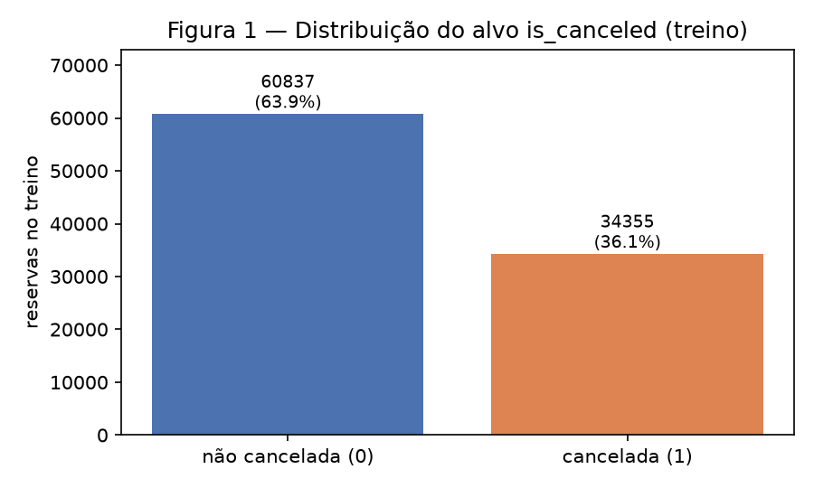
/// caption
**Figura 1** — Distribuição de `is_canceled` no treino. Conclusão: o desbalanceamento é
moderado (1,77 : 1), não exige reamostragem, mas invalida a acurácia como métrica única.
///

### D — Train and test

O split é **temporal**, em `data.split`: as reservas são ordenadas pela data de chegada e os
últimos 20% viram teste. O corte cai em **2017-04-22**, em dia inteiro: treino com **95.192
linhas** (79,85%, chegadas de 2015-07-01 a 2017-04-21) e teste com **24.018** (20,15%, de
2017-04-22 a 2017-08-31). Antes dele só rodam as **regras fixas** de `clean()` (remover
reservas sem hóspede, fundir dois códigos do mesmo nível, descartar colunas), que não usam
estatística nenhuma; toda **estatística ajustada** (quantis de recorte, mediana de imputação,
categorias conhecidas, média e desvio da escala) é calculada só no treino, e as seções 2 a 4
usam só o treino.

```python
--8<-- "docs/projects/eda/code/data.py:split"
```

Três razões para temporal em vez de aleatório-estratificado:

1. **É o uso real.** O hotel quer prever cancelamentos de reservas futuras com o histórico;
   um split aleatório avaliaria o modelo em reservas contemporâneas às de treino.
2. **Entidades repetidas.** Não há ID de cliente nem de reserva, mas cada data de chegada
   reúne em média 150 reservas, e as cópias de uma reserva de grupo compartilham a data. Com o
   corte em dia inteiro, **nenhuma** linha de teste tem cópia idêntica (nas 26 features e no
   alvo) no treino; num split aleatório estratificado com a mesma semente, **7.940 linhas de
   teste (33,30%)** teriam. Um modelo que decorasse o treino pareceria ótimo sem ser.
3. **Níveis novos aparecem de verdade.** No teste há 12 países (18 linhas, 0,07%), 22
   agências (261 linhas, 1,09%) e 20 empresas (58 linhas, 0,24%) inexistentes no treino, o
   que obriga o encoding da seção 4A a lidar com nível desconhecido.

O preço é a **deriva**: a taxa de cancelamento no teste é 40,99%, contra 36,09% no treino. Não
é sazonalidade: a mesma janela de calendário um ano antes (2016-04-22 a 2016-08-31, 22.249
reservas) cancelou 36,5%, praticamente a média do treino (36,1%). É uma mudança de um ano para o outro, e
vem acompanhada de outras: a fatia de Portugal cai de 43,4% para 29,8% das reservas (base: todas as linhas), a de
`Non Refund` de 12,9% para 9,8%, e `previous_cancellations > 0` passa de 6,66% das linhas
(93,3% canceladas) para 0,60% (21,7% canceladas). O modelo será avaliado numa população
diferente da de treino, o que vai para a tabela de riscos.

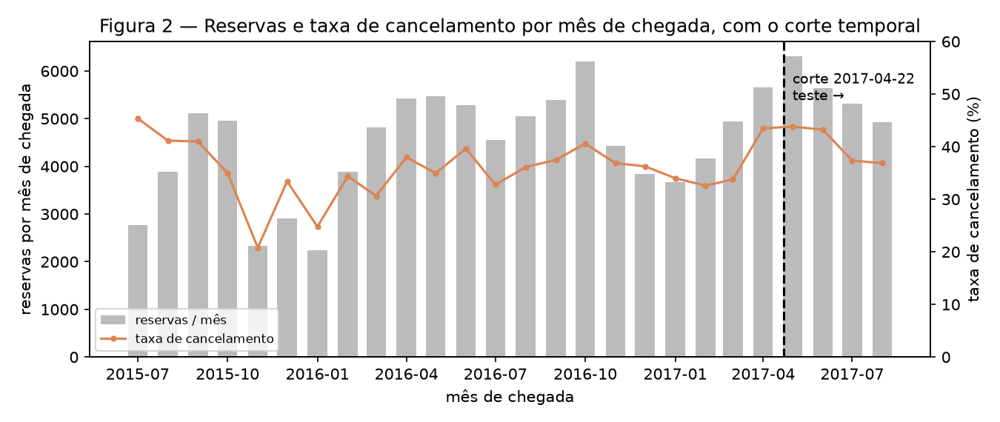
/// caption
**Figura 2** — Reservas por mês de chegada (barras) e taxa de cancelamento mensal (linha), com
o corte do split. A taxa vai de 20,8% (2015-11) a 45,4% (2015-07); abril de 2017 (cortado
pelo split) tem 43,5%, e os quatro meses inteiros do teste têm 43,8%, 43,2%, 37,4% e 36,8%.
Conclusão: os três primeiros meses do teste estão entre os de maior taxa da série, e isso não se repete nos mesmos meses de 2016,
então a próxima entrega enfrenta deriva, não sazonalidade.
///

---

## 2. Univariate analysis

Tudo desta seção em diante é calculado **só no treino** (95.192 linhas).

### A — Numerical

**Tabela 3** — Estatísticas das 14 features numéricas no treino (`numerical` em
`stage2_univariate.py`). Em `adr`, o único valor negativo (−6,38) não entra na coluna "zeros".

| Feature | Média | Desvio | Mín. | Q1 | Mediana | Q3 | P99 | Máx. | Zeros | Assimetria |
|---------|------:|-------:|-----:|---:|--------:|---:|----:|-----:|------:|-----------:|
| `lead_time` | 96,36 | 104,49 | 0 | 15 | 60 | 145 | 426 | 737 | 5,8% | 1,49 |
| `arrival_date_week_number` | 27,65 | 14,94 | 1 | 14 | 30 | 41 | 53 | 53 | 0,0% | −0,10 |
| `arrival_date_day_of_month` | 15,63 | 8,71 | 1 | 8 | 16 | 23 | 31 | 31 | 0,0% | 0,02 |
| `stays_in_weekend_nights` | 0,90 | 1,00 | 0 | 0 | 1 | 2 | 4 | 19 | 44,7% | 1,49 |
| `stays_in_week_nights` | 2,45 | 1,91 | 0 | 1 | 2 | 3 | 10 | 50 | 6,6% | 3,08 |
| `adults` | 1,84 | 0,60 | 0 | 2 | 2 | 2 | 3 | 55 | 0,2% | 21,02 |
| `children` | 0,09 | 0,38 | 0 | 0 | 0 | 0 | 2 | 10 | 93,5% | 4,42 |
| `babies` | 0,01 | 0,10 | 0 | 0 | 0 | 0 | 0 | 10 | 99,2% | 26,17 |
| `previous_cancellations` | 0,11 | 0,94 | 0 | 0 | 0 | 0 | 1 | 26 | 93,3% | 22,16 |
| `previous_bookings_not_canceled` | 0,13 | 1,39 | 0 | 0 | 0 | 0 | 3 | 61 | 96,9% | 21,61 |
| `booking_changes` | 0,21 | 0,62 | 0 | 0 | 0 | 0 | 3 | 17 | 85,1% | 5,42 |
| `days_in_waiting_list` | 2,86 | 19,56 | 0 | 0 | 0 | 0 | 91 | 391 | 96,2% | 10,77 |
| `adr` | 93,69 | 46,54 | −6,38 | 65,0 | 88,0 | 115,0 | 231,0 | 5.400 | 1,7% | 16,38 |
| `total_of_special_requests` | 0,53 | 0,77 | 0 | 0 | 0 | 1 | 3 | 5 | 61,3% | 1,41 |

Três leituras:

- **Só duas features são contínuas de verdade**, `lead_time` e `adr`; as outras doze são
  contagens pequenas ou calendário. Sete das 14 têm **mediana zero**, e cinco delas
  (`children`, `babies`, `previous_*`, `days_in_waiting_list`) são zero em mais de 93% das
  linhas: são quase *flags* com uma cauda.
- **Nove features têm assimetria > 2**, e a regra de Tukey (Q3 + 1,5 IQR) marcaria como
  outlier 14,9% de `booking_changes`, 6,7% de `previous_cancellations` e 3,3% de `adr` e
  `lead_time`. Em contagens com Q1 = Q3 = 0 a regra marca *qualquer* valor positivo, por isso
  ela não serve como estratégia aqui; o que serve é recortar só as pontas extremas (seção 4A).
- **As escalas vão de 0–5 a −6,38–5.400**, e `adr` é em euros: sem padronização, `lead_time` e
  `adr` dominariam qualquer distância e qualquer gradiente.

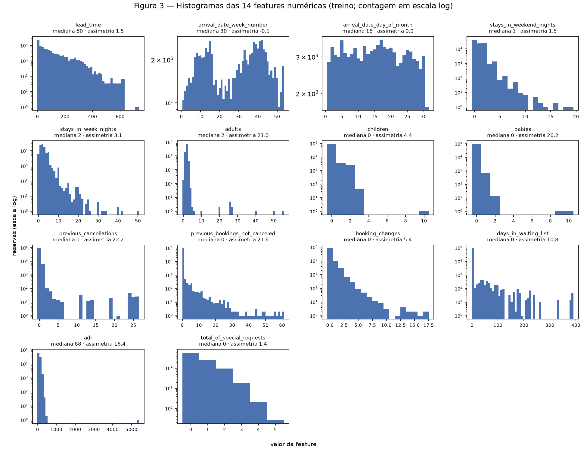
/// caption
**Figura 3** — Um histograma por feature numérica, com contagem em escala log para que as
caudas apareçam. Escolhemos a grade completa porque a pergunta do item ("qual é o formato de
cada distribuição?") precisa ser respondida para todas as 14, e a escala log mostra ao mesmo
tempo o pico em zero e os valores isolados (55 adultos, `adr` de 5.400, 391 dias em espera).
Conclusão: as duas únicas distribuições com corpo (`lead_time`, `adr`) têm cauda longa à
direita; o dia do mês é uniforme; na semana do ano, o vale entre as semanas 17 e 26 é efeito da
cobertura do treino (essas semanas só aparecem em 2016, as demais em dois anos), não
sazonalidade; todo o resto é "quase sempre zero".
///

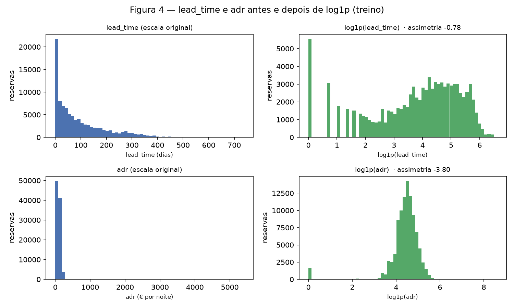
/// caption
**Figura 4** — As duas features contínuas na escala original e após `log1p`. A assimetria de
`lead_time` vai de 1,49 para −0,78 e a distribuição ganha corpo; as barras isoladas à esquerda
são os valores inteiros de 0 a 4 dias, que o log espalha. Em `adr`, o log transforma a cauda
num sino em torno de log1p(88) ≈ 4,5, mas cria um pico isolado em zero e a assimetria vira
**−3,80**: são as 1,7% de diárias ≤ 0, que ficariam seis desvios abaixo da média depois da
padronização. Conclusão: `log1p` é a transformação certa para `lead_time` e a errada para
`adr`, que recebe só o recorte da seção 4A (assimetria 0,98 depois dele).
///

### B — Categorical

**Tabela 4** — As 12 features categóricas no treino (`categorical` em
`stage2_univariate.py`). "Raro" é um nível com menos de 1% das linhas. ¹ Sobre as linhas com país informado; sobre todas as linhas do treino, PRT é 43,4%.

| Feature | Níveis | Nível dominante | % | Níveis raros | Linhas em níveis raros | Níveis com ≥ 100 linhas |
|---------|-------:|-----------------|--:|-------------:|-----------------------:|------------------------:|
| `hotel` | 2 | City Hotel | 65,9% | 0 | 0,0% | 2 |
| `arrival_date_month` | 12 | October | 11,7% | 0 | 0,0% | 12 |
| `meal` | 4 | BB | 78,5% | 1 | 0,8% | 4 |
| `market_segment` | 8 | Online TA | 44,6% | 3 | 0,8% | 7 |
| `distribution_channel` | 5 | TA/TO | 81,3% | 2 | 0,2% | 4 |
| `reserved_room_type` | 9 | A | 73,9% | 3 | 1,0% | 8 |
| `deposit_type` | 3 | No Deposit | 87,0% | 1 | 0,1% | 3 |
| `customer_type` | 4 | Transient | 72,7% | 1 | 0,5% | 4 |
| `is_repeated_guest` | 2 | 0 | 96,7% | 0 | 0,0% | 2 |
| `country` | 164 | PRT | 43,6%¹ | 151 | 9,6% | 34 |
| `agent` | 312 | 9 | 24,9% | 299 | 24,6% | 80 |
| `company` | 329 | none | 93,8% | 328 | 6,2% | 12 |

As frequências completas das nove de baixa cardinalidade estão na Figura 5; algumas
merecem registro em texto. `market_segment`: Online TA 44,6%, Offline TA/TO 21,4%, Groups
17,9%, Direct 10,4%, Corporate 4,9%, Complementary 0,7%, Aviation 0,2%, Undefined 2 linhas.
`deposit_type`: No Deposit 87,0%, Non Refund 12,9%, **Refundable 140 linhas (0,1%)**.
`customer_type`: Transient 72,7%, Transient-Party 23,1%, Contract 3,7%, Group 0,5%.
`reserved_room_type`: A 73,9%, D 15,0%, E 5,1%, e **L tem 6 linhas**. `meal`: BB 78,5%, HB
11,9%, SC 8,8%, FB 0,8%. Os meses vão de 5,6% (junho) a 11,7% (outubro), reflexo do período
coberto pelo treino (dois outubros e um só junho).

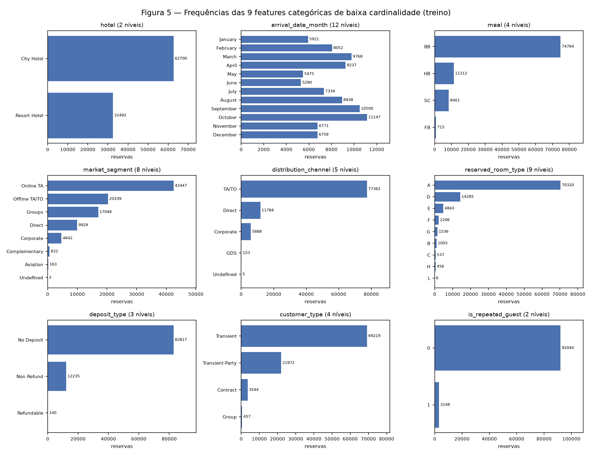
/// caption
**Figura 5** — Barras das nove categóricas de baixa cardinalidade, com a contagem de cada
nível. Conclusão: seis delas têm um nível com mais de 70% das linhas, e os 11 níveis raros
vão de 2 linhas (`Undefined` em `market_segment`) e 6 (`L`) a 715 (`FB`); são poucos o
bastante para receber a própria coluna no one-hot sem explodir a dimensão.
///

As três de alta cardinalidade são outro problema. `country` tem 164 níveis no treino, mas 13
cobrem 90% das linhas e **29 aparecem uma única vez**; `agent` tem 312, com a agência 9 em
24,9% das reservas, 47 níveis cobrindo 90% e 52 que aparecem uma vez; `company` tem 329, dos
quais `none` é 93,8% e só 12 têm 100 linhas ou mais. Um one-hot ingênuo criaria 806 colunas (805 níveis mais o `unknown`),
a maioria com menos de 100 uns, e níveis com uma linha não têm taxa de cancelamento estimável.

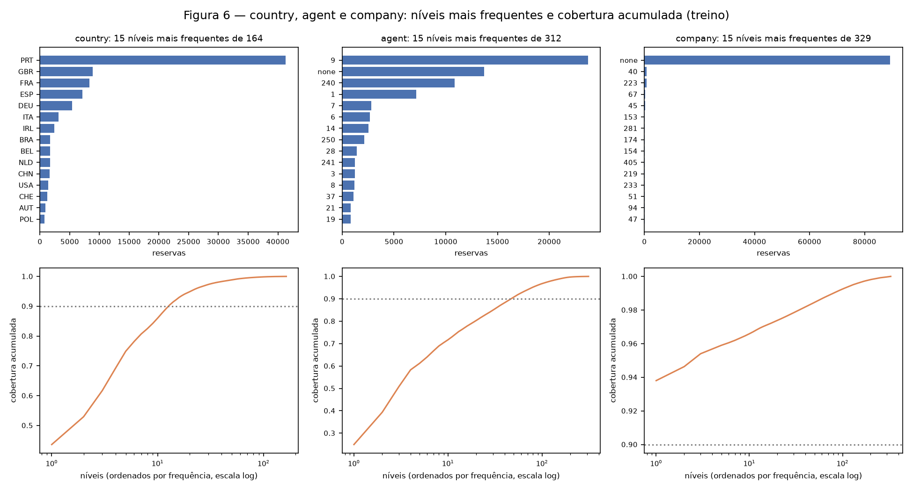
/// caption
**Figura 6** — Para `country`, `agent` e `company`, os 15 níveis mais frequentes (acima) e a
cobertura acumulada por número de níveis em escala log (abaixo). Conclusão: em `country` e
`agent` a cobertura de 90% é atingida com 13 e 47 níveis, respectivamente; em `company` um
único nível (`none`) já passa de 90%. Isso fixa a estratégia da seção 4A: manter os níveis com
pelo menos 100 linhas e agrupar o resto.
///

---

## 3. Bivariate and multivariate analysis

### A — Numerical × numerical

Usamos **Spearman**, não Pearson, por três razões que a Tabela 3 dá: nove das 14 features têm
assimetria > 2, sete são contagens com mediana zero, e há valores extremos isolados (5.400 em
`adr`, 55 em `adults`) que, com Pearson, pesariam mais que milhares de linhas. Spearman
trabalha com postos, mede qualquer relação monótona e ignora a magnitude dos extremos. Para
mostrar que a escolha importa, o script imprime os dois.

**Não há par redundante.** O par mais correlacionado por Spearman é `lead_time` ×
`stays_in_week_nights`, ρ = **+0,287**; nenhum par passa de |ρ| = 0,3. Por Pearson o maior é
`stays_in_weekend_nights` × `stays_in_week_nights`, r = +0,502, mas o Spearman do mesmo par é
0,224. A diferença não vem de um ponto extremo, e sim da forma da relação (Figura 8, centro):
nas estadias longas as duas contagens crescem juntas por aritmética de calendário (uma semana
= 2 + 5 noites, duas = 4 + 10), o que estica a reta de Pearson, enquanto a massa das reservas
de 1 a 4 noites, cheia de empates em 0, 1 e 2, quase não ordena uma pela outra. Os outros
pares acima de 0,2 são fracos: `adults` × `adr` (+0,262) e `children` × `adr` (+0,250), porque
a diária cresce com a ocupação do quarto; `lead_time` × `previous_cancellations` (+0,215),
que é o rastro dos blocos de grupo da seção 1B; `adults` × `previous_bookings_not_canceled`
(−0,213), em que a explicação mais provável é o segmento (reservas corporativas são de uma
pessoa e se repetem), não um traço do hóspede.

Com o alvo (Spearman, mesmo script): `lead_time` **+0,337** e `previous_cancellations`
**+0,317** são as mais associadas ao cancelamento no treino, mas a segunda é o artefato da
seção 1B e no teste essa associação some; `days_in_waiting_list` (+0,113) é o terceiro sinal
positivo. `total_of_special_requests` (**−0,266**), `booking_changes` (−0,183) e
`previous_bookings_not_canceled` (−0,115) apontam para o outro lado. Calendário, `adr` e
tamanho do grupo ficam abaixo de 0,07 em módulo.

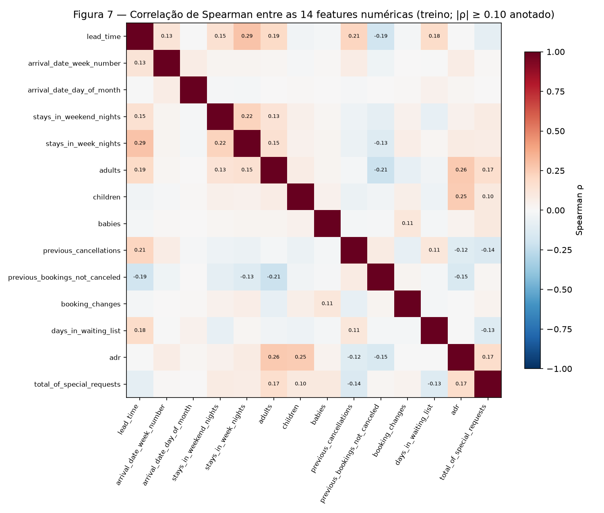
/// caption
**Figura 7** — Correlação de Spearman entre as 14 numéricas, com os valores anotados a partir
de |ρ| ≥ 0,10. Conclusão: a matriz é quase vazia; nenhuma feature numérica é função de outra,
e todas as 14 entram no pipeline.
///

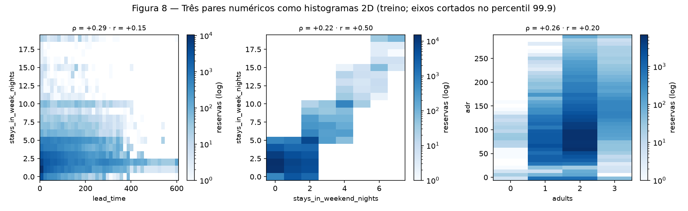
/// caption
**Figura 8** — Histogramas 2D (contagem em log) do par mais forte por Spearman (esquerda), do
par mais forte por Pearson (centro) e de `adults` × `adr` (direita). Usamos histogramas 2D e
não dispersões porque 95 mil pontos, quase todos em valores inteiros, se empilham. Conclusão: à esquerda, reservas com
mais de 400 dias de antecedência são quase só de 1–3 noites, o que explica o ρ positivo mas
modesto; ao centro, a relação é uma escada de semanas completas dominada pela célula (0–2,
0–5), o que explica a diferença entre r e ρ; à direita, a diária sobe com o número de adultos,
mas a dispersão dentro de cada coluna é maior que a diferença entre elas.
///

### B — Categorical × target

Para ordenar as 12 categóricas pela força da associação com o alvo usamos o **V de Cramér**
(com a correção de viés de Bergsma, que com 95 mil linhas muda pouco: `agent` vai de 0,409
para 0,405). Taxa global de cancelamento no treino: **36,09%**.

**Tabela 5** — Associação de cada categórica com o alvo e taxa de cancelamento por nível
(níveis com ≥ 100 linhas; `cat_target` em `stage3_bivariate.py`).

| Feature | V de Cramér | Leitura |
|---------|------------:|---------|
| `deposit_type` | **0,505** | Non Refund cancela **99,2%** (12.235 linhas); No Deposit 26,8%; Refundable 10,7% (140 linhas) |
| `agent` | 0,405 | entre as agências com ≥ 100 reservas, a 236 cancela 100% (247) e a 220, 1,0% (104) |
| `country` | 0,373 | PRT **55,5%** (41.319 linhas) e AGO 55,5% (326); DEU 15,2%, FRA 16,0%, GBR 17,5% |
| `market_segment` | 0,275 | Groups **60,3%**; Online TA 34,7%; Direct 14,6%; Complementary 11,9% |
| `distribution_channel` | 0,177 | TA/TO 40,1%; Direct 16,9% |
| `hotel` | 0,152 | City 41,3% × Resort 25,9% |
| `company` | 0,132 | `none` 37,3%; a empresa 67 cancela 65,5% (267), a 154, 3,3% (120) |
| `customer_type` | 0,117 | Transient 39,4%; Transient-Party 26,7%; Group 10,1% |
| `reserved_room_type` | 0,084 | A 38,4% até C 22,2% |
| `is_repeated_guest` | 0,076 | repetido cancela 16,2% × 36,8% |
| `arrival_date_month` | 0,065 | de 30,5% (janeiro) a 39,8% (abril): sazonalidade existe, mas é pequena |
| `meal` | 0,049 | FB 61,7%, mas são 715 linhas; o resto entre 34,2% e 36,3% |

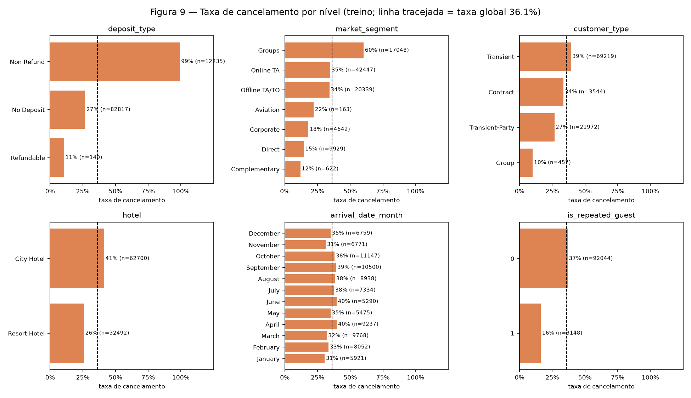
/// caption
**Figura 9** — Taxa de cancelamento por nível de seis categóricas (níveis com ≥ 100 linhas),
com o tamanho de cada nível e a taxa global tracejada. Conclusão: `deposit_type = Non Refund`
é quase determinístico (99%), o oposto do que a intuição diria, e a explicação vem logo
abaixo; `Groups` e o City Hotel cancelam acima da média, `Direct`, `Corporate`, hóspedes
repetidos e tipo `Group` bem abaixo; os meses mal se afastam da linha tracejada.
///

Por que Non Refund cancela 99%? Os dados dão a pista (`cat_target` imprime a composição):
das 12.235 reservas Non Refund do treino, **96,7% são de Portugal**, 86,9% do City Hotel,
62,4% do segmento `Groups` e 34,7% de `Offline TA/TO`, e 76,6% têm `lead_time` acima de 90
dias (Figura 12). A explicação mais plausível é que o depósito não reembolsável é exigido de
blocos reservados por operadoras e grupos portugueses com muita antecedência, e que esses
blocos são cancelados quando não se preenchem, com o depósito já contabilizado. O nível
carrega, portanto, a política do hotel em relação ao tipo de cliente. Ele é conhecido no
momento da reserva, então pode ser usado, mas uma taxa de 99% merece a mesma desconfiança
que aplicamos ao estacionamento: a entrega de classificação deve medir o modelo também
**dentro de `No Deposit`**, onde estão 87% das reservas, e a prova de projeto deve ter essa
pergunta na manga. O mesmo vale para Portugal (55,5%, Figura 10), cuja fatia cai de 43,4%
para 29,8% no teste: boa parte dos 55,5% é o Non Refund visto por outro ângulo.

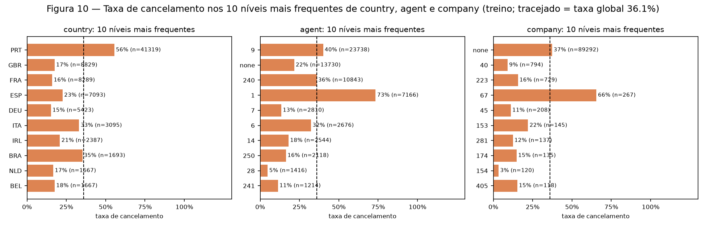
/// caption
**Figura 10** — Taxa de cancelamento nos dez níveis mais frequentes de `country`, `agent` e
`company`. Conclusão: Portugal cancela 55,5%, mais que o dobro dos outros grandes mercados
europeus (DEU 15,2%, FRA 16,0%, GBR 17,5%, ESP 22,6%), com Itália (33,1%) e Brasil (35,2%)
no meio do caminho, e a agência 1 (7.166 reservas) cancela 73,4% contra 4,8% da agência
28: os níveis frequentes dessas três features carregam sinal forte e justificam mantê-las, com
o resto agrupado.
///

### C — Numerical × categorical

Os boxplots agrupados respondem se os grupos diferem em **posição** (mediana), em
**dispersão** (IQR) ou nos dois.

**Tabela 6** — Mediana e IQR de `lead_time` (dias) e `adr` (€ por noite) por grupo, no
treino (`num_cat` em `stage3_bivariate.py`).

| Grupo | `lead_time` mediana / IQR | `adr` mediana / IQR |
|-------|--------------------------:|--------------------:|
| City Hotel | 65 / 130 | 94,5 / 42,0 |
| Resort Hotel | 48 / 129 | 68,0 / 56,6 |
| No Deposit | 48 / 106 | não calculado |
| Non Refund | **203 / 216** | não calculado |
| Groups | **151 / 220** | 65,0 / 23,0 |
| Online TA | 49 / 92 | 100,3 / 52,0 |
| Direct | 11 / 55 | 95,0 / 66,1 |
| Corporate | 7 / 24 | 65,0 / 39,4 |
| Complementary | 3 / 11 | 0,0 / 0,0 |

Cruzando com o alvo: no City Hotel, reservas canceladas têm `lead_time` mediano **104** dias
(IQR 200) contra **43** (IQR 93) das não canceladas; no Resort, 98 (IQR 140) contra 32 (IQR
107). Por segmento, a mediana das canceladas é sempre maior: Groups 222 × 97, Offline TA/TO
146 × 75, Online TA 70 × 37, Direct 32 × 8, Corporate 31 × 6. Já `adr` se move pouco e em
sentidos opostos: no City as canceladas têm diária mediana **menor** (91,8 × 95,0), no Resort
**maior** (73,0 × 66,0, com IQR 64,6 × 53,2).

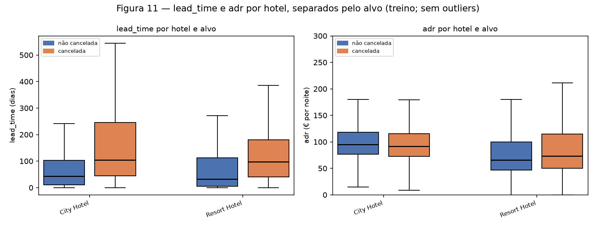
/// caption
**Figura 11** — `lead_time` e `adr` por hotel, separados pelo alvo (sem outliers no
desenho). Conclusão: `lead_time` difere **em posição e em dispersão**: no City a mediana das
canceladas é mais que o dobro e o IQR também (200 × 93); no Resort a mediana triplica (98 ×
32) e o IQR cresce 30% (140 × 107); o bigode das canceladas no City passa de 500 dias. `adr`
difere entre hotéis (o Resort é mais barato e mais disperso) e, dentro de cada hotel, muda
pouco e em sentidos opostos entre as classes (3 a 7 € de diferença na mediana, para IQRs de 42
a 65 €). O ρ agregado de +0,037 deve ser lido como relação fraca, que além disso muda de sinal
entre os hotéis.
///

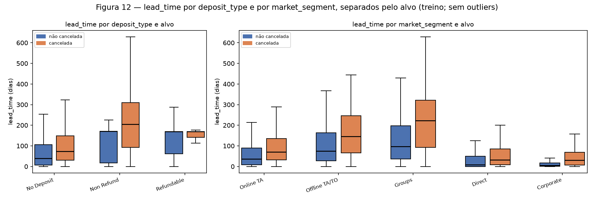
/// caption
**Figura 12** — `lead_time` por `deposit_type` e por `market_segment`, separados pelo alvo.
Conclusão: a antecedência mediana das reservas Non Refund (203 dias, Tabela 6) é quatro vezes
a das No Deposit (48); em No Deposit e Non Refund as canceladas estão acima (73 × 39 e 205 × 171
dias), e em Refundable as medianas empatam (169), com só 15 canceladas; entre segmentos, `Groups` e `Offline TA/TO` têm antecedência longa mesmo quando
*não* cancelam (medianas 97 e 75 dias), enquanto `Direct` e `Corporate` reservam com cerca de
uma semana (8 e 6 dias) e cancelam pouco. Nos grupos grandes, posição e dispersão crescem
juntas (a caixa de Groups canceladas é a maior da figura), mais um argumento para o `log1p`.
///

---

## 4. Preprocessing

### A — Strategies

Cada estratégia é ajustada **só no treino**, dentro do `ColumnTransformer` da seção 4C, e
aponta para o achado que a motiva. O destino é uma rede neural: entradas centradas, com
escala comparável e sem valores que dominem o gradiente.

**Tabela 7** — Estratégias de pré-processamento.

| # | Problema | Estratégia | Features | Achado que motiva |
|---|----------|------------|----------|-------------------|
| 1 | Valores ausentes | `children`: mediana do treino (`SimpleImputer`). `country`: constante `unknown`, que vira uma coluna do one-hot. `agent`/`company`: NaN já é o nível `none` desde `clean()`, porque significa "sem agência/empresa", não "desconhecido"; imputar a moda apagaria a informação. | `children`, `country`, `agent`, `company` | Tabela 2: 94,3% e 13,7% estruturais, 0,41% e 4 linhas residuais |
| 2 | Outliers | Recorte (`QuantileClipper`) de cada numérica aos quantis **0,1% e 99,9% do treino**; em seguida `log1p` em **7** features de cauda longa: cinco das seis com assimetria > 2 que não são contagens de pessoas (`stays_in_week_nights`, as duas de histórico, `booking_changes`, `days_in_waiting_list`; `adr` é a exceção, explicada a seguir) mais `lead_time` e `stays_in_weekend_nights` (assimetria 1,49, mas máximos de 737 e 19 contra P99 de 426 e 4). `adults`, `children` e `babies` ficam sem log porque, após o recorte, vão de 0 a 3, 2 e 1; `adr` fica sem log porque o recorte já a leva à assimetria 0,98 e o log criaria o pico da Figura 4. Nenhuma linha é removida nesta etapa. | 14 numéricas | Tabela 3 (nove assimetrias > 2), Figura 3 (valores isolados), Figura 4 (o log funciona para `lead_time` e não para `adr`) |
| 3 | Encoding categórico (inclusive nível novo no teste) | `OneHotEncoder` em tudo. Para as 9 de baixa cardinalidade, uma coluna por nível, com `handle_unknown="ignore"`: um nível novo viraria uma linha toda zero (não há nenhum no teste). Para `country`, `agent` e `company`, `min_frequency=100`: níveis com menos de 100 linhas de treino vão para uma única coluna `infrequent`, e **todo nível não visto no treino cai na mesma coluna** (`handle_unknown="infrequent_if_exist"`). | 12 categóricas | Tabela 4 e Figura 6 (806 níveis com o `unknown`, a maioria com < 100 linhas); seção 1D (54 níveis novos no teste) |
| 4 | Escala | `StandardScaler` após o recorte e o log, ajustado no treino. One-hot fica em 0/1. | 14 numéricas | Tabela 3: faixas de 0–5 a −6,38–5.400 |

**O que o recorte faz, em números** (saída de `pipeline.py`): os limites aprendidos no treino
são `lead_time` ≤ 608, `adr` ∈ [0, 299,87], `adults` ≤ 3, `children` ≤ 2, `babies` ≤ 1,
`booking_changes` ≤ 6, `days_in_waiting_list` ≤ 236, `previous_cancellations` ≤ 24,
`previous_bookings_not_canceled` ≤ 21, noites ≤ 7 (fim de semana) e ≤ 19 (semana),
`total_of_special_requests` ≤ 4. Isso elimina a diária negativa, a de 5.400 e os 55 adultos
sem perder a linha, e altera **695 linhas do treino (0,73%)**, 97 delas em `adr` e 83 em
`lead_time`. O recorte também toca valores plausíveis, como 4 adultos (que viram 3) ou 5
pedidos especiais (4); aceitamos esse custo porque, sem ele, um único 55 em `adults` ficaria a
cerca de 89 desvios da média depois da padronização. Mesmo assim, as contagens quase binárias
continuam com valores extremos após a escala: o maior |z| é 14,4 em `previous_cancellations`,
11,9 em `previous_bookings_not_canceled` e 11,2 em `babies`; `adr` fica em [−2,17, 4,78].
Esses três são candidatos a virar *flags* (> 0) na próxima entrega.

**Por que 100 linhas** para a alta cardinalidade: com n = 100 o erro-padrão de uma taxa de
cancelamento é no máximo 5 pontos percentuais, suficiente para que a coluna carregue sinal; os
níveis abaixo disso são 130 países (2.098 linhas), 232 agências (4.571) e 317 empresas
(3.021), e todos os 54 níveis novos do teste (337 linhas) caem nas mesmas três colunas, então
o modelo nunca vê uma entrada que não existia no treino.

### B — Dimensionality reduction

As três projeções usam a **saída do pipeline** (193 colunas: 14 numéricas padronizadas e 179
de one-hot) para o treino, porque é isso que o modelo verá. A PCA é ajustada nas 95.192
linhas; t-SNE e UMAP, e os desenhos das três, usam a mesma amostra de **5.000 linhas** de
treino sorteada com a semente 42 (36,0% canceladas; 15,5% dos pontos têm uma cópia exata na
amostra). Para comparar as projeções com um número e não só com o olho, o script calcula a
**pureza de vizinhança**: a fração dos 10 vizinhos mais próximos de cada ponto que tem o mesmo
rótulo. É uma estatística descritiva do desenho, não um modelo. Duas referências: uma
arrumação aleatória dá **0,539** para essa proporção de classes, e a pureza medida no próprio
espaço de 193 dimensões, antes de qualquer projeção, é **0,728**.

**PCA.** PC1 explica **10,81%** e PC2 **8,88%**: juntas, **19,69%** da variância; são
necessárias 8 componentes para 50%, 16 para 80% e **27 para 90%** (Figura 13, esquerda). Isso
tem duas causas: as 14 numéricas padronizadas carregam a maior parte da variância total e são
pouco correlacionadas entre si (|ρ| máximo 0,29, Figura 7), então não há um eixo dominante; e
as 179 colunas de one-hot repartem o resto em muitas direções pequenas (dentro de cada
feature elas são exatamente dependentes, pois somam 1). Chegar a 90% com 27 de 193
componentes mostra que a matriz comprime bem, mas não em duas dimensões. Os *loadings* são
legíveis: PC1 é um eixo de "tamanho e preço da reserva" (`adr` +0,42, `adults` +0,40,
`stays_in_week_nights` +0,31, `total_of_special_requests` +0,30, `stays_in_weekend_nights`
+0,29, e `previous_bookings_not_canceled` −0,29 no sentido oposto); PC2 é um eixo de
"antecedência" (`lead_time` +0,57, `days_in_waiting_list` +0,33, `previous_cancellations`
+0,29, `stays_in_week_nights` +0,24, contra `total_of_special_requests` −0,30 e
`previous_bookings_not_canceled` −0,21). PC2 alinha-se com os sinais da seção 3A, e por isso
as canceladas se concentram na parte de cima do plano. Pureza no plano: **0,645**.

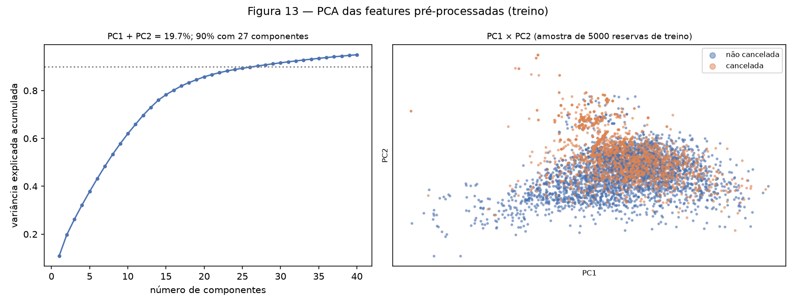
/// caption
**Figura 13** — Variância explicada acumulada (esquerda) e a amostra no plano PC1 × PC2,
colorida pelo alvo (direita). Conclusão: as duas primeiras componentes guardam um quinto da
variância e perdem parte da vizinhança (pureza 0,645 contra 0,728 no espaço completo); PC2
separa parcialmente as canceladas (acima), mas a sobreposição no centro é grande.
///

**t-SNE** (perplexidade 5 e 50, `init="pca"`). Com perplexidade 5 o desenho é uma nuvem com
grumos pequenos e uma faixa laranja no alto; com 50 aparecem ilhas compactas. O script
descreve os 10% de pontos mais acima do desenho de perplexidade 50: **86,8% cancelados**, 78%
Non Refund, 66% `Groups`, 90% City Hotel, `lead_time` mediano 270 dias, e 66% deles são
cópias exatas de outro ponto. Pureza **≈ 0,72** nas duas perplexidades.

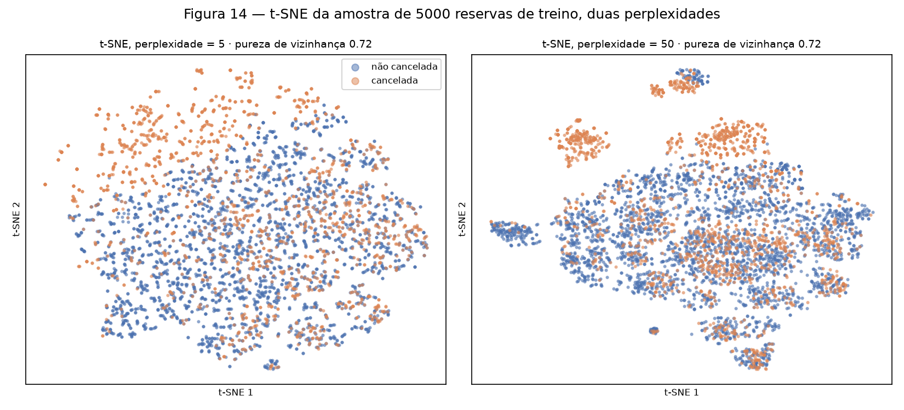
/// caption
**Figura 14** — t-SNE da amostra com duas perplexidades. Conclusão: a pureza é igual nas duas
(0,72), mas só com perplexidade 50 as reservas Non Refund de grupo se destacam como ilhas
quase puras; o tamanho das ilhas e a distância entre elas não têm leitura, porque o t-SNE
preserva vizinhanças, não escala.
///

**UMAP** (`n_neighbors` 5 e 50, `min_dist=0.1`). Com 5 vizinhos o UMAP fragmenta a amostra em
dezenas de satélites minúsculos (reservas com combinações raras de one-hot); com 50 ele junta
quase tudo numa massa com algumas ilhas destacadas. Para não escolher ilhas a olho, o script
roda DBSCAN no desenho de 50 vizinhos (sem usar o alvo): encontra 7 ou 8 ilhas com pelo menos 20
pontos, conforme a plataforma, a maior com cerca de 4.000 a 4.200, e duas delas são **100%
canceladas** em qualquer execução: uma de 210 pontos (56%
`Groups`, 53% Non Refund, 85% City Hotel, `lead_time` mediano 272 dias, 43% de cópias
exatas) e uma de 40 pontos (100% Non Refund, 72% de cópias). Pureza **≈ 0,72** e **≈ 0,71**.

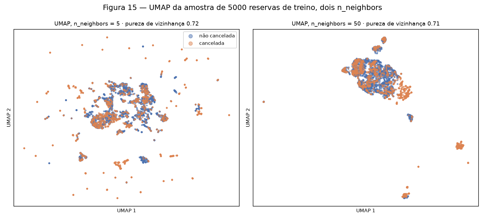
/// caption
**Figura 15** — UMAP da amostra com dois `n_neighbors`. Conclusão: o parâmetro muda
radicalmente o desenho (satélites × massa única) sem mudar a pureza; as ilhas 100% canceladas
são blocos de reservas de grupo e de operadora, metade com depósito não reembolsável e quase
metade idênticas entre si: as duplicatas da seção 1B vistas de outro ângulo.
///

**Comparação.** O que t-SNE e UMAP mostram e a PCA não mostra são **ilhas compactas e quase
puras** de cancelamento, que no plano PC1 × PC2 aparecem apenas como uma concentração difusa
acima do centro. Mas a leitura honesta dos números é outra: a pureza de t-SNE e UMAP
(0,71–0,72) é a mesma do espaço original de 193 dimensões (0,728), enquanto a PCA em 2D perde
(0,645). Ou seja, as projeções não lineares **preservam** a vizinhança que já existe nos
dados; elas não a criam. E as ilhas puras são, em grande parte, reservas que compartilham
poucas colunas de one-hot (`Non Refund`, `Groups`, `PRT`), portanto separáveis por qualquer
modelo, não só por um não linear. O que as três projeções dizem em conjunto é que (i) a
estrutura relevante não cabe em duas direções de variância, (ii) cerca de 27% dos vizinhos de
cada reserva têm o rótulo oposto mesmo no espaço completo, o que dá uma ideia do ruído que
nenhum modelo vai eliminar, e (iii) uma projeção 2D não testa separabilidade linear; essa
pergunta fica para a próxima entrega, com uma MLP comparada a um modelo linear.

```python
--8<-- "docs/projects/eda/code/stage4_projections.py:pca"
```

### C — Pipeline

`build_preprocessor()` em `code/pipeline.py` devolve um `ColumnTransformer` não ajustado
cujos quatro ramos são `Pipeline`s: numéricas com log (7), numéricas sem log (7), categóricas
de baixa (9) e de alta cardinalidade (3). A entrega de classificação importa a função e o
`load_split()` de `data.py`, chama `fit` só no treino e `transform` nos dois lados:

```python
import sys
sys.path.insert(0, "docs/projects/eda/code")   # a partir da raiz do repositório
from data import load_split
from pipeline import build_preprocessor

train, test, cut = load_split()
pre = build_preprocessor()
X_train = pre.fit_transform(train)              # só o treino
X_test = pre.transform(test)
```

```python
--8<-- "docs/projects/eda/code/pipeline.py:clipper"
```

```python
--8<-- "docs/projects/eda/code/pipeline.py:build"
```

Checagens impressas por `python docs/projects/eda/code/pipeline.py`:

| Checagem | Resultado |
|----------|-----------|
| Ajuste | `fit_transform` no treino (95.192 × 28 colunas de entrada, 26 usadas), `transform` no teste |
| NaN depois do pipeline | **0** no treino, **0** no teste |
| `shape` final | treino **(95.192, 193)**, teste **(24.018, 193)** |
| Composição das 193 colunas | 7 numéricas com log + escala, 7 só com escala, 49 one-hot das 9 categóricas de baixa cardinalidade, 130 das 3 de alta (35 países + 80 agências + 12 empresas + 3 colunas `infrequent`; o país 35 é o nível `unknown`) |
| Nomes das features | as 193, na ordem das colunas, estão listadas logo abaixo da tabela |
| Escala no treino | média 0,000 e desvio 1,000 nas 14 numéricas (tabela impressa) |
| Escala no teste | não é recentrado: `adr` tem média +0,95, `lead_time` +0,36 e `previous_cancellations` −0,21 no teste, a deriva temporal vista de dentro do pipeline |

??? note "As 193 features de saída, na ordem das colunas (`get_feature_names_out()`)"

    ```text
      0  lead_time
      1  stays_in_weekend_nights
      2  stays_in_week_nights
      3  previous_cancellations
      4  previous_bookings_not_canceled
      5  booking_changes
      6  days_in_waiting_list
      7  arrival_date_week_number
      8  arrival_date_day_of_month
      9  adults
     10  children
     11  babies
     12  adr
     13  total_of_special_requests
     14  hotel_City Hotel
     15  hotel_Resort Hotel
     16  arrival_date_month_April
     17  arrival_date_month_August
     18  arrival_date_month_December
     19  arrival_date_month_February
     20  arrival_date_month_January
     21  arrival_date_month_July
     22  arrival_date_month_June
     23  arrival_date_month_March
     24  arrival_date_month_May
     25  arrival_date_month_November
     26  arrival_date_month_October
     27  arrival_date_month_September
     28  meal_BB
     29  meal_FB
     30  meal_HB
     31  meal_SC
     32  market_segment_Aviation
     33  market_segment_Complementary
     34  market_segment_Corporate
     35  market_segment_Direct
     36  market_segment_Groups
     37  market_segment_Offline TA/TO
     38  market_segment_Online TA
     39  market_segment_Undefined
     40  distribution_channel_Corporate
     41  distribution_channel_Direct
     42  distribution_channel_GDS
     43  distribution_channel_TA/TO
     44  distribution_channel_Undefined
     45  reserved_room_type_A
     46  reserved_room_type_B
     47  reserved_room_type_C
     48  reserved_room_type_D
     49  reserved_room_type_E
     50  reserved_room_type_F
     51  reserved_room_type_G
     52  reserved_room_type_H
     53  reserved_room_type_L
     54  deposit_type_No Deposit
     55  deposit_type_Non Refund
     56  deposit_type_Refundable
     57  customer_type_Contract
     58  customer_type_Group
     59  customer_type_Transient
     60  customer_type_Transient-Party
     61  is_repeated_guest_0
     62  is_repeated_guest_1
     63  country_AGO
     64  country_ARG
     65  country_AUS
     66  country_AUT
     67  country_BEL
     68  country_BRA
     69  country_CHE
     70  country_CHN
     71  country_CZE
     72  country_DEU
     73  country_DNK
     74  country_ESP
     75  country_FIN
     76  country_FRA
     77  country_GBR
     78  country_GRC
     79  country_HUN
     80  country_IND
     81  country_IRL
     82  country_ISR
     83  country_ITA
     84  country_JPN
     85  country_KOR
     86  country_LUX
     87  country_MAR
     88  country_NLD
     89  country_NOR
     90  country_POL
     91  country_PRT
     92  country_ROU
     93  country_RUS
     94  country_SWE
     95  country_TUR
     96  country_USA
     97  country_unknown
     98  country_infrequent_sklearn
     99  agent_1
    100  agent_10
    101  agent_11
    102  agent_115
    103  agent_119
    104  agent_12
    105  agent_132
    106  agent_134
    107  agent_138
    108  agent_14
    109  agent_142
    110  agent_143
    111  agent_146
    112  agent_147
    113  agent_15
    114  agent_152
    115  agent_154
    116  agent_156
    117  agent_16
    118  agent_168
    119  agent_17
    120  agent_171
    121  agent_175
    122  agent_177
    123  agent_19
    124  agent_191
    125  agent_195
    126  agent_196
    127  agent_2
    128  agent_20
    129  agent_208
    130  agent_21
    131  agent_22
    132  agent_220
    133  agent_234
    134  agent_236
    135  agent_240
    136  agent_241
    137  agent_242
    138  agent_243
    139  agent_248
    140  agent_250
    141  agent_251
    142  agent_26
    143  agent_27
    144  agent_273
    145  agent_28
    146  agent_29
    147  agent_298
    148  agent_3
    149  agent_30
    150  agent_31
    151  agent_314
    152  agent_315
    153  agent_326
    154  agent_330
    155  agent_34
    156  agent_35
    157  agent_36
    158  agent_37
    159  agent_38
    160  agent_40
    161  agent_42
    162  agent_44
    163  agent_5
    164  agent_56
    165  agent_58
    166  agent_6
    167  agent_67
    168  agent_68
    169  agent_7
    170  agent_8
    171  agent_83
    172  agent_85
    173  agent_86
    174  agent_9
    175  agent_94
    176  agent_95
    177  agent_96
    178  agent_none
    179  agent_infrequent_sklearn
    180  company_153
    181  company_154
    182  company_174
    183  company_219
    184  company_223
    185  company_233
    186  company_281
    187  company_40
    188  company_405
    189  company_45
    190  company_67
    191  company_none
    192  company_infrequent_sklearn
    ```

---

## 5. Synthesis

Para quem vai construir o modelo:

1. **O alvo tem 36,1% de positivos no treino e 41,0% no teste** (Figura 1, Figura 2), e o
   teste é uma população diferente (menos Portugal, menos Non Refund, quase nenhum
   `previous_cancellations > 0`). Régua mínima: 63,9% de acurácia no treino e 59,0% no teste
   respondendo sempre "não cancela". Reporte *recall* e *precision* da classe cancelada e as
   curvas ROC e PR.
2. **As features mais informativas são conhecidas na reserva**: `deposit_type` (V = 0,51),
   `agent` (0,41), `country` (0,37), `market_segment` (0,28) e, entre as numéricas,
   `lead_time` (ρ = +0,34) e `total_of_special_requests` (−0,27) (Tabela 5, Figuras 9–11).
   `previous_cancellations` (+0,32 no treino) **não** entra nessa lista: é o artefato do
   item 1B. Não há par numérico redundante (Figura 7).
3. **Non Refund cancela 99,2%** (Figura 9) e Portugal 55,5% (Figura 10), e os dois estão
   ligados: um modelo pode ir longe só com isso. Avalie também o desempenho **dentro de `No
   Deposit`**, onde estão 87% das reservas e o problema real.
4. **O pré-processamento está pronto e é importável**: 193 colunas, sem NaN, com níveis
   novos tratados (seção 4C). Não refaça o split: use `data.load_split()`.
5. **Cerca de 27% dos vizinhos de cada reserva têm o rótulo oposto** no espaço completo
   (seção 4B): há um teto de ruído, e as ilhas puras são blocos de grupo que qualquer modelo
   acerta. Compare a MLP com um modelo linear antes de atribuir ganho à não linearidade.

| Risco | Evidência | Plano |
|-------|-----------|-------|
| `previous_cancellations` é um artefato não estacionário | 85,7% das linhas com valor > 0 não são de hóspede repetido; taxa de cancelamento 99,0% (2015) → 17,3% (2017); 6,66% das linhas no treino × 0,60% no teste (seções 1B, 1D) | Treinar **com e sem** a coluna; a versão sem ela é a candidata a final. Na prova, saber explicar por que o ρ de +0,32 engana |
| `booking_changes` acumula até o check-in (e `total_of_special_requests` pode ter o mesmo problema, não medido) | 15,7% × 40,9% de cancelamento com e sem alteração (seção 1B) | Treinar e reportar o modelo com e sem `booking_changes`; se a diferença for grande, entregar a versão sem |
| Deriva entre treino e teste | taxa 36,1% × 41,0%, sem contrapartida sazonal em 2016; PRT 43,4% → 29,8%; Non Refund 12,9% → 9,8%; médias deslocadas no teste (seções 1D, 4C) | Validação **temporal** dentro do treino (último trimestre como validação), não k-fold aleatório; não recentrar o teste; reportar métricas por período |
| Duplicatas de grupo pesam no treino e no teste | 26,8% de cópias; blocos de até 180 linhas; 15,5% da amostra das projeções com cópia (seções 1B, 4B) | Testar `sample_weight` = 1/tamanho do bloco no treino; reportar métricas de teste também sem cópias |
| `deposit_type = Non Refund` e `country = PRT` dominam | 99,2% e 55,5% de cancelamento; 96,7% das Non Refund são PRT (seção 3B) | Métricas separadas por `deposit_type`; verificar que o modelo não é só esse *flag*; na prova, saber que a ligação país × depósito é uma hipótese |
| Níveis raros e novos em `agent`/`country`/`company` | 806 níveis, 54 novos no teste (seções 2B, 1D) | Já tratados pelo `infrequent`; se o modelo sobreajustar nas 130 colunas, subir `min_frequency` |
| Contagens quase binárias com \|z\| até 14 após a escala | `previous_cancellations`, `previous_bookings_not_canceled`, `babies` (seção 4A) | Substituir por *flags* (> 0) se as curvas de treino oscilarem |
| 715 reservas com zero noites | 0,60% (seção 1B) | Mantidas; se o modelo as errar sistematicamente, criar um *flag* `day_use` |

A página se sustenta a partir de um clone limpo: o CSV está versionado em `data/hotel/`, os
cinco scripts rodam na ordem da caixa de reprodutibilidade sem arquivo intermediário, e os
números acima foram copiados da saída deles.

### Results summary

| # | Results summary | Value |
|---|-----------------|-------|
| 1 | Dataset, task and target | Hotel Booking Demand (Antonio, de Almeida & Nunes, 2019); classificação binária; `is_canceled` |
| 2 | Instances × features (numerical / categorical) | 119.210 × 26 após a limpeza (14 numéricas / 12 categóricas); bruto 119.390 × 32 |
| 3 | Column with the most missing values and its percentage | `company`: 112.593 NaN, 94,31% (estrutural: "sem empresa") |
| 4 | Dropped columns and the reason | `reservation_status`, `reservation_status_date` (são o desfecho); `assigned_room_type`, `required_car_parking_spaces` (comportam-se como preenchidas só para quem chegou: 5,4% e 0,0% de cancelamento); `arrival_date_year` (ano nunca visto em produção; constante no teste) |
| 5 | Minority class (%) | cancelada: 37,08% no conjunto limpo; 36,09% no treino; 40,99% no teste |
| 6 | Size of the training and test sets | 95.192 (79,85%, chegadas até 2017-04-21) / 24.018 (20,15%, de 2017-04-22 em diante) |
| 7 | Most correlated numerical pair and its value | Spearman: `lead_time` × `stays_in_week_nights`, ρ = +0,287 (Pearson máx.: `stays_in_weekend_nights` × `stays_in_week_nights`, r = +0,502) |
| 8 | Rows affected by the outlier strategy | 695 linhas do treino recortadas (0,73%); além disso, 180 linhas sem hóspedes removidas antes do split |
| 9 | Variance explained by PC1 + PC2 | 19,69% (10,81% + 8,88%); 27 componentes para 90% |
| 10 | `shape` of train and test after the pipeline | (95.192, 193) e (24.018, 193), sem NaN |

### Referências

- Antonio, N., de Almeida, A., & Nunes, L. (2019). Hotel booking demand datasets. *Data in
  Brief*, 22, 41–49. <https://doi.org/10.1016/j.dib.2018.11.126> (licença CC BY 4.0).
- Mostipak, J. Hotel booking demand (Kaggle).
  <https://www.kaggle.com/datasets/jessemostipak/hotel-booking-demand>
- TidyTuesday 2020-02-11, *Hotels*: cópia pública do mesmo arquivo.
  <https://github.com/rfordatascience/tidytuesday/tree/master/data/2020/2020-02-11>
- Bergsma, W. (2013). A bias-correction for Cramér's V and Tschuprow's T. *Journal of the
  Korean Statistical Society*, 42(3), 323–328.
- scikit-learn: `ColumnTransformer`, `OneHotEncoder` (`min_frequency`, `handle_unknown`),
  `PCA`, `TSNE`, `DBSCAN`. <https://scikit-learn.org/stable/>
- McInnes, L., Healy, J., & Melville, J. (2018). UMAP: Uniform Manifold Approximation and
  Projection. <https://umap-learn.readthedocs.io/>
