# 1. EDA — Análise Exploratória

!!! abstract "Entrega 1 de 2 do [Projeto](../index.md)"

    [Projects → EDA](https://insper.github.io/ann-dl/){:target='_blank'}

!!! info "Equipe"

    | Nome completo | GitHub |
    |---------------|--------|
    | Tiago Liberman | [tiliberman](https://github.com/tiliberman) |
    | Júlia Campos | [julia-campos-ma](https://github.com/julia-campos-ma) |

    Dataset, decisões e status: [página do projeto](../index.md).

!!! info "Reprodutibilidade"

    O CSV bruto está versionado em `data/hotel/hotel_bookings.csv` (o mesmo arquivo do Kaggle e
    do TidyTuesday 2020-02-11). A semente 42 é usada em tudo o que sorteia. A partir da raiz do
    repositório:

    ```shell
    python docs/projects/eda/code/stage1_inspection.py
    python docs/projects/eda/code/stage2_univariate.py
    python docs/projects/eda/code/stage3_bivariate.py
    python docs/projects/eda/code/pipeline.py
    python docs/projects/eda/code/stage4_projections.py
    ```

    Os scripts imprimem todos os números desta página e regeram as 15 figuras (cerca de 70 s).
    Versões fixadas no `requirements.txt`. t-SNE e UMAP variam um pouco entre plataformas, por
    isso seus números aparecem arredondados. Nenhum modelo é treinado nesta entrega.

O dataset reúne reservas de dois hotéis portugueses (julho de 2015 a agosto de 2017), e a
pergunta é **se uma reserva será cancelada**. A ideia central da análise: o modelo só pode usar o
que o hotel **sabe no momento da reserva**. Por isso descartamos as colunas que registram o
desfecho e fazemos um split **temporal** (treinar no passado, testar no futuro).

---

## Abordagem

| Arquivo | Conteúdo |
|---------|----------|
| `data.py` | Carrega o CSV, aplica a limpeza fixa (`clean`) e faz **o único split** (`split`). Todos os scripts usam `load_split()`. |
| `stage1_inspection.py` | Estágio 1: dicionário, qualidade, alvo e split. Figuras 1–2. |
| `stage2_univariate.py` | Estágio 2: numéricas e categóricas, só no treino. Figuras 3–6. |
| `stage3_bivariate.py` | Estágio 3: Spearman, taxa de cancelamento por categoria, boxplots. Figuras 7–12. |
| `pipeline.py` | `build_preprocessor()` importável (itens 4A e 4C). |
| `stage4_projections.py` | PCA, t-SNE e UMAP. Figuras 13–15. |

---

## 0. Proposal

Escolhemos um dataset com uma pergunta de negócio concreta: cancelamentos obrigam o hotel a
praticar *overbooking* e geram perda de receita. Ele também tem material para todos os itens do
roteiro (ausentes, duplicatas, outliers, alta cardinalidade e vazamento) e está documentado num
artigo revisado por pares.

| Campo | Valor |
|-------|-------|
| **Dataset** | Hotel Booking Demand (Antonio, de Almeida & Nunes, 2019), via Kaggle, licença CC BY 4.0 |
| **URL** | <https://www.kaggle.com/datasets/jessemostipak/hotel-booking-demand> |
| **Linhas × colunas** | 119.390 × 32 (bruto) → 119.210 × 26 features + alvo após a limpeza |
| **Alvo** | `is_canceled` (1 = cancelada ou *no-show*) |
| **Features** | 14 numéricas / 12 categóricas após a limpeza |
| **Primeiro risco** | Vazamento: `reservation_status` é o alvo com outro nome |

---

## 1. Initial inspection

### A — Data dictionary

**Fonte:** sistema de gestão (PMS) de dois hotéis em Portugal, um *resort* no Algarve e um
hotel urbano em Lisboa, anonimizado pelos autores do artigo. **Cada linha é uma reserva** com
chegada entre 2015-07-01 e 2017-08-31. Não há ID de cliente nem de reserva. `agent` e `company`
são códigos (IDs), não quantidades, e `is_repeated_guest` é um *flag* 0/1. Assumimos que `adr`
está em euros (o artigo não informa a moeda).

**Tabela 1** — Dicionário de dados.

| Feature | Significado | Tipo | Unidade | Decisão |
|---------|-------------|------|---------|---------|
| `hotel` | Resort Hotel ou City Hotel | categórica (2) | — | mantida |
| `is_canceled` | 1 se cancelada ou *no-show* | **alvo** 0/1 | — | alvo |
| `lead_time` | dias entre a reserva e a chegada | numérica, 0–737 | dias | mantida |
| `arrival_date_year` | ano da chegada | numérica, 2015–2017 | ano | descartada (1B) |
| `arrival_date_month` | mês da chegada | categórica (12) | — | mantida |
| `arrival_date_week_number` | semana do ano da chegada | numérica, 1–53 | semana | mantida |
| `arrival_date_day_of_month` | dia do mês da chegada | numérica, 1–31 | dia | mantida |
| `stays_in_weekend_nights` | noites de sábado/domingo | numérica, 0–19 | noites | mantida |
| `stays_in_week_nights` | noites de segunda a sexta | numérica, 0–50 | noites | mantida |
| `adults`, `children`, `babies` | pessoas na reserva | numéricas | pessoas | mantidas |
| `meal` | pacote de refeições (BB, HB, FB, SC) | categórica (5) | — | `Undefined` → `SC` |
| `country` | país de origem (ISO alpha-3) | categórica (177) | — | `CN` → `CHN`; NaN → `unknown` |
| `market_segment` | segmento de mercado (TA = agência, TO = operadora) | categórica (8) | — | mantida |
| `distribution_channel` | canal de distribuição | categórica (5) | — | mantida |
| `is_repeated_guest` | 1 se já se hospedou antes | categórica (flag) | — | mantida |
| `previous_cancellations` | reservas anteriores canceladas | numérica, 0–26 | reservas | mantida, com ressalva (1B, 5) |
| `previous_bookings_not_canceled` | reservas anteriores não canceladas | numérica, 0–72 | reservas | mantida |
| `reserved_room_type` | tipo de quarto reservado (código) | categórica (10) | — | mantida |
| `assigned_room_type` | tipo de quarto atribuído | categórica (12) | — | **descartada: vazamento** |
| `booking_changes` | alterações até o check-in ou cancelamento | numérica, 0–21 | alterações | mantida, com ressalva (1B, 5) |
| `deposit_type` | No Deposit, Non Refund, Refundable | categórica (3) | — | mantida |
| `agent` | ID da agência | categórica (código) | — | NaN → `none` |
| `company` | ID da empresa | categórica (código) | — | NaN → `none` |
| `days_in_waiting_list` | dias em lista de espera | numérica, 0–391 | dias | mantida |
| `customer_type` | Contract, Group, Transient, Transient-Party | categórica (4) | — | mantida |
| `adr` | diária média (receita ÷ noites) | numérica, −6,38–5.400 | € por noite | mantida |
| `required_car_parking_spaces` | vagas de estacionamento | numérica, 0–8 | vagas | **descartada: vazamento** |
| `total_of_special_requests` | pedidos especiais | numérica, 0–5 | pedidos | mantida |
| `reservation_status` | Canceled, Check-Out ou No-Show | categórica (3) | — | **descartada: é o alvo** |
| `reservation_status_date` | data da última mudança de status | data | — | **descartada: vazamento** |

### B — Quality

**Tabela 2** — Valores ausentes no arquivo bruto.

| Feature | Ausentes | % | Leitura |
|---------|---------:|--:|---------|
| `company` | 112.593 | 94,31% | Estrutural: significa "reserva sem empresa" |
| `agent` | 16.340 | 13,69% | Estrutural: significa "reserva sem agência" |
| `country` | 488 | 0,41% | Residual; vira o nível `unknown` |
| `children` | 4 | 0,00% | Imputado pela mediana (0) no pipeline |

**Duplicatas.** 31.994 linhas (26,80%) são cópias exatas de outra. Sem ID de reserva, não dá
para provar se são erros ou reservas iguais, mas os dados indicam **reservas de grupo**: a
maioria das linhas copiadas é dos segmentos `Groups` e `Offline TA/TO`, e elas cancelam 58,4%
(contra 26,2% das linhas sem cópia). Por isso as **mantivemos**: removê-las apagaria justamente as
reservas de maior risco. O split temporal (1D) impede que cópias caiam dos dois lados.

**Valores impossíveis ou inconsistentes.**

| Problema | Linhas | Decisão |
|----------|-------:|---------|
| reserva com zero pessoas | 180 | removidas em `clean()` |
| `adults > 4` (máx. 55), `adr` negativo, `adr` = 5.400 | 16 + 1 + 1 | mantidas; o recorte da seção 4A trata |
| total de noites = 0 | 715 (0,60%) | mantidas (*day use*) |
| `country` com `CN` e `CHN` | 1.279 `CN` | mesmo país; `CN` → `CHN` |
| `previous_cancellations > 0` sem ser hóspede repetido | 85,7% dos casos > 0 | contradiz a definição; parece contar os outros quartos de um mesmo grupo. Mantida, mas é o principal risco (seção 5) |

**Vazamento.** Estas cinco colunas saem em `clean()`, antes de qualquer estatística:

| Coluna descartada | Evidência |
|-------------------|-----------|
| `reservation_status` | É o alvo com outro nome: `Check-Out` ⇔ não cancelada (acurácia 100%). |
| `reservation_status_date` | Para canceladas, é a data do cancelamento: só existe depois do desfecho. |
| `assigned_room_type` | Quem teve o quarto trocado cancela **5,4%** contra 41,6%: o quarto é atribuído sobretudo no check-in. |
| `required_car_parking_spaces` | **Nenhuma** das 7.416 reservas com vaga foi cancelada: o campo carrega o desfecho. |
| `arrival_date_year` | Não é vazamento, mas em produção o ano é sempre novo para o modelo. Serve só para montar a data do split. |

!!! danger "`booking_changes`: vazamento parcial"

    Quem alterou a reserva cancela 15,7%, contra 40,9% de quem não alterou. O valor guardado é a
    contagem **final** (até o check-in ou o cancelamento), que o modelo não veria no momento da
    previsão. Mantivemos a coluna, mas a classificação deve medir o modelo com e sem ela.

```python
--8<-- "docs/projects/eda/code/data.py:columns"
```

```python
--8<-- "docs/projects/eda/code/data.py:clean"
```

Depois da limpeza: **119.210 linhas × 26 features** (14 numéricas, 12 categóricas) mais o alvo.

### C — Target

No conjunto limpo, 62,92% das reservas não foram canceladas e **37,08% foram** (razão 1,70 : 1).
No treino a taxa é 36,09% e no teste 40,99%. O desbalanceamento é moderado: não exige
reamostragem, mas um modelo que sempre diz "não cancela" já acerta 63,91% do treino e 59,01% do
teste. Por isso a acurácia sozinha não basta: a próxima entrega reporta *precision* e *recall* da
classe cancelada.

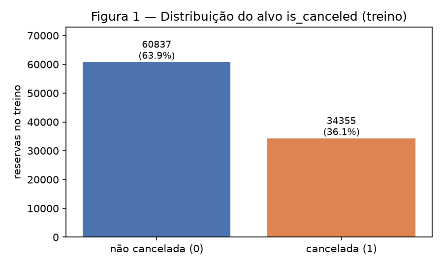
/// caption
**Figura 1** — Distribuição de `is_canceled` no treino. Conclusão: desbalanceamento moderado
(1,77 : 1); a acurácia não serve como métrica única.
///

### D — Train and test

O split é **temporal**: as reservas são ordenadas pela data de chegada e os últimos 20% viram
teste. O corte cai em **2017-04-22**: treino com **95.192 linhas** (79,85%) e teste com
**24.018** (20,15%). Antes do split só rodam as regras fixas de `clean()`, que não calculam
nenhuma estatística; tudo o que é ajustado (recortes, imputação, categorias, escala) usa **só o
treino**, assim como as seções 2 a 4.

```python
--8<-- "docs/projects/eda/code/data.py:split"
```

Por que temporal e não aleatório estratificado:

1. **É o uso real:** o hotel prevê reservas futuras a partir do histórico.
2. **Duplicatas de grupo:** com o corte em dia inteiro, nenhuma linha de teste tem cópia no
   treino; num split aleatório, 33,30% do teste teria, e o modelo pareceria melhor do que é.
3. **Níveis novos aparecem de verdade** no teste (países, agências e empresas que o treino não
   tem), e o pré-processamento precisa lidar com isso.

O preço é a **deriva**: o teste cancela 40,99% contra 36,09% no treino, e a população muda
(por exemplo, a fatia de Portugal cai de 43,4% para 29,8%). Isso vai para a tabela de riscos.

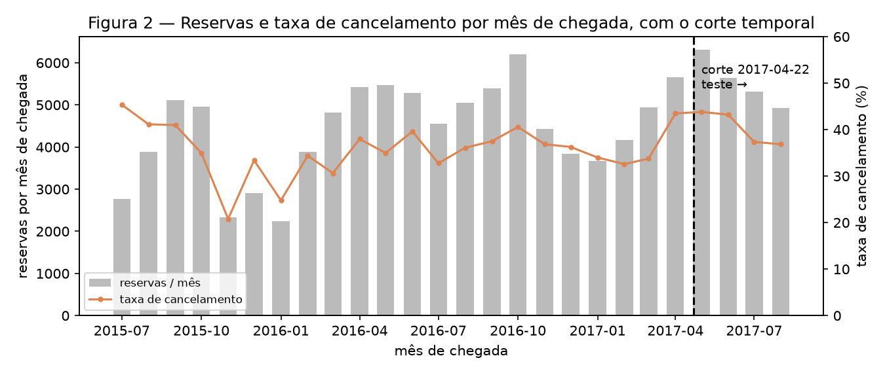
/// caption
**Figura 2** — Reservas por mês de chegada (barras) e taxa de cancelamento (linha), com o corte
do split. Conclusão: os primeiros meses do teste estão entre os de maior taxa da série; o modelo
será avaliado numa população diferente da de treino.
///

---

## 2. Univariate analysis

Tudo daqui em diante usa **só o treino** (95.192 linhas).

### A — Numerical

**Tabela 3** — Estatísticas das 14 features numéricas no treino.

| Feature | Média | Desvio | Mín. | Q1 | Mediana | Q3 | Máx. | Assimetria |
|---------|------:|-------:|-----:|---:|--------:|---:|-----:|-----------:|
| `lead_time` | 96,36 | 104,49 | 0 | 15 | 60 | 145 | 737 | 1,49 |
| `arrival_date_week_number` | 27,65 | 14,94 | 1 | 14 | 30 | 41 | 53 | −0,10 |
| `arrival_date_day_of_month` | 15,63 | 8,71 | 1 | 8 | 16 | 23 | 31 | 0,02 |
| `stays_in_weekend_nights` | 0,90 | 1,00 | 0 | 0 | 1 | 2 | 19 | 1,49 |
| `stays_in_week_nights` | 2,45 | 1,91 | 0 | 1 | 2 | 3 | 50 | 3,08 |
| `adults` | 1,84 | 0,60 | 0 | 2 | 2 | 2 | 55 | 21,02 |
| `children` | 0,09 | 0,38 | 0 | 0 | 0 | 0 | 10 | 4,42 |
| `babies` | 0,01 | 0,10 | 0 | 0 | 0 | 0 | 10 | 26,17 |
| `previous_cancellations` | 0,11 | 0,94 | 0 | 0 | 0 | 0 | 26 | 22,16 |
| `previous_bookings_not_canceled` | 0,13 | 1,39 | 0 | 0 | 0 | 0 | 61 | 21,61 |
| `booking_changes` | 0,21 | 0,62 | 0 | 0 | 0 | 0 | 17 | 5,42 |
| `days_in_waiting_list` | 2,86 | 19,56 | 0 | 0 | 0 | 0 | 391 | 10,77 |
| `adr` | 93,69 | 46,54 | −6,38 | 65,0 | 88,0 | 115,0 | 5.400 | 16,38 |
| `total_of_special_requests` | 0,53 | 0,77 | 0 | 0 | 0 | 1 | 5 | 1,41 |

Três leituras:

- **Só `lead_time` e `adr` são contínuas de verdade**; as outras são contagens pequenas ou
  calendário, várias quase sempre zero.
- **Nove features têm assimetria > 2** e há valores isolados absurdos (55 adultos, diária de
  5.400): motivam o recorte e o `log1p` da seção 4A.
- **As escalas vão de 0–5 a 0–5.400**: sem padronização, `lead_time` e `adr` dominariam o
  gradiente da rede.

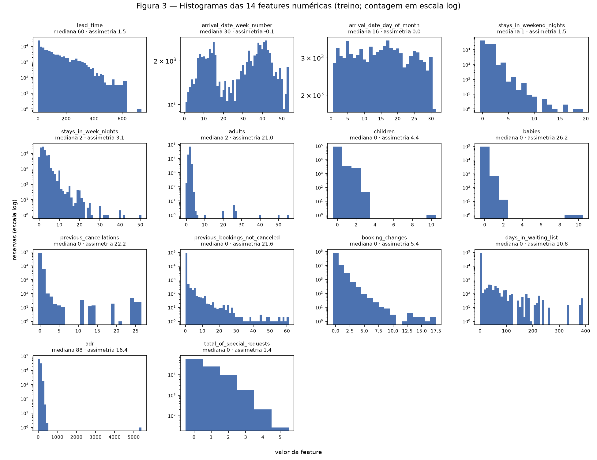
/// caption
**Figura 3** — Histograma de cada feature numérica, com contagem em escala log para mostrar as
caudas. Conclusão: `lead_time` e `adr` têm cauda longa à direita; o dia do mês é uniforme; o resto
é "quase sempre zero" com poucos valores extremos.
///

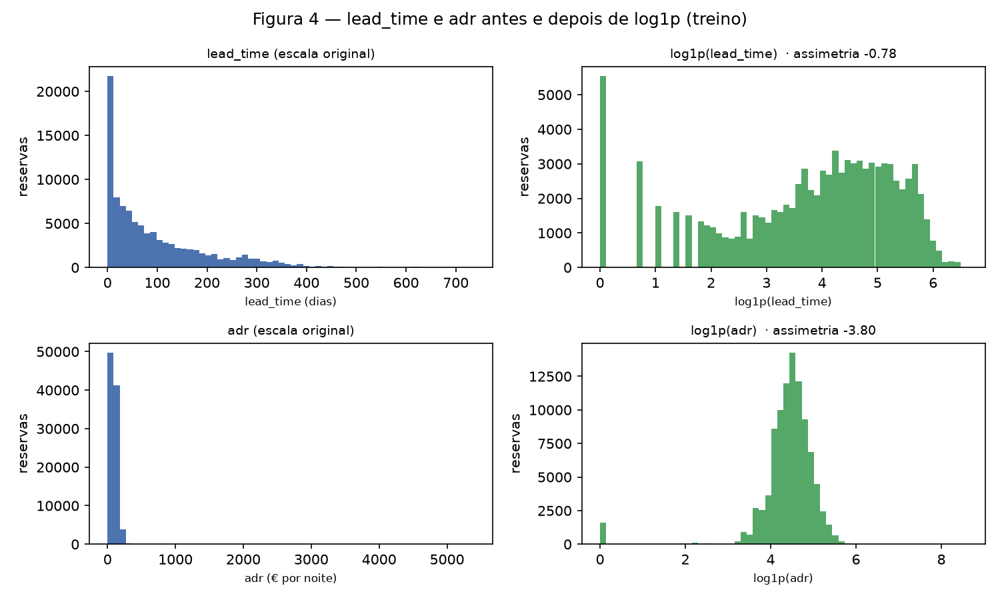
/// caption
**Figura 4** — `lead_time` e `adr` na escala original e após `log1p`. Conclusão: o log corrige a
assimetria de `lead_time` (1,49 → −0,78), mas em `adr` cria um pico isolado em zero (assimetria
−3,80). Logo, `log1p` em `lead_time` e só recorte em `adr`.
///

### B — Categorical

**Tabela 4** — As 12 features categóricas no treino. "Raro" = nível com menos de 1% das linhas.

| Feature | Níveis | Nível dominante | % | Níveis raros |
|---------|-------:|-----------------|--:|-------------:|
| `hotel` | 2 | City Hotel | 65,9% | 0 |
| `arrival_date_month` | 12 | October | 11,7% | 0 |
| `meal` | 4 | BB | 78,5% | 1 |
| `market_segment` | 8 | Online TA | 44,6% | 3 |
| `distribution_channel` | 5 | TA/TO | 81,3% | 2 |
| `reserved_room_type` | 9 | A | 73,9% | 3 |
| `deposit_type` | 3 | No Deposit | 87,0% | 1 |
| `customer_type` | 4 | Transient | 72,7% | 1 |
| `is_repeated_guest` | 2 | 0 | 96,7% | 0 |
| `country` | 164 | PRT | 43,6% | 151 |
| `agent` | 312 | 9 | 24,9% | 299 |
| `company` | 329 | none | 93,8% | 328 |

Os 11 níveis raros das nove de baixa cardinalidade (contagens na Figura 5): `meal` FB (715);
`market_segment` Complementary (622), Aviation (163) e Undefined (2); `distribution_channel` GDS
(153) e Undefined (5); `reserved_room_type` C (537), H (456) e L (6); `deposit_type` Refundable
(140); `customer_type` Group (457).

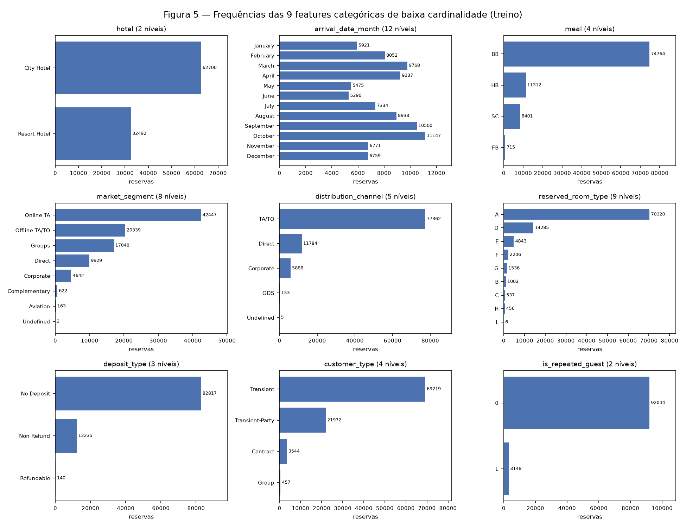
/// caption
**Figura 5** — Frequência de cada nível das nove categóricas de baixa cardinalidade. Conclusão:
quase todas têm um nível dominante e poucos níveis raros (como `Refundable`, com 140 linhas);
são poucos níveis, então cada um pode ter sua própria coluna no one-hot.
///

**Alta cardinalidade.** `country`, `agent` e `company` têm 805 níveis somados, a maioria com
pouquíssimas linhas. Um one-hot de tudo criaria centenas de colunas quase vazias.

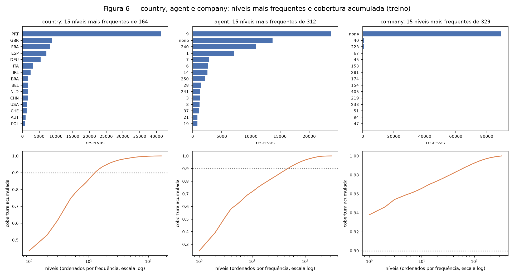
/// caption
**Figura 6** — Os 15 níveis mais frequentes e a cobertura acumulada de `country`, `agent` e
`company`. Conclusão: poucos níveis cobrem 90% das linhas (13 países, 47 agências, e em
`company` só o `none`). Estratégia (4A): manter os níveis com pelo menos 100 linhas e agrupar o
resto.
///

---

## 3. Bivariate and multivariate analysis

### A — Numerical × numerical

Usamos **Spearman** e não Pearson porque as features são muito assimétricas, são quase todas
contagens e têm valores extremos isolados (Tabela 3). Spearman usa postos, então um 5.400 em
`adr` não distorce a correlação.

**Não há par redundante.** O par mais correlacionado é `lead_time` × `stays_in_week_nights`,
ρ = **+0,287**; nenhum par passa de |ρ| = 0,3, então todas as 14 numéricas ficam.

Com o alvo, as mais associadas são `lead_time` (**+0,337**) e `total_of_special_requests`
(**−0,266**). `previous_cancellations` (+0,317) também aparece forte, mas é o artefato da seção
1B.

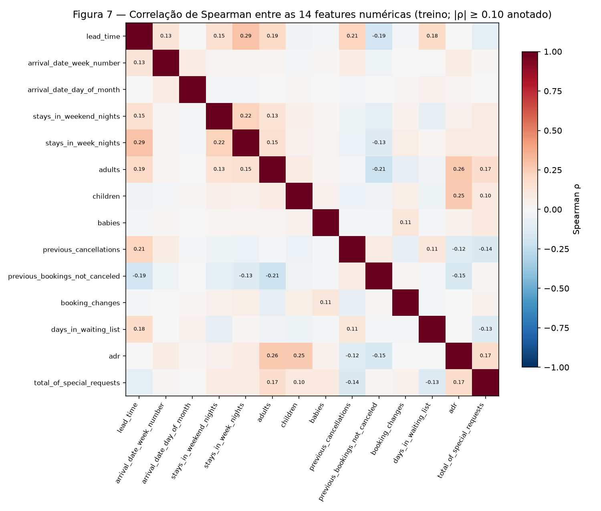
/// caption
**Figura 7** — Correlação de Spearman entre as 14 numéricas. Conclusão: a matriz é quase vazia;
nenhuma feature é redundante.
///

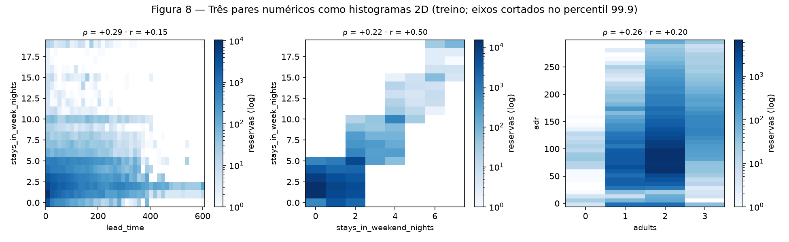
/// caption
**Figura 8** — Histogramas 2D de três pares (usados no lugar de dispersões porque 95 mil pontos
inteiros se sobrepõem). Conclusão: mesmo os pares mais fortes mostram relação fraca e muito
espalhada.
///

### B — Categorical × target

Para ordenar as categóricas pela associação com o alvo usamos o **V de Cramér**, com correção de viés (0 = nenhuma,
1 = total). Taxa global de cancelamento no treino: **36,09%**.

**Tabela 5** — Associação de cada categórica com o alvo.

| Feature | V de Cramér | Destaque |
|---------|------------:|----------|
| `deposit_type` | **0,505** | Non Refund cancela **99,2%**; No Deposit 26,8% |
| `agent` | 0,405 | há agências que cancelam quase tudo e outras quase nada |
| `country` | 0,373 | Portugal **55,5%**; Alemanha, França e Reino Unido entre 15% e 18% |
| `market_segment` | 0,275 | Groups **60,3%**; Direct 14,6% |
| `distribution_channel` | 0,177 | TA/TO 40,1%; Direct 16,9% |
| `hotel` | 0,152 | City 41,3% × Resort 25,9% |
| `company` | 0,132 | — |
| `customer_type` | 0,117 | Transient 39,4%; Group 10,1% |
| `reserved_room_type` | 0,084 | fraca |
| `is_repeated_guest` | 0,076 | repetido cancela 16,2% |
| `arrival_date_month` | 0,065 | sazonalidade pequena |
| `meal` | 0,049 | fraca |

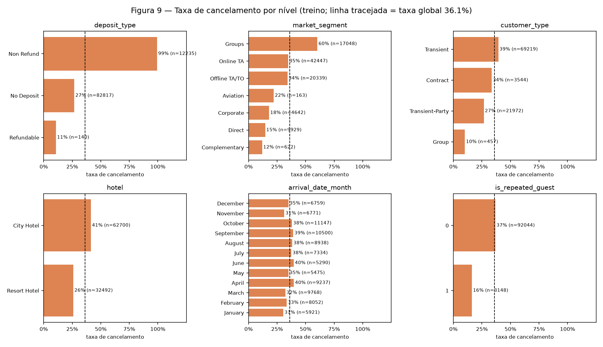
/// caption
**Figura 9** — Taxa de cancelamento por nível de seis categóricas, com a taxa global tracejada.
Conclusão: `Non Refund` cancela quase sempre; `Groups` e o City Hotel cancelam acima da média, e
os meses quase não se afastam da linha global.
///

**Por que Non Refund cancela 99%?** Quase todas essas reservas são de Portugal, de grupos e
operadoras, e feitas com muita antecedência (Figura 12). A explicação mais plausível: o hotel
exige depósito não reembolsável de blocos de grupo, que são cancelados quando não se preenchem.
A coluna é conhecida no momento da reserva, então pode ser usada, mas a classificação deve
medir o modelo também **dentro de `No Deposit`** (87% das reservas).

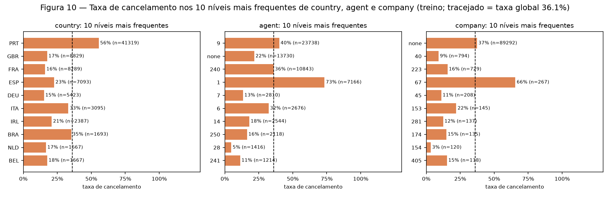
/// caption
**Figura 10** — Taxa de cancelamento nos dez níveis mais frequentes de `country`, `agent` e
`company`. Conclusão: os níveis frequentes carregam sinal forte (Portugal cancela mais que o
dobro dos outros mercados europeus), o que justifica mantê-los e agrupar o resto.
///

### C — Numerical × categorical

**Tabela 6** — Mediana e IQR de `lead_time` (dias) e `adr` (€) por grupo, no treino.

| Grupo | `lead_time` mediana / IQR | `adr` mediana / IQR |
|-------|--------------------------:|--------------------:|
| City Hotel | 65 / 130 | 94,5 / 42,0 |
| Resort Hotel | 48 / 129 | 68,0 / 56,6 |
| No Deposit | 48 / 106 | — |
| Non Refund | **203 / 216** | — |
| Groups | **151 / 220** | 65,0 / 23,0 |
| Online TA | 49 / 92 | 100,3 / 52,0 |
| Direct | 11 / 55 | 95,0 / 66,1 |
| Corporate | 7 / 24 | 65,0 / 39,4 |

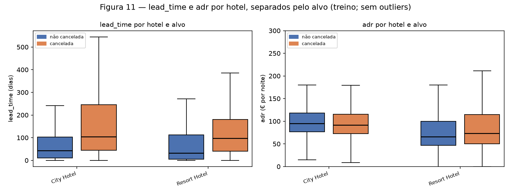
/// caption
**Figura 11** — `lead_time` e `adr` por hotel, separados pelo alvo. Conclusão: em `lead_time` as
canceladas diferem **em posição e em dispersão** (no City, mediana 104 × 43 dias e IQR 200 × 93).
Em `adr` a diferença é entre hotéis (o Resort é mais barato e mais disperso); dentro de cada hotel
as classes quase não diferem.
///

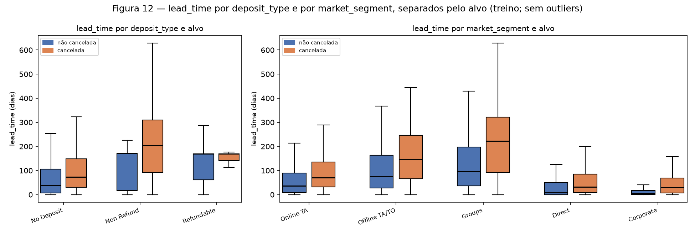
/// caption
**Figura 12** — `lead_time` por `deposit_type` e `market_segment`, separados pelo alvo.
Conclusão: Non Refund e Groups reservam com muito mais antecedência (medianas 203 e 151 dias)
e com dispersão maior; Direct e Corporate reservam com cerca de uma semana e cancelam pouco.
Posição e dispersão crescem juntas, mais um argumento para o `log1p` em `lead_time`.
///

---

## 4. Preprocessing

### A — Strategies

Cada estratégia é ajustada **só no treino**, dentro do pipeline da seção 4C, e vem de um achado
anterior. O destino é uma rede neural, que precisa de entradas sem NaN, numéricas, em escala
parecida e sem valores extremos dominando o gradiente.

**Tabela 7** — Estratégias de pré-processamento.

| # | Problema | Estratégia | Achado que motiva |
|---|----------|------------|-------------------|
| 1 | Valores ausentes | `children`: mediana do treino. `country`: nível `unknown`. `agent`/`company`: NaN vira o nível `none` ("sem agência/empresa"); imputar a moda apagaria essa informação. | Tabela 2 |
| 2 | Outliers | Recorte de cada numérica aos quantis **0,1% e 99,9% do treino**; depois `log1p` em 7 features de cauda longa (`lead_time`, as duas de noites, as duas de histórico, `booking_changes`, `days_in_waiting_list`). `adr` fica sem log. Nenhuma linha é removida. | Tabela 3 (assimetrias), Figuras 3 e 4 |
| 3 | Encoding (inclusive nível novo no teste) | One-hot em tudo. Nas 3 de alta cardinalidade, níveis com menos de **100 linhas** viram uma coluna `infrequent`, e **todo nível novo do teste cai nela**. Nas 9 de baixa, nível novo vira uma linha toda zero. | Tabela 4, Figura 6, seção 1D |
| 4 | Escala | `StandardScaler` nas 14 numéricas, ajustado no treino; one-hot fica em 0/1. | Tabela 3: escalas de 0–5 a 0–5.400 |

**Efeito do recorte:** altera **695 linhas do treino (0,73%)** e elimina a diária negativa, a
diária de 5.400 e os 55 adultos sem perder linhas.

**Por que 100 linhas:** com 100 reservas, a taxa de cancelamento de um nível já é estimada com
erro de no máximo cerca de 5 pontos percentuais; abaixo disso o nível é ruído.

### B — Dimensionality reduction

As três projeções usam a **saída do pipeline** (193 colunas), porque é isso que o modelo verá.
A PCA é ajustada no treino inteiro; t-SNE e UMAP usam uma amostra de **5.000 linhas** do treino
(semente 42). Para comparar os desenhos com um número, usamos a **pureza de vizinhança**: a
fração dos 10 vizinhos mais próximos de cada ponto que tem o mesmo rótulo. No espaço original de
193 dimensões ela é **0,728**; um desenho aleatório daria cerca de 0,54.

**PCA.** PC1 explica **10,81%** e PC2 **8,88%**: juntas, **19,69%**. São precisas **27
componentes para 90%** (Figura 13): não há um eixo dominante, porque as numéricas são pouco
correlacionadas e o one-hot espalha a variância em muitas direções. *Loadings*: PC1 é "tamanho
e preço da reserva" (`adr` +0,42, `adults` +0,40); PC2 é "antecedência" (`lead_time` +0,57,
`days_in_waiting_list` +0,33). Como `lead_time` é o sinal mais forte do alvo, as canceladas se
concentram no alto do plano. Pureza: **0,645**.

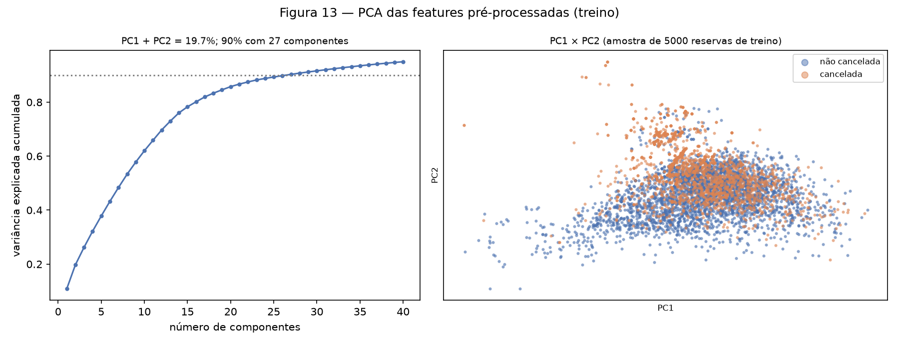
/// caption
**Figura 13** — Variância explicada acumulada (esquerda) e plano PC1 × PC2 colorido pelo alvo
(direita). Conclusão: duas componentes guardam só um quinto da variância e perdem parte da
vizinhança (pureza 0,645 contra 0,728).
///

**t-SNE** (perplexidade 5 e 50). Com 5 o desenho é uma nuvem única; com 50 aparecem ilhas
compactas, quase todas canceladas. Os 10% de pontos mais altos do desenho de perplexidade 50 são
**86,8% cancelados**, na maioria Non Refund e `Groups`. Pureza **≈ 0,72** nas duas.

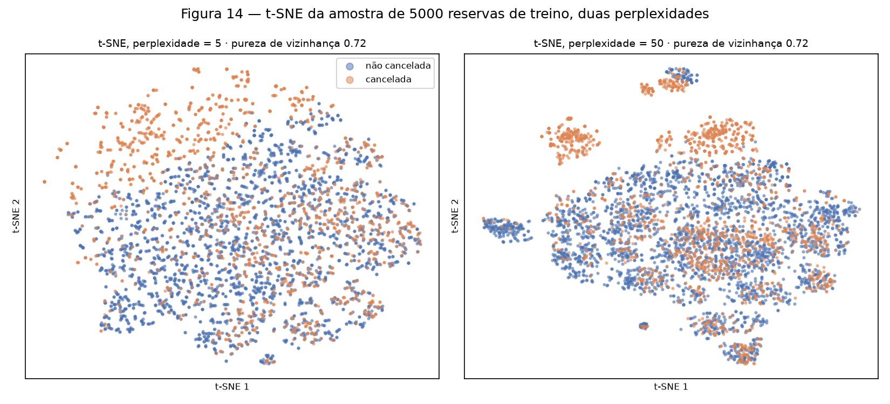
/// caption
**Figura 14** — t-SNE com duas perplexidades. Conclusão: a pureza é a mesma (0,72), mas só com
perplexidade 50 os blocos de grupo Non Refund aparecem como ilhas. O tamanho das ilhas e a
distância entre elas não têm leitura.
///

**UMAP** (`n_neighbors` 5 e 50). Com 5 vizinhos o UMAP quebra a amostra em dezenas de pequenos
satélites; com 50 junta quase tudo numa massa com algumas ilhas, duas delas só de canceladas.
Pureza **≈ 0,72** e **≈ 0,71**.

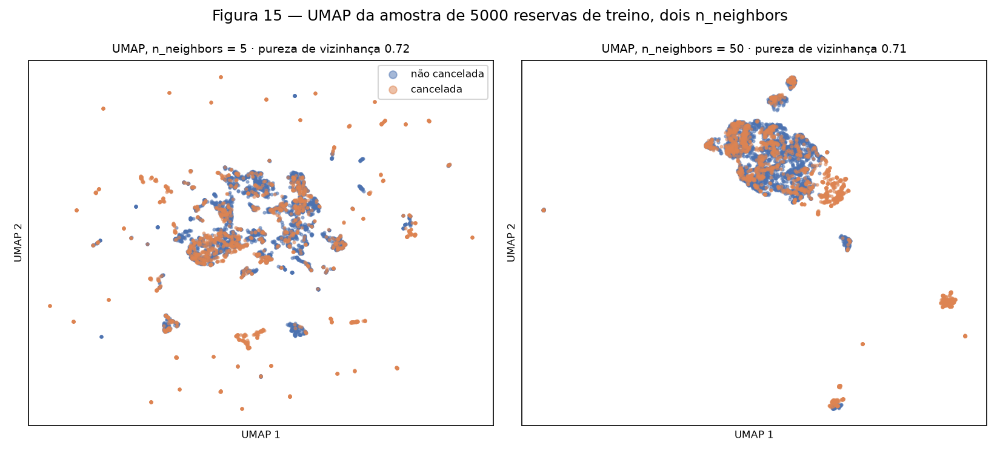
/// caption
**Figura 15** — UMAP com dois `n_neighbors`. Conclusão: o parâmetro muda muito o desenho, mas
não a pureza; as ilhas de canceladas são de novo os blocos de grupo (as duplicatas da seção 1B).
///

**Comparação.** t-SNE e UMAP mostram **ilhas de cancelamento** que a PCA só mostra como uma
mancha difusa. Mas a pureza deles (0,71–0,72) é igual à do espaço original (0,728): eles
**preservam** a vizinhança que já existe, não criam separação nova. A PCA em 2D perde parte
dela (0,645). Conclusões: (i) a estrutura dos dados não cabe em duas direções lineares;
(ii) mesmo no espaço completo cerca de 27% dos vizinhos têm o rótulo oposto, um ruído que nenhum
modelo elimina; (iii) se uma rede não linear vale a pena é pergunta para a próxima entrega,
comparando a MLP com um modelo linear.

```python
--8<-- "docs/projects/eda/code/stage4_projections.py:pca"
```

### C — Pipeline

`build_preprocessor()` em `code/pipeline.py` devolve um `ColumnTransformer` com quatro
`Pipeline`s: numéricas com log (7), numéricas sem log (7), categóricas de baixa (9) e de alta
cardinalidade (3). A entrega de classificação importa a função, ajusta **só no treino** e
transforma os dois lados:

```python
import sys
sys.path.insert(0, "docs/projects/eda/code")   # a partir da raiz do repositório
from data import load_split
from pipeline import build_preprocessor

train, test, cut = load_split()
pre = build_preprocessor()
X_train = pre.fit_transform(train)              # só o treino
X_test = pre.transform(test)
```

```python
--8<-- "docs/projects/eda/code/pipeline.py:clipper"
```

```python
--8<-- "docs/projects/eda/code/pipeline.py:build"
```

Checagens impressas por `python docs/projects/eda/code/pipeline.py`:

| Checagem | Resultado |
|----------|-----------|
| Ajuste | `fit_transform` no treino, `transform` no teste |
| NaN depois do pipeline | **0** no treino, **0** no teste |
| `shape` final | treino **(95.192, 193)**, teste **(24.018, 193)** |
| Composição das 193 colunas | 14 numéricas + 49 one-hot de baixa cardinalidade + 130 de alta (incluindo as colunas `infrequent`) |
| Nomes das features | listados abaixo |

??? note "As 193 features de saída, na ordem das colunas (`get_feature_names_out()`)"

    ```text
      0  lead_time
      1  stays_in_weekend_nights
      2  stays_in_week_nights
      3  previous_cancellations
      4  previous_bookings_not_canceled
      5  booking_changes
      6  days_in_waiting_list
      7  arrival_date_week_number
      8  arrival_date_day_of_month
      9  adults
     10  children
     11  babies
     12  adr
     13  total_of_special_requests
     14  hotel_City Hotel
     15  hotel_Resort Hotel
     16  arrival_date_month_April
     17  arrival_date_month_August
     18  arrival_date_month_December
     19  arrival_date_month_February
     20  arrival_date_month_January
     21  arrival_date_month_July
     22  arrival_date_month_June
     23  arrival_date_month_March
     24  arrival_date_month_May
     25  arrival_date_month_November
     26  arrival_date_month_October
     27  arrival_date_month_September
     28  meal_BB
     29  meal_FB
     30  meal_HB
     31  meal_SC
     32  market_segment_Aviation
     33  market_segment_Complementary
     34  market_segment_Corporate
     35  market_segment_Direct
     36  market_segment_Groups
     37  market_segment_Offline TA/TO
     38  market_segment_Online TA
     39  market_segment_Undefined
     40  distribution_channel_Corporate
     41  distribution_channel_Direct
     42  distribution_channel_GDS
     43  distribution_channel_TA/TO
     44  distribution_channel_Undefined
     45  reserved_room_type_A
     46  reserved_room_type_B
     47  reserved_room_type_C
     48  reserved_room_type_D
     49  reserved_room_type_E
     50  reserved_room_type_F
     51  reserved_room_type_G
     52  reserved_room_type_H
     53  reserved_room_type_L
     54  deposit_type_No Deposit
     55  deposit_type_Non Refund
     56  deposit_type_Refundable
     57  customer_type_Contract
     58  customer_type_Group
     59  customer_type_Transient
     60  customer_type_Transient-Party
     61  is_repeated_guest_0
     62  is_repeated_guest_1
     63  country_AGO
     64  country_ARG
     65  country_AUS
     66  country_AUT
     67  country_BEL
     68  country_BRA
     69  country_CHE
     70  country_CHN
     71  country_CZE
     72  country_DEU
     73  country_DNK
     74  country_ESP
     75  country_FIN
     76  country_FRA
     77  country_GBR
     78  country_GRC
     79  country_HUN
     80  country_IND
     81  country_IRL
     82  country_ISR
     83  country_ITA
     84  country_JPN
     85  country_KOR
     86  country_LUX
     87  country_MAR
     88  country_NLD
     89  country_NOR
     90  country_POL
     91  country_PRT
     92  country_ROU
     93  country_RUS
     94  country_SWE
     95  country_TUR
     96  country_USA
     97  country_unknown
     98  country_infrequent_sklearn
     99  agent_1
    100  agent_10
    101  agent_11
    102  agent_115
    103  agent_119
    104  agent_12
    105  agent_132
    106  agent_134
    107  agent_138
    108  agent_14
    109  agent_142
    110  agent_143
    111  agent_146
    112  agent_147
    113  agent_15
    114  agent_152
    115  agent_154
    116  agent_156
    117  agent_16
    118  agent_168
    119  agent_17
    120  agent_171
    121  agent_175
    122  agent_177
    123  agent_19
    124  agent_191
    125  agent_195
    126  agent_196
    127  agent_2
    128  agent_20
    129  agent_208
    130  agent_21
    131  agent_22
    132  agent_220
    133  agent_234
    134  agent_236
    135  agent_240
    136  agent_241
    137  agent_242
    138  agent_243
    139  agent_248
    140  agent_250
    141  agent_251
    142  agent_26
    143  agent_27
    144  agent_273
    145  agent_28
    146  agent_29
    147  agent_298
    148  agent_3
    149  agent_30
    150  agent_31
    151  agent_314
    152  agent_315
    153  agent_326
    154  agent_330
    155  agent_34
    156  agent_35
    157  agent_36
    158  agent_37
    159  agent_38
    160  agent_40
    161  agent_42
    162  agent_44
    163  agent_5
    164  agent_56
    165  agent_58
    166  agent_6
    167  agent_67
    168  agent_68
    169  agent_7
    170  agent_8
    171  agent_83
    172  agent_85
    173  agent_86
    174  agent_9
    175  agent_94
    176  agent_95
    177  agent_96
    178  agent_none
    179  agent_infrequent_sklearn
    180  company_153
    181  company_154
    182  company_174
    183  company_219
    184  company_223
    185  company_233
    186  company_281
    187  company_40
    188  company_405
    189  company_45
    190  company_67
    191  company_none
    192  company_infrequent_sklearn
    ```

---

## 5. Synthesis

Para quem vai construir o modelo:

1. **O alvo tem 36,1% de positivos no treino e 41,0% no teste** (Figuras 1 e 2), e o teste é
   uma população diferente. Base mínima: responder sempre "não cancela" acerta 59,0% do teste.
   Reportar *precision* e *recall* da classe cancelada.
2. **As features mais informativas são conhecidas na reserva:** `deposit_type`, `agent`,
   `country`, `market_segment` (Tabela 5) e, entre as numéricas, `lead_time` e
   `total_of_special_requests` (seção 3A). Não há par numérico redundante (Figura 7).
3. **O pré-processamento está pronto e é importável:** 193 colunas, sem NaN, níveis novos
   tratados (tabela de checagens da seção 4C). Não refazer o split: usar `data.load_split()`.
4. **Há ruído que nenhum modelo elimina:** cerca de 27% dos vizinhos de cada reserva têm o
   rótulo oposto (seção 4B, Figuras 13–15). Comparar a MLP com um modelo linear.

| Risco | Evidência | Plano |
|-------|-----------|-------|
| `previous_cancellations` é um artefato | não bate com a definição e some no teste (seção 1B) | treinar com e sem a coluna; a versão sem é a candidata a final |
| `booking_changes` é contagem final | 15,7% × 40,9% de cancelamento (seção 1B) | reportar o modelo com e sem a coluna |
| Deriva entre treino e teste | 36,1% × 41,0%; menos Portugal no teste (seção 1D) | validação temporal dentro do treino, não k-fold aleatório |
| `Non Refund` quase determinístico | cancela 99,2% (seção 3B) | medir o modelo também dentro de `No Deposit` |
| Duplicatas de grupo | 26,8% de cópias (seção 1B) | mantidas; o split temporal evita cópias dos dois lados |

O CSV está versionado em `data/hotel/` e os cinco scripts rodam a partir de um clone limpo, na
ordem da caixa de reprodutibilidade.

### Referências

- Antonio, N., de Almeida, A., & Nunes, L. (2019). Hotel booking demand datasets. *Data in
  Brief*, 22, 41–49. <https://doi.org/10.1016/j.dib.2018.11.126> (licença CC BY 4.0).
- Mostipak, J. Hotel booking demand (Kaggle).
  <https://www.kaggle.com/datasets/jessemostipak/hotel-booking-demand>
- scikit-learn: `ColumnTransformer`, `OneHotEncoder`, `PCA`, `TSNE`. <https://scikit-learn.org/stable/>
- McInnes, L., Healy, J., & Melville, J. (2018). UMAP: Uniform Manifold Approximation and
  Projection. <https://umap-learn.readthedocs.io/>

### Results summary

| # | Results summary | Value |
|---|-----------------|-------|
| 1 | Dataset, task and target | Hotel Booking Demand; classificação binária; `is_canceled` |
| 2 | Instances × features (numerical / categorical) | 119.210 × 26 após a limpeza (14 numéricas / 12 categóricas) |
| 3 | Column with the most missing values and its percentage | `company`, 94,31% (significa "sem empresa") |
| 4 | Dropped columns and the reason | `reservation_status`, `reservation_status_date`, `assigned_room_type`, `required_car_parking_spaces` (vazamento do desfecho); `arrival_date_year` (ano sempre novo em produção) |
| 5 | Minority class (%) | cancelada: 37,08% (36,09% no treino, 40,99% no teste) |
| 6 | Size of the training and test sets | 95.192 / 24.018 (split temporal em 2017-04-22) |
| 7 | Most correlated numerical pair and its value | `lead_time` × `stays_in_week_nights`, Spearman ρ = +0,287 |
| 8 | Rows affected by the outlier strategy | 695 linhas do treino recortadas (0,73%) |
| 9 | Variance explained by PC1 + PC2 | 19,69% (10,81% + 8,88%) |
| 10 | `shape` of train and test after the pipeline | (95.192, 193) e (24.018, 193), sem NaN |
